<h1 align="center">Microsoft 365 Administration &amp; Support Project</h1>

<strong>Exchange Online · Teams · SharePoint · IT Support</strong>

  
  
  

  
  
  
  
  
  

  <a href="#project-overview">Overview</a> ·
  <a href="#target-architecture">Architecture</a> ·
  <a href="#featured-implementation-evidence">Featured evidence</a> ·
  <a href="#implementation-progress">Lab roadmap</a> ·
  <a href="#resolved-support-cases">Cases</a> ·
  <a href="#supporting-documentation">Documentation</a> ·
  <a href="#security-design-principles">Security principles</a>

A hands-on Microsoft 365 administration and support lab for the fictional organization **Baltic Finance**.

The project is designed to connect user accounts, licenses, email, collaboration, desktop clients and employee lifecycle tasks through controlled service requests and troubleshooting exercises. Each stage will record the administrative decision, the affected user's experience and the observed result.

This repository complements the owner's Microsoft Entra, hybrid security and IAM automation projects with everyday Microsoft 365 administration and IT support.

## Project Overview

**Status: Stages 01–13 COMPLETE; Stage 14 IN_PROGRESS.**\
Earlier owner subscription views showed **Business Standard (25 seats)**, **Business Premium (25 seats)** and **Business Premium with Copilot (1 seat)**. A fresh closing review of term dates and recurring billing is recorded separately in the retained-state inventory. Three pilot accounts exist; Piotr now remains blocked/unlicensed as a retained shared-mailbox anchor. Licensing recovery, a three-user MFA scope, Finance groups, alias delivery, distribution recovery, shared-mailbox delegation, calendar permissions, room booking and mail-flow diagnosis/recovery are documented. See the [current baseline](docs/01-environment-baseline.md) for the observed state and source limits.

**Recorded execution: 13 completed stages, with Stage 13 assessed against its revised practical scope, 32 PASS / 0 NOT_RUN, 15 resolved lab cases and 153 indexed captures.** The completed stages connect working services to scoped MFA, entitlement recovery, group ownership, delegated mail/calendar behavior and evidence-supported mail-flow diagnosis, desktop identity correction, offline synchronization recovery, private-channel authorization/restoration and knowledge-site access diagnosis, OneDrive pause/resume and content-verified version/deleted-file recovery, followed by current service/change review and user knowledge validation. [Implementation index](docs/stages/README.md) · [Results](tests/README.md) · [Evidence](evidence/README.md)

The completed stages now also include guided employee movement, blocked sign-in, retained-mail custody and approved file handover after product unassignment.

The target roles are **Junior Microsoft 365 Administrator**, **Junior System Administrator** and **IT Support Specialist**.

Each stage is designed to include:

- a business requirement and explicit lab scope
- configuration choices and administrative reasoning
- positive, negative and recovery checks
- user-session verification
- troubleshooting and observed limitations
- sanitized evidence and a reproducible procedure

## Explore the Project

| Architecture | Implementation | Validation | Evidence |
|:---:|:---:|:---:|:---:|
| [View design](#target-architecture) | [Browse stages](#implementation-progress) | [Open test matrix](tests/test-matrix.csv) | [Browse evidence](evidence/README.md) |
| Target design and recorded baseline | 13 complete; Stage 14 in progress | 32 PASS / 0 NOT_RUN | 153 captures across Days 01–10, Day 12 and Day 13 |

## Technologies and Concepts

| Area | Technologies and learning scope |
| --- | --- |
| Tenant administration | Microsoft 365 Admin Center, service entitlements, administrative roles, MFA, service health |
| Users and licenses | Cloud-only identities, usage locations, service plans, provisioning and group types |
| Messaging | Exchange Online, aliases, distribution lists, shared mailboxes and sender delegation |
| Calendars and resources | Calendar read/edit permissions, room mailboxes and conflicting reservations |
| Mail troubleshooting | NDRs, Message Trace, scoped mail-flow rules and delivery recovery |
| Desktop support | Outlook, Microsoft 365 Apps activation, account context and browser/client comparison |
| Collaboration | Teams ownership, standard/private channels and connected SharePoint sites |
| Content and access | SharePoint libraries, metadata, inheritance, membership and sharing links |
| File operations | OneDrive synchronization, Files On-Demand, version history and deleted-file recovery |
| Support operations | Incident triage, escalation, user communication and knowledge articles |
| Reporting | Implemented read-only PowerShell reports for licenses, mailbox delegation and human group membership |
| Employee lifecycle | Onboarding, department changes, offboarding and approved data handover |

The scoped Conditional Access MFA pilot now contains Anna, Piotr and Marek. Anna/Marek retain their product assignments; Piotr's Premium assignment was removed in Stage 12; the one-seat [Copilot extension](docs/copilot-pilot-plan.md) is planned around Stages 06, 08, 10 and 13. Intune can be an extension. PIM, full E5/Entra Suite restoration, Exchange hybrid deployment, Teams Phone and advanced retention/holds remain outside the core.

---

## Current Implementation

| Component | Current recorded state |
| --- | --- |
| Learning plan | 14 stage documents with objectives, exercises and exit checks |
| Subscription | Earlier views: Standard 25, Premium 25 and Premium with Copilot 1; fresh term/renewal review is separate |
| Synthetic inputs | Three retained synthetic accounts; all 15 lab cases resolved |
| Validation | 32 global checks: 32 PASS; supporting observations recorded separately |
| Operational documentation | Fifteen completed case records, a verified lifecycle runbook, user-tested articles and a prepared escalation package |
| Delegation and calendars | Earlier sender tests verified; Stage 12 removes Piotr Helpdesk grants while Anna retains access; calendar reader restored |
| Room booking | Automatic policy verified through accepted, conflicting/declined and rescheduled/accepted requests |
| Mail-flow diagnosis and recovery | Unknown-recipient NDR correlated with Trace; marked rejection, unmarked delivery and delivery after rule disable verified |
| Desktop clients | BFL-WKS01: Apps activation, correct identity restored, offline synchronization recovered and calendar/Helpdesk access verified |
| Finance collaboration | Existing-group Team, standard/private SharePoint sites, temporary private membership and computer/phone meeting verified |
| Knowledge site | Independent communication site, Mail/Draft metadata, reader/editor roles, revoked-link access comparison and restored folder boundary verified |
| OneDrive | Marek's work client, Files On-Demand, resumed sync, full V1 restored through history and recycle bin |
| Support operations | Current service/change review, three English procedures and German companion; case review and second-line package prepared |
| Employee lifecycle | Existing-user readiness, IT move, scoped removals, blocked sign-in, retained mailbox and approved file custody verified |
| PowerShell | Three implemented reports; selected portal reconciliation, explicit partial/failure output and 25 isolated offline cases |
| Implementation evidence | 153 captures: Day 01 baseline (31), Day 02 licensing/groups (21), Day 03 alias/recovery (11), Day 04 delegation/calendar/room (27), Day 05 mail flow (14), Day 06 desktop clients (9), Day 07 Teams/sites/meeting (6), Day 08 SharePoint/access (7), Day 09 OneDrive/recovery (7), Day 10 support/knowledge (4), Day 12 lifecycle (9), Day 13 practical validation (7) |

Captured configuration, functional results and owner-reported details are distinguished in the stage notes. Assigned services and a visible Copilot button do not establish full workload operation or validated AI output.

## Resolved Support Cases

| Case | Trigger and verified result |
| --- | --- |
| [M365-001 — Pilot license recovery](tickets/M365-001-pilot-license-recovery.md) | Piotr can authenticate but Outlook has no entitlement; Premium/Exchange assignment restores mailbox access and two-way mail |
| [M365-002 — Finance alias delivery](tickets/M365-002-finance-alias-delivery.md) | External mail explicitly addressed to the secondary address reaches Anna's existing mailbox |
| [M365-003 — Distribution membership recovery](tickets/M365-003-distribution-membership-recovery.md) | Direct mail works during omitted DL membership; re-adding Piotr restores distribution while Anna continues receiving |
| [M365-004 — Helpdesk sender-permission recovery](tickets/M365-004-helpdesk-sender-permission-recovery.md) | Reading works before sending; separate Send As restores the intended sender and reply flow |
| [M365-005 — Room booking conflict](tickets/M365-005-room-booking-conflict-recovery.md) | The room explicitly declines an overlap; rescheduling the same request produces a fresh acceptance |
| [M365-006 — Unknown-recipient diagnosis](tickets/M365-006-unknown-recipient-diagnosis.md) | NDR and Trace agree on 550 5.1.10 SMTP lookup failure; closed as diagnosed expected rejection |
| [M365-007 — Scoped rule recovery](tickets/M365-007-scoped-rule-recovery.md) | Marked mail fails while the unmarked control delivers; disabling the rule restores new marked-message delivery |
| [M365-008 — Office identity recovery](tickets/M365-008-office-identity-recovery.md) | Piotr is the active Word user while the subscription still names Marek; intended user and functional checks restored |
| [M365-009 — Outlook offline recovery](tickets/M365-009-outlook-offline-recovery.md) | Same mailbox works in web; reconnecting classic Outlook delivers the affected message and a new outbound control succeeds |
| [M365-010 — Private-channel membership](tickets/M365-010-private-channel-membership-recovery.md) | Excluded team member denied; temporary channel membership grants access; removal restores private denial with standard access retained |
| [M365-011 — Knowledge reader](tickets/M365-011-knowledge-reader-access.md) | Piotr reads without editing; Marek saves and Anna sees the change after reopening |
| [M365-012 — Revoked link and retained access](tickets/M365-012-revoked-link-retained-access.md) | Old link explicitly removed; library access retained; isolated folder denial and restoration verified |
| [M365-013 — Paused OneDrive sync](tickets/M365-013-onedrive-paused-sync-recovery.md) | Cloud V2 / local V1 label discrepancy; Resume and fresh local reopening verify V2 |
| [M365-014 — OneDrive content recovery](tickets/M365-014-onedrive-file-recovery.md) | Earlier-version and recycle-bin restores return full original V1 in web and local views |
| [M365-015 — Employee offboarding](tickets/M365-015-employee-offboarding.md) | Mover controls, blocked sign-in, corrected mailbox custody, license removal and selected V1 handover verified |

These are fifteen guided lab records from the [15-case backlog](samples/ticket-backlog.csv). The separate role-delegation exception remains unresolved in the Stage 05 notes.

## Planned Outcomes

| Administration or support objective | Result to demonstrate |
| --- | --- |
| Prepare a user for work | Correct services, mail and collaboration access verified as the user |
| Diagnose a delivery problem | Evidence-supported cause and restored delivery with a control check |
| Manage mailbox delegation | Mailbox access and sender permissions tested independently |
| Control collaboration access | Intended read/edit access plus verified denial for an excluded identity |
| Recover work files | Restored contents compared with a synthetic baseline |
| Produce useful support records | 15 documented cases with diagnostic choices, verification and communication |
| Report operational state | Three read-only reports reconciled with independent workload reads |
| Handle employee changes | Onboarding, department transfer and offboarding with verified access/data handling |
| Work independently | Five final tasks with supported resolutions or justified escalation |

These are project-wide targets. The first twelve stages establish the working baseline, fifteen guided case resolutions and verified lifecycle custody. Five practical validation tasks are recorded separately from the still-unperformed independent assessment; portfolio review records the retained lab state.

## Featured Implementation Evidence

Selected lab captures connect the user experience to configuration and recovery. [All 153 captions and review notes](evidence/README.md) · [Case records](tickets/README.md)

<table>
<tr>
<td width="50%" align="center">
  <a href="evidence/day-02/08-piotr-mail-received-after-license.png">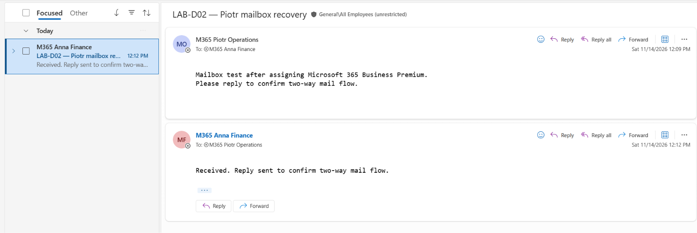</a> 
  <strong>Licensing Repair — Two-Way Mail Verified</strong> 
  <a href="tickets/M365-001-pilot-license-recovery.md">M365-001</a>
</td>
<td width="50%" align="center">
   
  <strong>MFA Pilot — Applied Successfully</strong> 
  Existing claim satisfies MFA; Day 02 extends the group to three users
</td>
</tr>
<tr>
<td width="50%" align="center">
  <a href="evidence/day-03/07-dl-membership-piotr-restored.png">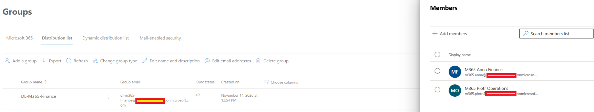</a> 
  <strong>Distribution Membership Restored</strong> 
  <a href="tickets/M365-003-distribution-membership-recovery.md">M365-003 diagnosis and repair</a>
</td>
<td width="50%" align="center">
   
  <strong>Recovery Verified as the User</strong> 
  Anna continues receiving as the unchanged control
</td>
</tr>
<tr>
<td width="50%" align="center">
   
  <strong>Sender Delegation Verified</strong> 
  Send on behalf compared with Piotr's Send As
</td>
<td width="50%" align="center">
  <a href="evidence/day-04/22-room-booking-conflict-declined.png">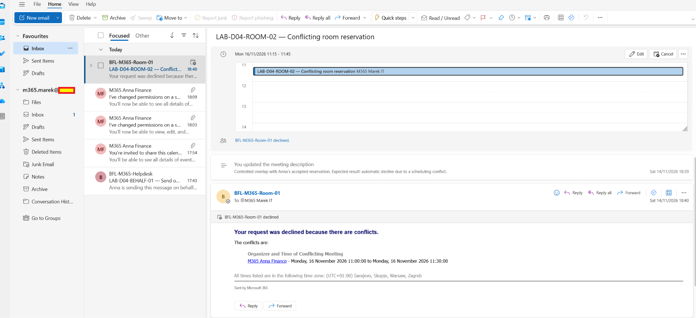</a> 
  <strong>Room Conflict Explained</strong> 
  Explicit decline followed by acceptance after rescheduling
</td>
</tr>
<tr>
<td width="50%" align="center">
  <a href="evidence/day-05/12-transport-rule-and-control-trace.png">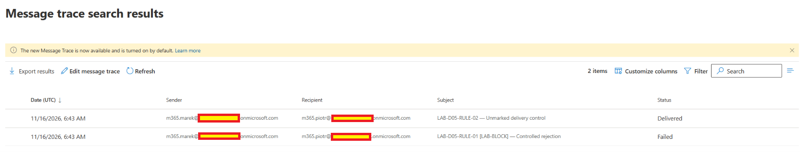</a> 
  <strong>Scoped Rejection — Control Still Delivers</strong> 
  <a href="tickets/M365-007-scoped-rule-recovery.md">M365-007</a>
</td>
<td width="50%" align="center">
  <a href="evidence/day-05/14-delivery-after-rule-disabled-trace.png">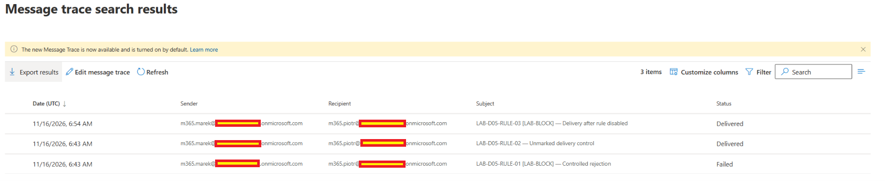</a> 
  <strong>Mail Flow Restored After Rule Disable</strong> 
  New marked message verified in Exchange Trace
</td>
</tr>
<tr>
<td width="50%" align="center">
   
  <strong>Desktop Apps Activated</strong> 
  <a href="docs/stages/06-outlook-and-microsoft-365-apps.md">Identity and functional checks recorded separately</a>
</td>
<td width="50%" align="center">
  <a href="evidence/day-06/06-outlook-online-recovery.png">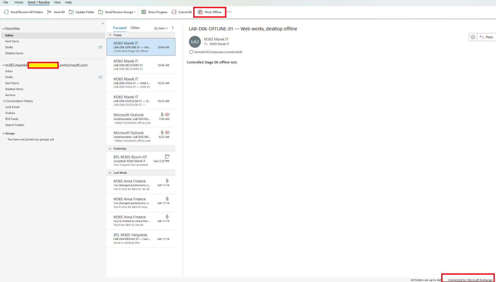</a> 
  <strong>Outlook Synchronization Restored</strong> 
  <a href="tickets/M365-009-outlook-offline-recovery.md">Same-message recovery and a new outbound control</a>
</td>
</tr>
<tr>
<td width="50%" align="center">
  <a href="evidence/day-07/04-private-file-access-denied-piotr.png">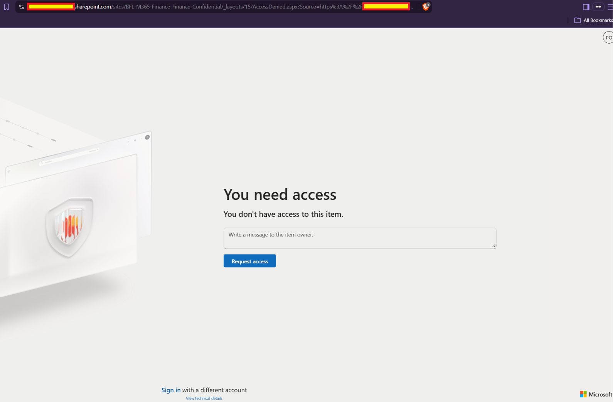</a> 
  <strong>Private-Channel Boundary Verified</strong> 
  <a href="tickets/M365-010-private-channel-membership-recovery.md">Temporary membership grants access; removal restores denial</a>
</td>
<td width="50%" align="center">
  <a href="evidence/day-07/06-meeting-screen-share-piotr.jpg">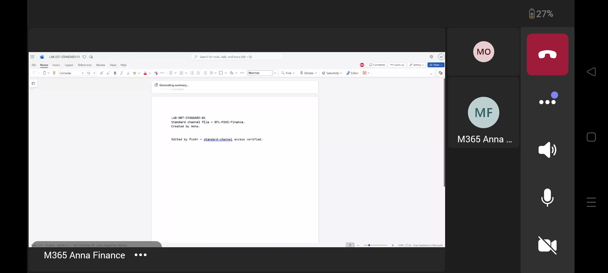</a> 
  <strong>Screen Sharing Received on a Phone</strong> 
  Two-way audio and meeting closure confirmed by the owner
</td>
</tr>
</table>

<table>
<tr>
<td width="50%" align="center">
  <a href="evidence/day-08/04-knowledge-reader-piotr.png">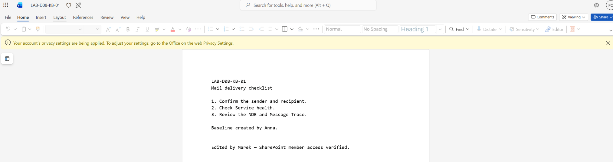</a> 
  <strong>Knowledge Reader and Editor Verified</strong> 
  <a href="tickets/M365-011-knowledge-reader-access.md">Saved change with a reader boundary</a>
</td>
<td width="50%" align="center">
  <a href="evidence/day-08/06-knowledge-restricted-access-denied-piot.png">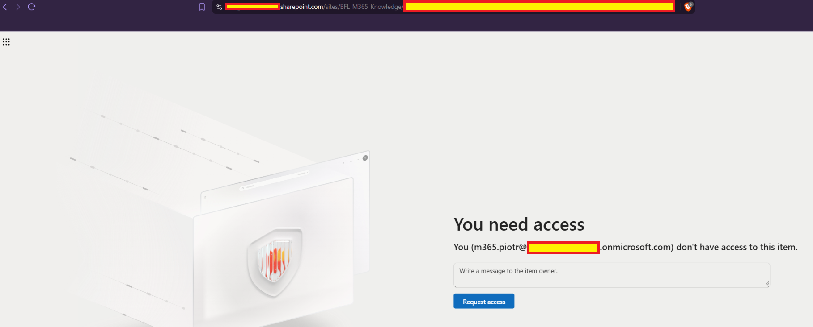</a> 
  <strong>Folder Boundary and Restoration</strong> 
  Working controls and final inheritance restoration owner-confirmed
</td>
</tr>
</table>

## Target Architecture

The diagram combines **implemented baseline components and labelled future extensions**. All three pilots, the MFA scope, Finance group/site link, DL, alias, Helpdesk and room exist. Shared-mailbox delegation, calendar read/edit/restoration, room booking and mail-flow rejection/control/recovery are verified. The scoped exercise transport rule is retained Disabled. Teams and its private-channel boundary are verified; the independent knowledge site has verified roles, metadata, sharing-link revocation and restored folder inheritance. Marek's work OneDrive sync, version restore and deleted-file restore are verified in BFL-WKS01. Knowledge now contains four user instructions with reader access and selected procedures verified. The reused Baltic Finance Lab site is separate from the new Finance group. This is not a protocol trace.

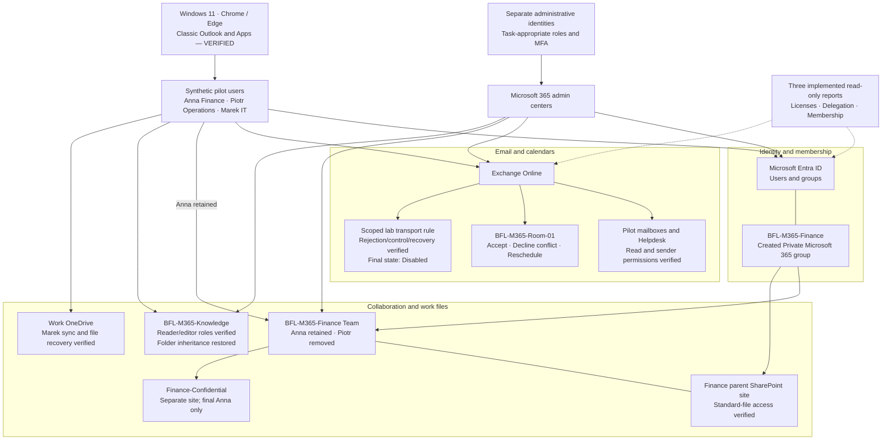

<strong>Architecture notes and planned lab scope</strong>

- The core uses a personal lab tenant and the default onmicrosoft.com domain. An owned custom domain is optional.
- Three pilot accounts exist; Piotr now remains blocked/unlicensed as a retained shared-mailbox anchor. SG-M365-MFA-Pilot contains Anna, Piotr and Marek. The CA setup role was removed; Exchange Recipient Administrator remains the recorded recipient-work assignment on adm-lab.
- Stage 05 Trace access was owner-confirmed as adm-lab; rule work used bg01. The attempted custom Transport Rules delegation remains unresolved and is not claimed as a successful least-privilege grant.
- Standard channels use the parent team's SharePoint site. A private channel has its own site and membership boundary.
- The independent knowledge site is separate from the Finance team's connected site. Marek's work OneDrive is his user workspace; its client recovery does not establish SharePoint-library sync or independent backup.
- User permission checks will use ordinary user sessions. An elevated administrator session is not the excluded-user control.
- Raw report output, private configuration, billing records and recovery material remain local.
- No Azure VM, on-premises Exchange server or hybrid identity integration is required for the core exercises.

[Full architecture](docs/architecture.md) · [Observed and planned access matrix](docs/access-matrix.md) · [Environment baseline](docs/01-environment-baseline.md)

---

## Implementation Progress

**13 of 14 stages completed. Stages 01–13 COMPLETE; Stage 14 IN_PROGRESS.**

The schedule targets approximately **50–65 hours over a 30-day trial**, including documentation. Day ranges are estimates and must fit the actual subscription end date. Notes and evidence are saved throughout the project; the final days are a buffer.

### Quick Lab Index

| Stage | Target days | Lab | Documentation | Status |
| --- | --- | --- | --- | --- |
| 01 | 1 | Tenant baseline and administrative roles | [Stage notes](docs/stages/01-tenant-and-roles.md) | COMPLETE |
| 02 | 2–3 | Users, licenses and group types | [Stage notes](docs/stages/02-users-licenses-and-groups.md) | COMPLETE |
| 03 | 4–5 | Exchange recipients, aliases and distribution | [Stage notes](docs/stages/03-exchange-recipients-and-mail.md) | COMPLETE |
| 04 | 6–7 | Shared mailboxes, calendars and room booking | [Stage notes](docs/stages/04-delegation-calendars-and-rooms.md) | COMPLETE |
| 05 | 8–9 | Mail-flow troubleshooting and recovery | [Stage notes](docs/stages/05-mail-flow-troubleshooting.md) | COMPLETE |
| 06 | 10–11 | Outlook and Microsoft 365 Apps | [Stage notes](docs/stages/06-outlook-and-microsoft-365-apps.md) | COMPLETE |
| 07 | 12–13 | Teams and connected SharePoint sites | [Stage notes](docs/stages/07-teams-and-connected-sites.md) | COMPLETE |
| 08 | 14–16 | SharePoint structure, permissions and sharing | [Stage notes](docs/stages/08-sharepoint-and-sharing.md) | COMPLETE |
| 09 | 17–18 | OneDrive synchronization and file recovery | [Stage notes](docs/stages/09-onedrive-sync-and-recovery.md) | COMPLETE |
| 10 | 19–20 | Support operations and user knowledge | [Stage notes](docs/stages/10-support-operations-and-knowledge.md) | COMPLETE |
| 11 | 21–23 | Read-only operational PowerShell reports | [Stage notes](docs/stages/11-powershell-reporting.md) | COMPLETE |
| 12 | 24–25 | Employee onboarding, access change and offboarding | [Stage notes](docs/stages/12-employee-lifecycle.md) | COMPLETE |
| 13 | 26–27 | Cross-workload practical validation | [Stage plan](docs/stages/13-independent-capstone.md) | COMPLETE |
| 14 | 28–30 | Portfolio review and lab closure | [Stage plan](docs/stages/14-portfolio-and-lab-closure.md) | IN_PROGRESS |

[Full roadmap](docs/roadmap.md) · [Test matrix](tests/test-matrix.csv) · [Support backlog](samples/ticket-backlog.csv) · [Polish coaching plan](PROJECT-PLAN_PL.md)

### Detailed Lab Notes

Expand a stage to see its scope. Stages 01–12 are complete; the final two records distinguish practical validation from the original independent-assessment criterion. T03 and T16 were first exercised in Day 01; T06 first ran in Day 02 and was extended in Day 03 without adding another global check. Stage 07 extends T16 on the new Finance Team and adds the private-channel boundary check T17. Stage 11 adds T24/T25; its 25 offline code cases are counted separately.

<strong>Stage 01 — Tenant baseline and administrative roles</strong> · complete

Provision a distinct ordinary pilot, connect service configuration to actual user behavior, and introduce a controlled MFA requirement.

- [x] Captured Anna's Business Premium with Copilot assignment and Poland usage location.
- [x] Verified external mail, OneDrive/Word web, Teams self-chat and SharePoint document persistence.
- [x] Verified ordinary-user administration denied before and after MFA.
- [x] Recorded the initial single-factor Exchange sign-in and one-member MFA pilot group.
- [x] Captured Authenticator mode, scope, exclusions and Anna's completed registration.
- [x] Evaluated the pilot in Report-only, then enabled it and recorded policy Success.
- [x] Removed the added CA operator role and verified continued basic administration.
- [x] Recorded Service health, client versions and both owner-reported emergency-account checks.

**Evidence limit:** The successful MFA event reuses an existing claim; a fresh Authenticator push approval is not captured. Recovery checks are owner-reported without screenshots.

[Stage implementation](docs/stages/01-tenant-and-roles.md) · [Day 01 results](tests/day-01.md) · [31 screenshots](evidence/day-01/README.md)

---

<strong>Stage 02 — Users, licenses and group types</strong> · complete

- [x] Provisioned Piotr and Marek; retained Anna's one-seat Copilot bundle.
- [x] Recorded owner-reported job attributes and captured product assignments.
- [x] Diagnosed Piotr's missing Exchange entitlement and verified mailbox access plus two-way mail after repair.
- [x] Extended the MFA group to all three pilots; captured matching policy Success results.
- [x] Created the Private Finance Microsoft 365 group and separate DL with explicit owners/members.
- [x] Verified DL member delivery; Marek reports no Inbox/Junk copy within ten minutes.

**Limits:** Provisioning elapsed time is unmeasured. New-user Authenticator registration is owner-reported; captured CA tabs do not show a fresh approval method. Teams is not attached to the Finance group.

[Implementation](docs/stages/02-users-licenses-and-groups.md) · [Results](tests/day-02.md) · [21 screenshots](evidence/day-02/README.md) · [M365-001](tickets/M365-001-pilot-license-recovery.md)

---

<strong>Stage 03 — Exchange recipients, aliases and distribution</strong> · complete

- [x] Added secondary m365.finance to Anna's mailbox while retaining primary m365.anna.
- [x] Distinguished the inconclusive internal address display from explicit external alias targeting.
- [x] Verified the external sent/received pair for alias delivery.
- [x] Introduced missing DL membership and verified Piotr still receives direct mail.
- [x] Recorded a ten-minute non-receipt observation while Anna receives the DL message.
- [x] Restored Piotr's membership and verified new delivery to both recipients.

**Final state:** The alias is retained and the DL is restored. T06 is extended rather than counted twice. No exact rewriting mechanism, cache interval or Message Trace sequence is claimed.

[Implementation](docs/stages/03-exchange-recipients-and-mail.md) · [Results](tests/day-03.md) · [11 screenshots](evidence/day-03/README.md) · [Case records](tickets/README.md)

---

<strong>Stage 04 — Shared mailboxes, calendars and room booking</strong> · complete

- [x] Created Helpdesk and captured its direct sign-in block.
- [x] Distinguished Piotr's Full Access from Send As; verified sender authorization and reply flow.
- [x] Verified Anna's separate Send on behalf message and Marek's denied mailbox access.
- [x] Compared calendar reader/editor behavior and restored Marek to read access.
- [x] Created the room and captured automatic booking policy with explicit limits.
- [x] Verified accepted booking, explicit conflict decline and acceptance after rescheduling.
- [x] Recorded owner-confirmed room sign-in blocking and retained final reservations.

**Final state:** Piotr retains Full Access/Send As, Anna Full Access/Send on behalf. Marek remains a calendar reader. Anna's room booking is 11:00–11:30; Marek's is 12:00–12:30 on 16 November 2026, Warsaw time.

**Limits:** Selected identity, persistence and restoration checks are owner-reported. The initial sending error does not display From; exact propagation intervals and a PowerShell permission audit were not established.

[Implementation](docs/stages/04-delegation-calendars-and-rooms.md) · [Results](tests/day-04.md) · [27 screenshots](evidence/day-04/README.md) · [Case records](tickets/README.md)

---

<strong>Stage 05 — Mail-flow troubleshooting and recovery</strong> · complete

- [x] Captured Service health and verified a working Marek → Piotr baseline.
- [x] Correlated the actual unknown-recipient NDR with Receive → Submit → Fail and 550 5.1.10 in Trace.
- [x] Saved a rule requiring sender Marek AND recipient Piotr AND subject [LAB-BLOCK].
- [x] Verified marked rejection with the custom explanation and unmarked control delivery.
- [x] Recorded the owner's confirmation that Piotr opened the unmarked control.
- [x] Disabled the rule and verified a new marked message as Delivered.

**Final state:** TR-M365-001-Lab-Block-Marek-To-Piotr is retained Disabled. T11/T12/T13 PASS; RULE-03 recovery is established by Trace.

**Limits:** Rule operations used bg01; Trace access as adm-lab is owner-confirmed. The attempted custom role-group delegation remains unresolved. Exact propagation time, a separate RULE-03 opening report and different-identity controls were not established; Exchange PowerShell diagnostics were deferred.

[Implementation](docs/stages/05-mail-flow-troubleshooting.md) · [Results](tests/day-05.md) · [14 screenshots](evidence/day-05/README.md) · [Case records](tickets/README.md)

---

<strong>Stage 06 — Outlook and Microsoft 365 Apps</strong> · complete

- [x] Installed Apps in the dedicated BFL-WKS01 VM and recorded the classic Outlook client version.
- [x] Verified Marek's active Apps product, local Word reopen/edit/save and desktop/web mail in both directions.
- [x] Distinguished Piotr's active Office user from the product subscription still naming Marek, then restored Marek.
- [x] Diagnosed Work Offline with a working web control; verified the same message after reconnect and a new outbound control.
- [x] Rechecked Anna's Read-Only calendar and Piotr's Helpdesk reply round trip in classic Outlook.
- [x] Restored Marek's Outlook profile and active Word identity by explicit owner confirmation.

**Client:** Version 2610, Build 20527.20196, Click-to-Run, Current Channel; classic Outlook 64-bit owner-confirmed. T14/T15 PASS.

**Limits:** Selected functional/restoration checks and the approximately 60-second non-receipt are owner-reported. The wrong-user capture remains licensed to Marek; no activation outage is invented. New Outlook, device enrollment and optional Copilot output were not validated. The additional Piotr profile was not reported deleted.

[Implementation](docs/stages/06-outlook-and-microsoft-365-apps.md) · [Results](tests/day-06.md) · [9 captures](evidence/day-06/README.md) · [Case records](tickets/README.md)

---

<strong>Stage 07 — Teams and connected SharePoint sites</strong> · complete

- [x] Added Teams to the existing Private Finance group in the owner-confirmed From a group workflow.
- [x] Retained Anna as Owner, Piotr as Member and Marek outside the membership list.
- [x] Rechecked T16 on Finance-Operations: Piotr edits/saves, opens via SharePoint and Anna sees the change after reopening.
- [x] Verified private-channel denial with a working standard-file control, temporary membership access and fresh denial after removal.
- [x] Identified separate parent and private-channel SharePoint site roots.
- [x] Tested a computer/phone meeting: received presentation captured; two-way audio, dynamic view change and meeting closure owner-confirmed.

**Final state:** Finance-Confidential retains Anna only. Piotr remains a team member with standard-channel access. T16 retains its earlier PASS; T17 is newly PASS.

**Limits:** Final membership restoration, selected file/session controls, site comparison and audio include owner reports. Exact propagation and call-quality metrics were not measured. The phone capture remains JPG; the visible summary interface is not a validated Copilot exercise.

[Implementation](docs/stages/07-teams-and-connected-sites.md) · [Results](tests/day-07.md) · [6 captures](evidence/day-07/README.md) · [Membership case](tickets/M365-010-private-channel-membership-recovery.md)

---

<strong>Stage 08 — SharePoint structure, permissions and sharing</strong> · complete

- [x] Created independent BFL-M365-Knowledge communication site and Knowledge library with Mail/Draft metadata.
- [x] Verified Anna Full Control, Marek Edit and Piotr Read through saved-change, reopened-owner and negative editing checks.
- [x] Removed the owner-confirmed Specific people / Piotr / Can view link; old URL reports removed while library access remains.
- [x] Tested Visitors-grant removal on an isolated folder: Piotr denied with working controls; inheritance and TXT access restored.
- [x] Retained original KB-01 after lock recovery; removed diagnostic KB-02 and first TXT per owner.

**Final state:** original KB-01, site roles and the restored test folder remain. The selected link is removed. T18–T20 PASS; M365-011/012 RESOLVED.

**Limits:** Link settings/revocation, raw effective-permission results and restoration include owner reports. KB-01's post-sharing item ACL was not separately captured. The owner explains original lock recovery after closing Word and waiting; exact release time was not measured. Optional Copilot remains unexecuted.

[Implementation](docs/stages/08-sharepoint-and-sharing.md) · [Results](tests/day-08.md) · [7 captures](evidence/day-08/README.md) · [Reader case](tickets/M365-011-knowledge-reader-access.md) · [Retained-access case](tickets/M365-012-revoked-link-retained-access.md)

---

<strong>Stage 09 — OneDrive synchronization and file recovery</strong> · complete

- [x] Verified Marek's work client and local-to-web baseline in the lab folder.
- [x] Tested online-only, downloaded and Always keep availability states.
- [x] Compared the paused cloud/local labels, resumed and reopened the actual synchronized file at V2.
- [x] Restored history entry 1.0 and checked full original V1 in web/local views.
- [x] Deleted only the synthetic item, restored it through OneDrive recycle bin and checked the same full V1.

**Final state:** client resumed and healthy; original V1 retained. Separate V2 helper remains in VM Downloads. T21/T22 PASS; M365-013/014 RESOLVED.

**Limits:** corrected 02 supports the label mismatch but has a mixed third line; 05/07 establish full baseline recovery. Exact latency, final pin retention, SharePoint sync, retention configuration and independent backup were not tested.

[Implementation](docs/stages/09-onedrive-sync-and-recovery.md) · [Results](tests/day-09.md) · [7 captures](evidence/day-09/README.md) · [Sync case](tickets/M365-013-onedrive-paused-sync-recovery.md) · [Recovery case](tickets/M365-014-onedrive-file-recovery.md)

---

<strong>Stage 10 — Support operations and user knowledge</strong> · complete

- [x] Reviewed current Service health and Message center with actual state, untested lab impact and future rollout distinguished.
- [x] Made three English procedures and a German companion available in Knowledge; Piotr reads all four without editing.
- [x] Reproduced Helpdesk reply flow, selected-link revocation/retained library access, EN version restore and DE recycle-bin restore.
- [x] Compared case impact, missing urgency information, workarounds and conditional escalation criteria.
- [x] Prepared a second-line package for the unresolved Exchange role-delegation exception.

**Final state:** four articles remain in Knowledge; D10 file restored to full V1 with healthy sync. T23 and T31 PASS. Backlog remains 14 resolved / 1 planned; preparing escalation does not resolve the RBAC exception.

**Limits:** EN restore used additional chat guidance; DE tests the deleted-file branch. 04 shows local contents and cloud file presence; full cloud contents are owner-confirmed. The package was not sent and no PowerShell investigation ran.

[Implementation](docs/stages/10-support-operations-and-knowledge.md) · [Results](tests/day-10.md) · [4 captures](evidence/day-10/README.md) · [Articles](knowledge-base/README.md) · [Case review](tickets/stage-10-case-review.md) · [Escalation package](tickets/escalations/exchange-role-delegation.md)

---

<strong>Stage 11 — Read-only operational PowerShell reports</strong> · complete

Implemented three selected-target reports and reconciled product, group and named-delegate values with fresh portal reads.

- [x] License baseline: one SPB product, 62 plan rows; pending values remain actual data.
- [x] Finance: Private, Anna owner, Anna/Piotr direct human members; four rows including group properties.
- [x] Helpdesk: seven returned ACL/delegation rows, retaining both different SELF FullAccess entries.
- [x] Mixed target control retains 124 rows and separately reports a missing/not-visible identifier, PARTIAL / 2.
- [x] Same-session Marek own-mailbox read succeeds while Helpdesk lookup fails; adm-lab restores the seven-row read.
- [x] 25 isolated offline cases pass separately from the live matrix; curated extracts published, raw output ignored.

**T24/T25 PASS within recorded scope.** T25 verifies explicit failure handling across account visibility, not a captured 403 or a proven role diagnosis. A supplemental ACL error exposed nested 401; its precise cause remains unconfirmed. Actual Graph scopes include ReadWrite permissions, so read-only code is not presented as a least-privilege token. No roles/grants were changed by the report/control calls.

[Stage record](docs/stages/11-powershell-reporting.md) · [Actual results](tests/day-11.md) · [Report usage](scripts/README.md) · [Redacted samples](samples/reports/README.md)

---

<strong>Stage 12 — Employee onboarding, access change and offboarding</strong> · complete

Revalidated existing Piotr services, moved Operations → IT, then blocked sign-in and retained approved data under Anna's custody.

- [x] New IT edit/save plus owner reopen; old Finance site denial with working controls and bounded DL/direct-mail comparison.
- [x] Selected OneDrive TXT copied into Anna's own My files; all three V1 lines checked after block and license removal.
- [x] Saved sign-in block and fresh denied login; old-session effect recorded separately.
- [x] Existing mailbox converted to SharedMailbox; wrong Anna delegate corrected, actual intended FullAccess read and retained baseline mail opened.
- [x] Size/archive/hold observations reviewed; Premium removed, blocked account retained; Anna custody and active-owner controls still work.
- [x] IT, Helpdesk and Knowledge Visitors removals reported; inconclusive Knowledge permission query preserved.

**T26–T28 PASS; M365-015 RESOLVED.** Piotr remains a blocked/unlicensed mailbox anchor; this is one approved file copy, not a whole-drive migration or complete effective-access purge. The source OneDrive follows unlicensed-account policy.

[Implementation](docs/stages/12-employee-lifecycle.md) · [Results](tests/day-12.md) · [9 captures](evidence/day-12/README.md) · [Verified runbook](runbooks/employee-lifecycle.md) · [Case](tickets/M365-015-employee-offboarding.md)

---

<strong>Stage 13 — Cross-workload practical validation</strong> · COMPLETE · five practical tasks verified

Five practical tasks verify Helpdesk on-behalf mail, desktop account/function, temporary single-file access and revocation, actual offline edit/sync return, and current Piotr/Finance/Helpdesk reports with selected portal agreement. Seven original captures and redacted extracts preserve what was seen versus owner-confirmed.

**Status: COMPLETE for the revised five-task practical scope, adopted 18 November 2026.** The owner executed the operations using supplied procedures/launchers. T32 is PASS for this revised practical-validation criterion. The original independent-assessment criterion was replaced, not recorded as independently passed.

[Stage scope](docs/stages/13-independent-capstone.md) · [Results](tests/day-13.md) · [7 captures](evidence/day-13/README.md) · [Current extracts](samples/capstone/README.md)

---

<strong>Stage 14 — Portfolio review and retained lab</strong> · in_progress

The owner retains resources. Documentation/evidence claims, source/output hashes, internal links, private-identifier boundaries and public-only offline preservation are reviewed. No destructive cleanup or billing mutation is performed. Exact subscription review stays private and is pending.

[Review record](docs/stages/14-portfolio-and-lab-closure.md) · [Closure inventory](docs/lab-closure.md) · [Portfolio summary](docs/portfolio-summary.md) · [Documentation QA](tests/day-14.md)

---

## Supporting Documentation

| Resource | Purpose |
| --- | --- |
| [English roadmap](docs/roadmap.md) and [Polish coaching plan](PROJECT-PLAN_PL.md) | Learning sequence, workload and completion criteria |
| [Environment baseline](docs/01-environment-baseline.md) | Recorded subscriptions, client versions, verified baseline and limitations |
| [Architecture](docs/architecture.md) and [access matrix](docs/access-matrix.md) | Planned objects, service relationships and permission boundaries |
| [Stage index](docs/stages/README.md) and [lab-note template](docs/LAB-NOTE-TEMPLATE.md) | Eleven completed stages and three planned stages |
| [Support workflow](tickets/README.md), [case template](tickets/TICKET-TEMPLATE.md) and [backlog](samples/ticket-backlog.csv) | Diagnostic reasoning, recovery and user verification |
| [Functional validation guide](tests/README.md), [32-check matrix](tests/test-matrix.csv) and [Day 01 results](tests/day-01.md) | Global results, supporting observations and evidence links |
| [PowerShell reports](scripts/README.md) | Usage, permission/context requirements, live results and isolated code checks |
| [Lifecycle runbook template](runbooks/LIFECYCLE-TEMPLATE.md) | Onboarding, access changes, offboarding and data custody |
| [Knowledge articles](knowledge-base/README.md) | Three English procedures and a German companion, with reproduction boundaries |
| [Synthetic users](samples/pilot-users.csv) and [sample guide](samples/README.md) | Fictional planning inputs without real tenant identifiers |
| [Evidence guide](evidence/README.md) and [recording workflow](CONTRIBUTING.md) | Sanitization, status rules and coherent commits |
| [Copilot pilot plan](docs/copilot-pilot-plan.md) | One-seat readiness, source checking and permission-sensitive use cases; not yet executed |
| [Microsoft sources](docs/sources.md) | Official references for service behavior and licensing |

---

## Security Design Principles

**Separate administration from ordinary use**

Use dedicated administrative identities and task-appropriate roles. Verify user behavior from the intended ordinary account.

**Explicit lab scope**

Use synthetic identities, messages and files. Controlled mail-flow rules and failure exercises are limited to documented test objects.

**Effective access verification**

Check allowed and denied operations directly. Group membership, link removal or a saved setting alone does not establish the full access result.

**Reversible changes and recovery**

Record the starting state and recovery path before introducing a training condition. Repeat the functional check after restoration.

**Evidence-supported diagnosis**

Distinguish symptoms, hypotheses and observed causes. Include client context and propagation delays where they affect the conclusion.

**Data custody before license changes**

Plan mailbox/file handover and check applicable preservation and licensing conditions before removing service entitlements.

## Evidence Boundaries

This is an educational lab and technical portfolio. The organization and pilot identities are synthetic; the fourteen resolved cases are guided lab exercises. External test correspondence is kept minimal and personal details require redaction.

Published evidence covers baseline workloads, the MFA rollout, licensing recovery, group configuration, explicit external alias delivery, distribution repair, shared-mailbox delegation, calendar permission restoration, room conflict recovery, NDR/Trace-based mail-flow diagnosis, desktop Apps activation and client identity/offline recovery. Historical Day 01 captures retain their original scope; the current MFA group has three members.

The successful Day 01 MFA event reuses a claim. Day 02 shows policy Success for My Signins (Piotr) and One Outlook Web (Marek), not a captured fresh approval or Basic info requirement. Bounded non-receipt and selected profile/recovery checks are owner-reported. The first internal alias headers name the primary address; the external pair establishes the alias target. Day 04 combines captured permission/results with attributed owner reports for session controls, calendar persistence/restoration and room sign-in blocking. Day 05 distinguishes rule configuration from actual rejection/delivery; RULE-02 opening and operator identities are owner-reported, while RULE-03 recovery uses Trace. Publication review and interpretation boundaries are described in the [evidence guide](evidence/README.md#current-publication-review).

Day 06 distinguishes the active Word user from the subscription account, captured offline/reconnected state from owner-reported timing, and local document persistence from OneDrive synchronization. New Outlook and device registration/enrollment were not validated. Day 07 verifies the private-channel boundary and temporary membership restoration; its two-way audio and final state include owner confirmations, while the phone image shows received presentation.

Day 08 verifies the independent knowledge site and reader/editor separation. Link revocation invalidates the old URL while library access remains; folder denial is captured and restoration is owner-confirmed. Original DOCX recovery is attributed to closing Word and waiting per owner, without a measured release time. The post-sharing KB-01 ACL was not separately audited.

Day 09 combines captured paused/resumed state and full recovered text with owner-confirmed file location, fresh reopening, deletion propagation and final health. The selected corrected mismatch capture has a mixed third line; version/recycle-bin recovery is verified against all original lines separately. A V2 helper remains outside OneDrive in VM Downloads.

Day 10 records a current advisory separately from untested lab impact and a future PDF feature notice. Article procedures have attributed user results; EN restoration includes chat assistance. The case review and second-line package are prepared documentation, not a sent escalation or a repaired RBAC exception. T31 is first explicitly consolidated PASS after the repeated link test; earlier stage counters remain historical.

Stage 11 adds three actual PowerShell exports and 25 isolated offline fixture checks. Live account-dependent visibility failure is separate from simulated 403 coverage; no live 403, complete role audit or least-privilege session is claimed. No validated Copilot exercise or production incident resolution is claimed.

Configuration evidence, live report checks and offline fixture results are recorded separately. A blocked result remains blocked until the dependency is resolved; it is not converted into a pass.

Publish only reviewed synthetic or sanitized content. Credentials, tokens, recovery codes, billing data, personal mail files and raw tenant exports stay outside the repository. See the [evidence guide](evidence/README.md) and [.gitignore](.gitignore).

An owned custom domain with SPF/DKIM/DMARC and controlled external sharing are optional extensions after the core. Additional entitlements and policy dependencies must be verified before execution.

---

## Repository Structure

| Path | Contents |
| --- | --- |
| [README.md](README.md) | Project overview, architecture, stage roadmap and current evidence status |
| [docs/](docs/roadmap.md) | Implementation records, baseline, access model, retained-state review and sources |
| [tickets/](tickets/README.md) | Fifteen resolved lab cases, workflow and case template |
| [tests/](tests/README.md) | Thirty-two global checks, thirty-one recorded passes and detailed workload/documentation records; 25 offline cases counted separately |
| [evidence/](evidence/README.md) | 153 indexed captures across Days 01–10, Day 12 and Day 13, review notes and screenshot timing guidance |
| [scripts/](scripts/README.md) | Three read-only reports and common export/context library |
| [runbooks/](runbooks/README.md) | Verified employee lifecycle procedure and reusable template |
| [knowledge-base/](knowledge-base/README.md) | Three English user procedures and a German companion with attributed reproduction |
| [samples/](samples/README.md) | Three retained synthetic identities; 15 resolved lab cases |
| [.github/ISSUE_TEMPLATE/](.github/ISSUE_TEMPLATE/lab-stage.yml) | Lab-stage and support-case issue forms |

## Related Projects

- [Microsoft Entra Identity &amp; Access Project](https://github.com/krzysztof-szot/entra-identity-access-project)
- [Microsoft Hybrid Enterprise Security Project](https://github.com/krzysztof-szot/hybrid-enterprise-security-project)
- [IAM PowerShell Automation Project](https://github.com/krzysztof-szot/iam-powershell-automation-project)

Review the [completed cases](tickets/README.md) and [results](tests/README.md), then review the [portfolio summary](docs/portfolio-summary.md) and [retained-state inventory](docs/lab-closure.md).
