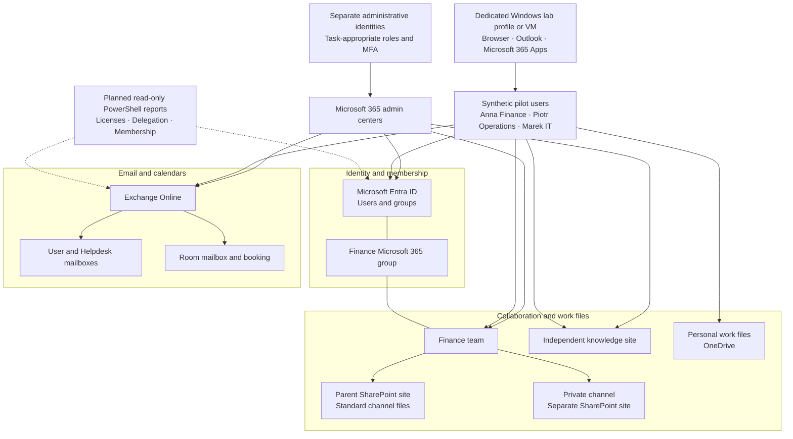

<h1 align="center">Microsoft 365 Administration &amp; Support Project</h1>

<strong>Exchange Online · Teams · SharePoint · IT Support</strong>

  
  
  

  
  
  
  
  
  

  <a href="#project-overview">Overview</a> ·
  <a href="#target-architecture">Architecture</a> ·
  <a href="#featured-implementation-evidence">Featured evidence</a> ·
  <a href="#implementation-progress">Lab roadmap</a> ·
  <a href="#supporting-documentation">Documentation</a> ·
  <a href="#security-design-principles">Security principles</a>

A hands-on Microsoft 365 administration and support lab for the fictional organization **Baltic Finance**.

The project is designed to connect user accounts, licenses, email, collaboration, desktop clients and employee lifecycle tasks through controlled service requests and troubleshooting exercises. Each stage will record the administrative decision, the affected user's experience and the observed result.

This repository complements the owner's Microsoft Entra, hybrid security and IAM automation projects with everyday Microsoft 365 administration and IT support.

## Project Overview

**Status: initial setup — repository scaffold prepared; Stages 01–14 planned.**  
The owner has reported an active **30-day Microsoft 365 Business Standard trial**. Enabled service plans, Teams entitlement, available pilot seats, administrative roles and client versions remain to be verified in the [environment baseline](docs/01-environment-baseline.md).

**Recorded execution: 0 completed stages, 0 functional checks run and no published implementation screenshots.** The repository contains learning plans, synthetic inputs and templates. Reports, resolved incidents and implementation evidence will be added after the exercises are performed.

The target roles are **Junior Microsoft 365 Administrator**, **Junior System Administrator** and **IT Support Specialist**.

Each stage is designed to include:

- a business requirement and explicit lab scope
- configuration choices and administrative reasoning
- positive, negative and recovery checks
- user-session verification
- troubleshooting and observed limitations
- sanitized evidence and a reproducible procedure

## Explore the Project

| Architecture | Implementation | Validation | Evidence |
|:---:|:---:|:---:|:---:|
| [View design](#target-architecture) | [Browse stages](#implementation-progress) | [Open test matrix](tests/test-matrix.csv) | [Open evidence guide](evidence/README.md) |
| Planned service relationships | 14 planned learning stages | 32 checks, all NOT_RUN | Captures pending execution |

## Technologies and Concepts

| Area | Planned technologies and concepts |
| --- | --- |
| Tenant administration | Microsoft 365 Admin Center, service entitlements, administrative roles, MFA, service health |
| Users and licenses | Cloud-only identities, usage locations, service plans, provisioning and group types |
| Messaging | Exchange Online, aliases, distribution lists, shared mailboxes and sender delegation |
| Calendars and resources | Calendar read/edit permissions, room mailboxes and conflicting reservations |
| Mail troubleshooting | NDRs, Message Trace, scoped mail-flow rules and delivery recovery |
| Desktop support | Outlook, Microsoft 365 Apps activation, account context and browser/client comparison |
| Collaboration | Teams ownership, standard/private channels and connected SharePoint sites |
| Content and access | SharePoint libraries, metadata, inheritance, membership and sharing links |
| File operations | OneDrive synchronization, Files On-Demand, version history and deleted-file recovery |
| Support operations | Incident triage, escalation, user communication and knowledge articles |
| Reporting | Planned read-only PowerShell reports for licenses, mailbox delegation and group membership |
| Employee lifecycle | Onboarding, department changes, offboarding and approved data handover |

The actual subscription and enabled services will determine the executable scope. The core does not require Intune, PIM, Conditional Access implementation, Exchange hybrid deployment, Teams Phone, paid Copilot or advanced retention/holds.

---

## Current Implementation

| Component | Current recorded state |
| --- | --- |
| Learning plan | 14 stage documents with objectives, exercises and exit checks |
| Subscription | Business Standard trial reported active by the owner; baseline inspection pending |
| Synthetic inputs | Three planned pilot identities and a backlog of 15 support cases |
| Validation | 32 defined checks; every result is NOT_RUN |
| Operational documentation | Lab/ticket templates, lifecycle template and user-article plan |
| PowerShell | Three report contracts defined; no executable scripts yet |
| Implementation evidence | None collected or published |

A prepared template or checklist does not establish that the underlying tenant configuration exists. Live state will be recorded in the corresponding stage notes.

## Planned Outcomes

| Administration or support objective | Result to demonstrate |
| --- | --- |
| Prepare a user for work | Correct services, mail and collaboration access verified as the user |
| Diagnose a delivery problem | Evidence-supported cause and restored delivery with a control check |
| Manage mailbox delegation | Mailbox access and sender permissions tested independently |
| Control collaboration access | Intended read/edit access plus verified denial for an excluded identity |
| Recover work files | Restored contents compared with a synthetic baseline |
| Produce useful support records | 15 documented cases with diagnostic choices, verification and communication |
| Report operational state | Three read-only reports reconciled with independent workload reads |
| Handle employee changes | Onboarding, department transfer and offboarding with verified access/data handling |
| Work independently | Five final tasks with supported resolutions or justified escalation |

These are learning targets. They will become demonstrated outcomes only after execution and recorded verification.

## Featured Implementation Evidence

**No implementation screenshots are available yet.**

After the corresponding exercises are verified, this section will feature selected, sanitized evidence for mailbox delegation, mail-flow diagnosis, collaboration access and file recovery. Each capture will link to its stage note, result and evidence index.

[Evidence handling guide](evidence/README.md) · [Functional check matrix](tests/test-matrix.csv)

## Target Architecture

The diagram shows **planned service relationships**, not a deployed topology or a network/protocol trace.

<strong>Architecture notes and planned lab scope</strong>

- The core uses a personal lab tenant and the default onmicrosoft.com domain. An owned custom domain is optional.
- Three synthetic licensed pilot users and separate administrative identities are planned; their live provisioning has not been documented.
- Standard channels use the parent team's SharePoint site. A private channel has its own site and membership boundary.
- The independent knowledge site is separate from the Finance team's connected site.
- User permission checks will use ordinary user sessions. An elevated administrator session is not the excluded-user control.
- Raw report output, private configuration, billing records and recovery material remain local.
- No Azure VM, on-premises Exchange server or hybrid identity integration is required for the core exercises.

[Full architecture](docs/architecture.md) · [Planned access matrix](docs/access-matrix.md) · [Environment baseline](docs/01-environment-baseline.md)

---

## Implementation Progress

**0 of 14 stages completed.** All learning stages remain **PLANNED**.

The schedule targets approximately **50–65 hours over a 30-day trial**, including documentation. Day ranges are estimates and must fit the actual subscription end date. Notes and evidence are saved throughout the project; the final days are a buffer.

### Quick Lab Index

| Stage | Target days | Lab | Documentation | Status |
| --- | --- | --- | --- | --- |
| 01 | 1 | Tenant baseline and administrative roles | [Stage plan](docs/stages/01-tenant-and-roles.md) | PLANNED |
| 02 | 2–3 | Users, licenses and group types | [Stage plan](docs/stages/02-users-licenses-and-groups.md) | PLANNED |
| 03 | 4–5 | Exchange recipients, aliases and distribution | [Stage plan](docs/stages/03-exchange-recipients-and-mail.md) | PLANNED |
| 04 | 6–7 | Shared mailboxes, calendars and room booking | [Stage plan](docs/stages/04-delegation-calendars-and-rooms.md) | PLANNED |
| 05 | 8–9 | Mail-flow troubleshooting and recovery | [Stage plan](docs/stages/05-mail-flow-troubleshooting.md) | PLANNED |
| 06 | 10–11 | Outlook and Microsoft 365 Apps | [Stage plan](docs/stages/06-outlook-and-microsoft-365-apps.md) | PLANNED |
| 07 | 12–13 | Teams and connected SharePoint sites | [Stage plan](docs/stages/07-teams-and-connected-sites.md) | PLANNED |
| 08 | 14–16 | SharePoint structure, permissions and sharing | [Stage plan](docs/stages/08-sharepoint-and-sharing.md) | PLANNED |
| 09 | 17–18 | OneDrive synchronization and file recovery | [Stage plan](docs/stages/09-onedrive-sync-and-recovery.md) | PLANNED |
| 10 | 19–20 | Support operations and user knowledge | [Stage plan](docs/stages/10-support-operations-and-knowledge.md) | PLANNED |
| 11 | 21–23 | Read-only operational PowerShell reports | [Stage plan](docs/stages/11-powershell-reporting.md) | PLANNED |
| 12 | 24–25 | Employee onboarding, access change and offboarding | [Stage plan](docs/stages/12-employee-lifecycle.md) | PLANNED |
| 13 | 26–27 | Independent administration and troubleshooting assessment | [Stage plan](docs/stages/13-independent-capstone.md) | PLANNED |
| 14 | 28–30 | Portfolio review and lab closure | [Stage plan](docs/stages/14-portfolio-and-lab-closure.md) | PLANNED |

[Full roadmap](docs/roadmap.md) · [Test matrix](tests/test-matrix.csv) · [Support backlog](samples/ticket-backlog.csv) · [Polish coaching plan](PROJECT-PLAN_PL.md)

### Detailed Lab Notes

Expand a stage to see its planned scope. Unchecked items are future work; no implementation or result is implied.

<strong>Stage 01 — Tenant baseline and administrative roles</strong> · planned exercises

Establish a verified service baseline and separate administrative work from ordinary user activity.

- [ ] Record the actual subscription, enabled service plans, available seats and trial end date privately.
- [ ] Confirm Teams entitlement and desktop Apps availability instead of inferring them from the product name.
- [ ] Separate administrative and pilot identities; configure MFA and private recovery access.
- [ ] Select the role needed for each workload and inspect Service health.

**Validation target:** An authorized administrative task succeeds in the intended tenant. The same administrative operation is denied to an ordinary user. A licensed initial pilot user can open the required services after provisioning.

[Stage documentation](docs/stages/01-tenant-and-roles.md) · [Test matrix](tests/test-matrix.csv) · [Evidence guide](evidence/README.md)

---

<strong>Stage 02 — Users, licenses and group types</strong> · planned exercises

Prepare pilot identities and choose an appropriate group type for each business requirement.

- [ ] Create Anna Finance, Piotr Operations and Marek IT as synthetic users.
- [ ] Set usage locations and assign only the service entitlements required by the exercise.
- [ ] Compare security groups, Microsoft 365 groups and distribution lists.
- [ ] On an empty test account, investigate a deliberately missing service entitlement and restore it.

**Validation target:** The selected workload becomes usable after the entitlement is corrected. Membership and ownership match the documented access matrix. Provisioning delay is recorded separately from a configuration failure.

[Stage documentation](docs/stages/02-users-licenses-and-groups.md) · [Test matrix](tests/test-matrix.csv) · [Evidence guide](evidence/README.md)

---

<strong>Stage 03 — Exchange recipients, aliases and distribution</strong> · planned exercises

Understand recipient types and verify actual mail delivery.

- [ ] Compare user mailboxes, shared mailboxes, aliases, distribution lists and Microsoft 365 groups.
- [ ] Create a Finance alias and a lab distribution list with explicit owners and members.
- [ ] Send uniquely marked synthetic messages and record sender, recipient and time.
- [ ] Change list membership and repeat delivery checks after propagation.

**Validation target:** Mail to the alias arrives in the intended mailbox. Approved distribution-list members receive the marked message. An excluded account does not receive a distribution copy.

[Stage documentation](docs/stages/03-exchange-recipients-and-mail.md) · [Test matrix](tests/test-matrix.csv) · [Evidence guide](evidence/README.md)

---

<strong>Stage 04 — Shared mailboxes, calendars and room booking</strong> · planned exercises

Distinguish mailbox access from sender permissions and understand calendar/resource behavior.

- [ ] Create the BFL-M365-Helpdesk shared mailbox.
- [ ] Exercise Full Access, Send As and Send on Behalf separately; record the Outlook edition used.
- [ ] Compare calendar read and edit permissions.
- [ ] Create one room mailbox and inspect booking behavior for overlapping reservations.

**Validation target:** Mailbox opening and sending are verified as separate operations. An excluded identity cannot open the shared mailbox. A calendar reader can read but cannot edit the test event. The room accepts an allowed request and handles a conflict according to its recorded settings.

[Stage documentation](docs/stages/04-delegation-calendars-and-rooms.md) · [Test matrix](tests/test-matrix.csv) · [Evidence guide](evidence/README.md)

---

<strong>Stage 05 — Mail-flow troubleshooting and recovery</strong> · planned exercises

Diagnose delivery failures using observed evidence and restore the expected mail flow.

- [ ] Collect sender, recipient, timestamp, subject and actual NDR details.
- [ ] Inspect Service health and Message Trace in Exchange administration.
- [ ] Test a nonexistent lab recipient.
- [ ] Introduce one reversible rule limited to a selected synthetic recipient and a [LAB-BLOCK] subject marker; keep an unmarked control message.

**Validation target:** Evidence distinguishes an invalid recipient from the controlled rule rejection. The unmarked control message continues to arrive. After disabling the exercise rule and allowing for propagation, the intended delivery succeeds.

[Stage documentation](docs/stages/05-mail-flow-troubleshooting.md) · [Test matrix](tests/test-matrix.csv) · [Evidence guide](evidence/README.md)

---

<strong>Stage 06 — Outlook and Microsoft 365 Apps</strong> · planned exercises

Separate account, license, service and desktop-client problems.

- [ ] Use a dedicated lab Windows profile or VM and record client versions.
- [ ] Configure the correct pilot account in Outlook and verify desktop Apps activation.
- [ ] Compare browser and desktop behavior for the same mailbox and identity.
- [ ] Investigate a wrong Office identity and validate access to delegated mail/calendar resources.

**Validation target:** The correct licensed identity is active in the intended client. Observed browser/client differences support the diagnosis. The affected action and a regression check succeed after correction.

[Stage documentation](docs/stages/06-outlook-and-microsoft-365-apps.md) · [Test matrix](tests/test-matrix.csv) · [Evidence guide](evidence/README.md)

---

<strong>Stage 07 — Teams and connected SharePoint sites</strong> · planned exercises

Understand team/channel membership and the location of collaboration data.

- [ ] Create the BFL-M365-Finance team with explicit ownership.
- [ ] Create standard and private channels with different membership.
- [ ] Open the same file through Teams and its SharePoint location.
- [ ] Test a lab meeting, audio-device selection and screen sharing; record any single-device test limitations.

**Validation target:** A team member can open the standard-channel file. An authorized private-channel member can open its file. A team member excluded from the private channel is denied at the direct file URL. The parent site and separate private-channel site are identified correctly.

[Stage documentation](docs/stages/07-teams-and-connected-sites.md) · [Test matrix](tests/test-matrix.csv) · [Evidence guide](evidence/README.md)

---

<strong>Stage 08 — SharePoint structure, permissions and sharing</strong> · planned exercises

Build a usable knowledge site and reason about all relevant access paths.

- [ ] Create the independent BFL-M365-Knowledge site, a document library and simple metadata.
- [ ] Assign Owners, Members and Visitors according to the access matrix.
- [ ] Test Specific people links and revoke one controlled sharing link.
- [ ] On one isolated synthetic resource, inspect permission inheritance and record how to restore it.
- [ ] Manage Teams private-channel membership through Teams rather than by independently changing its SharePoint permissions.

**Validation target:** A reader can read but cannot edit. A member can make and save the intended change. An excluded identity is denied with other access paths checked. A revoked link is evaluated together with direct grants and group membership.

[Stage documentation](docs/stages/08-sharepoint-and-sharing.md) · [Test matrix](tests/test-matrix.csv) · [Evidence guide](evidence/README.md)

---

<strong>Stage 09 — OneDrive synchronization and file recovery</strong> · planned exercises

Diagnose synchronization and validate recovery by comparing actual file contents.

- [ ] Set up synchronization of a lab-only test folder and examine Files On-Demand.
- [ ] Compare personal OneDrive files with a team SharePoint library.
- [ ] Pause and resume sync to create a controlled stale-client condition.
- [ ] Restore an earlier version and a deliberately deleted synthetic file; retain a baseline of its contents.

**Validation target:** Changes appear in browser and client after sync resumes. Restored version content matches the expected baseline. A recovered deleted file opens with the expected contents. The note explains the difference between synchronization, version history and backup.

[Stage documentation](docs/stages/09-onedrive-sync-and-recovery.md) · [Test matrix](tests/test-matrix.csv) · [Evidence guide](evidence/README.md)

---

<strong>Stage 10 — Support operations and user knowledge</strong> · planned exercises

Produce useful incident records, user communication and escalation material.

- [ ] Maintain tickets throughout the project and review impact, urgency and escalation criteria here.
- [ ] Inspect Service health and Message center; record actual observations.
- [ ] Write three concise user articles on the knowledge site, including one German-language companion.
- [ ] Prepare one second-line escalation summary with reproduction steps, scope and collected evidence.

**Validation target:** A ticket separates user reports, observations, hypotheses and confirmed causes. A healthy service is not presented as a real Microsoft outage. A reader can follow the user article and reproduce its intended result. The escalation contains enough information for another operator to continue.

[Stage documentation](docs/stages/10-support-operations-and-knowledge.md) · [Test matrix](tests/test-matrix.csv) · [Evidence guide](evidence/README.md)

---

<strong>Stage 11 — Read-only operational PowerShell reports</strong> · planned exercises

Report selected license, delegation and membership state and reconcile it with independent reads.

- [ ] Implement the three scoped reports listed in scripts/README.md only after manual exercises.
- [ ] Record module versions, authentication context and required permissions.
- [ ] Handle a missing object, insufficient permissions and partial reads without reporting false success.
- [ ] Export raw CSV locally and publish only curated synthetic or redacted samples.

**Validation target:** Selected rows match independent portal/workload reads. Permission and missing-object failures produce useful diagnostics. Partial output is explicitly identified as incomplete. Report execution does not change workload configuration.

[Stage documentation](docs/stages/11-powershell-reporting.md) · [Test matrix](tests/test-matrix.csv) · [Evidence guide](evidence/README.md)

---

<strong>Stage 12 — Employee onboarding, access change and offboarding</strong> · planned exercises

Execute an end-to-end employee lifecycle using a verified runbook.

- [ ] Onboard Piotr with a license, mail, intended collaboration access and a user test.
- [ ] Move the synthetic employee to a different department and verify both removed and added access.
- [ ] Plan data custody before removing service entitlements.
- [ ] Block new sign-in, take appropriate session actions and remove intended memberships.
- [ ] If preserving mail as a shared mailbox, verify conversion before any license removal; keep its blocked anchoring account and check applicable license limits.
- [ ] Document OneDrive handover and actual preservation limits.

**Validation target:** The onboarding checklist produces usable services. Access after the department change matches the target matrix. A new leaver sign-in is denied; existing-session behavior is reported separately. An approved custodian opens the designated retained mailbox and files.

[Stage documentation](docs/stages/12-employee-lifecycle.md) · [Test matrix](tests/test-matrix.csv) · [Evidence guide](evidence/README.md)

---

<strong>Stage 13 — Independent administration and troubleshooting assessment</strong> · planned exercises

Demonstrate independent diagnosis across workloads without a step-by-step repair guide.

- [ ] Select five tasks covering mail, client identity, collaboration permissions, synchronization and lifecycle reporting.
- [ ] Use your own runbooks and official sources to choose diagnostic steps.
- [ ] Record expected outcomes before changes and keep recovery paths.
- [ ] Classify each task as resolved, partially resolved or requiring escalation based on evidence.

**Validation target:** Each task has a supported diagnosis or a justified escalation. Changes are scoped and have recorded recovery paths. Final functional and regression checks use the affected identities. The operator can explain the decisions without reading a copied click sequence.

[Stage documentation](docs/stages/13-independent-capstone.md) · [Test matrix](tests/test-matrix.csv) · [Evidence guide](evidence/README.md)

---

<strong>Stage 14 — Portfolio review and lab closure</strong> · planned exercises

Publish accurate project evidence and close or deliberately retain the lab.

- [ ] Save notes and sanitized evidence continuously; use the final days as a buffer.
- [ ] Review README, architecture, ticket links, test results and untested scope.
- [ ] Summarize the hardest diagnoses and observed propagation/client limitations.
- [ ] Privately confirm subscription end date and renewal decisions; export approved project material before access ends.
- [ ] Record remaining resources and the chosen lab closure state.

**Validation target:** Public claims match recorded evidence and actual results. No private credentials, billing records or raw exports are published. Repository links and indexes resolve. The closure note records completed, outstanding and untested work explicitly.

[Stage documentation](docs/stages/14-portfolio-and-lab-closure.md) · [Test matrix](tests/test-matrix.csv) · [Evidence guide](evidence/README.md)

---

## Supporting Documentation

| Resource | Purpose |
| --- | --- |
| [English roadmap](docs/roadmap.md) and [Polish coaching plan](PROJECT-PLAN_PL.md) | Learning sequence, workload and completion criteria |
| [Environment baseline](docs/01-environment-baseline.md) | Known subscription state and checks still to perform |
| [Architecture](docs/architecture.md) and [access matrix](docs/access-matrix.md) | Planned objects, service relationships and permission boundaries |
| [Stage index](docs/stages/README.md) and [lab-note template](docs/LAB-NOTE-TEMPLATE.md) | Planned exercises and later implementation records |
| [Support workflow](tickets/README.md), [case template](tickets/TICKET-TEMPLATE.md) and [backlog](samples/ticket-backlog.csv) | Diagnostic reasoning, recovery and user verification |
| [Functional validation guide](tests/README.md) and [32-check matrix](tests/test-matrix.csv) | Expected behavior, results and evidence links |
| [PowerShell report plan](scripts/README.md) | Report scope, permission requirements and verification contracts |
| [Lifecycle runbook template](runbooks/LIFECYCLE-TEMPLATE.md) | Onboarding, access changes, offboarding and data custody |
| [Knowledge article plan](knowledge-base/README.md) | User instructions and a German-language companion |
| [Synthetic users](samples/pilot-users.csv) and [sample guide](samples/README.md) | Fictional planning inputs without real tenant identifiers |
| [Evidence guide](evidence/README.md) and [recording workflow](CONTRIBUTING.md) | Sanitization, status rules and coherent commits |
| [Microsoft sources](docs/sources.md) | Official references for service behavior and licensing |

---

## Security Design Principles

**Separate administration from ordinary use**

Use dedicated administrative identities and task-appropriate roles. Verify user behavior from the intended ordinary account.

**Explicit lab scope**

Use synthetic identities, messages and files. Controlled mail-flow rules and failure exercises are limited to documented test objects.

**Effective access verification**

Check allowed and denied operations directly. Group membership, link removal or a saved setting alone does not establish the full access result.

**Reversible changes and recovery**

Record the starting state and recovery path before introducing a training condition. Repeat the functional check after restoration.

**Evidence-supported diagnosis**

Distinguish symptoms, hypotheses and observed causes. Include client context and propagation delays where they affect the conclusion.

**Data custody before license changes**

Plan mailbox/file handover and check applicable preservation and licensing conditions before removing service entitlements.

## Evidence Boundaries

This is an educational lab and technical portfolio. The organization, users and support cases are synthetic.

At this stage, the repository demonstrates planning and documentation structure. No live Microsoft 365 test, resolved support incident, PowerShell execution, automated test success or production outcome is claimed.

Configuration evidence, functional results and any future offline script checks will be recorded separately. A blocked result remains blocked until the dependency is resolved; it is not converted into a pass.

Publish only reviewed synthetic or sanitized content. Credentials, tokens, recovery codes, billing data, personal mail files and raw tenant exports stay outside the repository. See the [evidence guide](evidence/README.md) and [.gitignore](.gitignore).

An owned custom domain with SPF/DKIM/DMARC and controlled external sharing are optional extensions after the core. Additional entitlements and policy dependencies must be verified before execution.

---

## Repository Structure

| Path | Contents |
| --- | --- |
| [README.md](README.md) | Project overview, architecture, stage roadmap and current evidence status |
| [docs/](docs/roadmap.md) | Fourteen stage plans, baseline, access model, architecture and sources |
| [tickets/](tickets/README.md) | Support workflow and case template |
| [tests/](tests/README.md) | Thirty-two planned functional checks and result conventions |
| [evidence/](evidence/README.md) | Publication rules and future sanitized implementation captures |
| [scripts/](scripts/README.md) | Planned read-only operational reports |
| [runbooks/](runbooks/README.md) | Employee lifecycle procedure template |
| [knowledge-base/](knowledge-base/README.md) | Planned user-facing articles |
| [samples/](samples/README.md) | Three synthetic identities and fifteen planned support cases |
| [.github/ISSUE_TEMPLATE/](.github/ISSUE_TEMPLATE/lab-stage.yml) | Lab-stage and support-case issue forms |

## Related Projects

- [Microsoft Entra Identity &amp; Access Project](https://github.com/krzysztof-szot/entra-identity-access-project)
- [Microsoft Hybrid Enterprise Security Project](https://github.com/krzysztof-szot/hybrid-enterprise-security-project)
- [IAM PowerShell Automation Project](https://github.com/krzysztof-szot/iam-powershell-automation-project)

Start with [Stage 01 — tenant baseline and administrative roles](docs/stages/01-tenant-and-roles.md).
