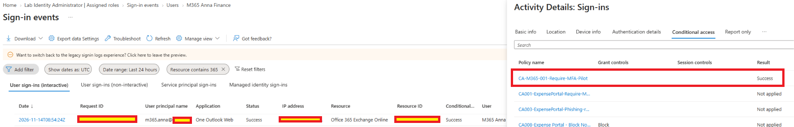
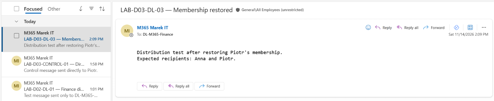
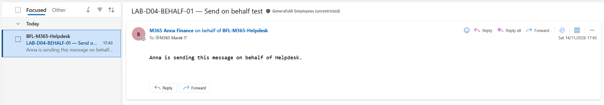
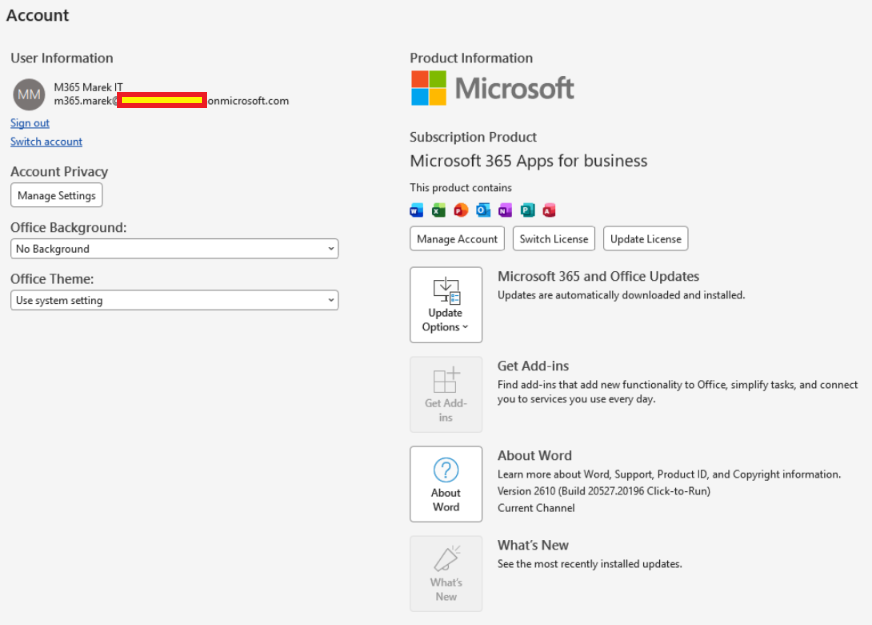
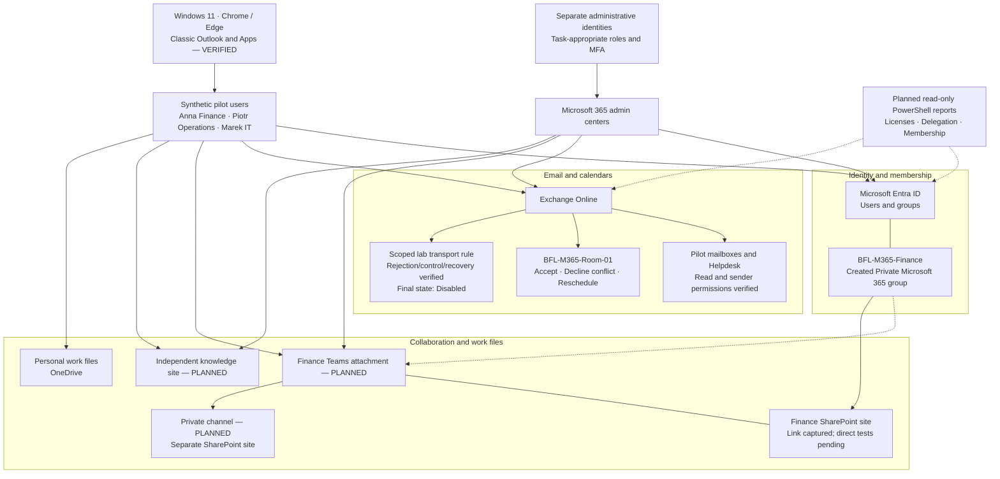

<h1 align="center">Microsoft 365 Administration &amp; Support Project</h1>

<strong>Exchange Online · Teams · SharePoint · IT Support</strong>

  
  
  

  
  
  
  
  
  

  <a href="#project-overview">Overview</a> ·
  <a href="#target-architecture">Architecture</a> ·
  <a href="#featured-implementation-evidence">Featured evidence</a> ·
  <a href="#implementation-progress">Lab roadmap</a> ·
  <a href="#resolved-support-cases">Cases</a> ·
  <a href="#supporting-documentation">Documentation</a> ·
  <a href="#security-design-principles">Security principles</a>

A hands-on Microsoft 365 administration and support lab for the fictional organization **Baltic Finance**.

The project is designed to connect user accounts, licenses, email, collaboration, desktop clients and employee lifecycle tasks through controlled service requests and troubleshooting exercises. Each stage will record the administrative decision, the affected user's experience and the observed result.

This repository complements the owner's Microsoft Entra, hybrid security and IAM automation projects with everyday Microsoft 365 administration and IT support.

## Project Overview

**Status: Stages 01–06 complete; Stages 07–14 planned.**\
The lab now uses **Business Standard (25 seats)**, **Business Premium (25 seats)** and **Business Premium with Copilot (1 seat)** according to the owner's active subscription views. All three pilots are provisioned. Licensing recovery, a three-user MFA scope, Finance groups, alias delivery, distribution recovery, shared-mailbox delegation, calendar permissions, room booking and mail-flow diagnosis/recovery are documented. See the [current baseline](docs/01-environment-baseline.md) for the observed state and source limits.

**Recorded execution: 6 completed stages, 18 PASS / 14 NOT_RUN in the global matrix, 9 resolved lab cases, and 113 published captures.** The completed stages connect working services to scoped MFA, entitlement recovery, group ownership, delegated mail/calendar behavior and evidence-supported mail-flow diagnosis, desktop identity correction and offline synchronization recovery. [Implementation index](docs/stages/README.md) · [Results](tests/README.md) · [Evidence](evidence/README.md)

The target roles are **Junior Microsoft 365 Administrator**, **Junior System Administrator** and **IT Support Specialist**.

Each stage is designed to include:

- a business requirement and explicit lab scope
- configuration choices and administrative reasoning
- positive, negative and recovery checks
- user-session verification
- troubleshooting and observed limitations
- sanitized evidence and a reproducible procedure

## Explore the Project

| Architecture | Implementation | Validation | Evidence |
|:---:|:---:|:---:|:---:|
| [View design](#target-architecture) | [Browse stages](#implementation-progress) | [Open test matrix](tests/test-matrix.csv) | [Browse evidence](evidence/README.md) |
| Target design and recorded baseline | Stages 01–06 complete; 8 stages planned | 18 PASS / 14 NOT_RUN | 113 captures across Days 01–06 |

## Technologies and Concepts

| Area | Technologies and learning scope |
| --- | --- |
| Tenant administration | Microsoft 365 Admin Center, service entitlements, administrative roles, MFA, service health |
| Users and licenses | Cloud-only identities, usage locations, service plans, provisioning and group types |
| Messaging | Exchange Online, aliases, distribution lists, shared mailboxes and sender delegation |
| Calendars and resources | Calendar read/edit permissions, room mailboxes and conflicting reservations |
| Mail troubleshooting | NDRs, Message Trace, scoped mail-flow rules and delivery recovery |
| Desktop support | Outlook, Microsoft 365 Apps activation, account context and browser/client comparison |
| Collaboration | Teams ownership, standard/private channels and connected SharePoint sites |
| Content and access | SharePoint libraries, metadata, inheritance, membership and sharing links |
| File operations | OneDrive synchronization, Files On-Demand, version history and deleted-file recovery |
| Support operations | Incident triage, escalation, user communication and knowledge articles |
| Reporting | Planned read-only PowerShell reports for licenses, mailbox delegation and group membership |
| Employee lifecycle | Onboarding, department changes, offboarding and approved data handover |

The scoped Conditional Access MFA pilot now contains Anna, Piotr and Marek. Ordinary Premium seats support the M365 users; the one-seat [Copilot extension](docs/copilot-pilot-plan.md) is planned around Stages 06, 08, 10 and 13. Intune can be an extension. PIM, full E5/Entra Suite restoration, Exchange hybrid deployment, Teams Phone and advanced retention/holds remain outside the core.

---

## Current Implementation

| Component | Current recorded state |
| --- | --- |
| Learning plan | 14 stage documents with objectives, exercises and exit checks |
| Subscription | Standard 25, Premium 25 and Premium with Copilot 1 reported active; Anna's bundle assignment captured |
| Synthetic inputs | Three provisioned synthetic pilots; 9 of 15 lab cases resolved |
| Validation | 32 global checks: 18 PASS and 14 NOT_RUN; supporting observations recorded separately |
| Operational documentation | Nine completed case records; lab/lifecycle templates and a user-article plan |
| Delegation and calendars | Piotr Send As, Anna Send on behalf, excluded Marek denied; calendar editor tested and reader restored |
| Room booking | Automatic policy verified through accepted, conflicting/declined and rescheduled/accepted requests |
| Mail-flow diagnosis and recovery | Unknown-recipient NDR correlated with Trace; marked rejection, unmarked delivery and delivery after rule disable verified |
| Desktop clients | BFL-WKS01: Apps activation, correct identity restored, offline synchronization recovered and calendar/Helpdesk access verified |
| PowerShell | Three report contracts defined; no executable scripts yet |
| Implementation evidence | 113 captures: Day 01 baseline (31), Day 02 licensing/groups (21), Day 03 alias/recovery (11), Day 04 delegation/calendar/room (27), Day 05 mail flow (14), Day 06 desktop clients (9) |

Captured configuration, functional results and owner-reported details are distinguished in the stage notes. Assigned services and a visible Copilot button do not establish full workload operation or validated AI output.

## Resolved Support Cases

| Case | Trigger and verified result |
| --- | --- |
| [M365-001 — Pilot license recovery](tickets/M365-001-pilot-license-recovery.md) | Piotr can authenticate but Outlook has no entitlement; Premium/Exchange assignment restores mailbox access and two-way mail |
| [M365-002 — Finance alias delivery](tickets/M365-002-finance-alias-delivery.md) | External mail explicitly addressed to the secondary address reaches Anna's existing mailbox |
| [M365-003 — Distribution membership recovery](tickets/M365-003-distribution-membership-recovery.md) | Direct mail works during omitted DL membership; re-adding Piotr restores distribution while Anna continues receiving |
| [M365-004 — Helpdesk sender-permission recovery](tickets/M365-004-helpdesk-sender-permission-recovery.md) | Reading works before sending; separate Send As restores the intended sender and reply flow |
| [M365-005 — Room booking conflict](tickets/M365-005-room-booking-conflict-recovery.md) | The room explicitly declines an overlap; rescheduling the same request produces a fresh acceptance |
| [M365-006 — Unknown-recipient diagnosis](tickets/M365-006-unknown-recipient-diagnosis.md) | NDR and Trace agree on 550 5.1.10 SMTP lookup failure; closed as diagnosed expected rejection |
| [M365-007 — Scoped rule recovery](tickets/M365-007-scoped-rule-recovery.md) | Marked mail fails while the unmarked control delivers; disabling the rule restores new marked-message delivery |
| [M365-008 — Office identity recovery](tickets/M365-008-office-identity-recovery.md) | Piotr is the active Word user while the subscription still names Marek; intended user and functional checks restored |
| [M365-009 — Outlook offline recovery](tickets/M365-009-outlook-offline-recovery.md) | Same mailbox works in web; reconnecting classic Outlook delivers the affected message and a new outbound control succeeds |

These are nine guided lab records from the [15-case backlog](samples/ticket-backlog.csv). The other six remain planned. The separate role-delegation exception remains unresolved in the Stage 05 notes.

## Planned Outcomes

| Administration or support objective | Result to demonstrate |
| --- | --- |
| Prepare a user for work | Correct services, mail and collaboration access verified as the user |
| Diagnose a delivery problem | Evidence-supported cause and restored delivery with a control check |
| Manage mailbox delegation | Mailbox access and sender permissions tested independently |
| Control collaboration access | Intended read/edit access plus verified denial for an excluded identity |
| Recover work files | Restored contents compared with a synthetic baseline |
| Produce useful support records | 15 documented cases with diagnostic choices, verification and communication |
| Report operational state | Three read-only reports reconciled with independent workload reads |
| Handle employee changes | Onboarding, department transfer and offboarding with verified access/data handling |
| Work independently | Five final tasks with supported resolutions or justified escalation |

These are project-wide targets. The first six stages establish a working baseline and nine guided case resolutions; remaining objectives become demonstrated outcomes only after execution and recorded verification.

## Featured Implementation Evidence

Selected lab captures connect the user experience to configuration and recovery. [All 113 captions and review notes](evidence/README.md) · [Case records](tickets/README.md)

<table>
<tr>
<td width="50%" align="center">
   
  <strong>Licensing Repair — Two-Way Mail Verified</strong> 
  <a href="tickets/M365-001-pilot-license-recovery.md">M365-001</a>
</td>
<td width="50%" align="center">
   
  <strong>MFA Pilot — Applied Successfully</strong> 
  Existing claim satisfies MFA; Day 02 extends the group to three users
</td>
</tr>
<tr>
<td width="50%" align="center">
   
  <strong>Distribution Membership Restored</strong> 
  <a href="tickets/M365-003-distribution-membership-recovery.md">M365-003 diagnosis and repair</a>
</td>
<td width="50%" align="center">
   
  <strong>Recovery Verified as the User</strong> 
  Anna continues receiving as the unchanged control
</td>
</tr>
<tr>
<td width="50%" align="center">
   
  <strong>Sender Delegation Verified</strong> 
  Send on behalf compared with Piotr's Send As
</td>
<td width="50%" align="center">
   
  <strong>Room Conflict Explained</strong> 
  Explicit decline followed by acceptance after rescheduling
</td>
</tr>
<tr>
<td width="50%" align="center">
   
  <strong>Scoped Rejection — Control Still Delivers</strong> 
  <a href="tickets/M365-007-scoped-rule-recovery.md">M365-007</a>
</td>
<td width="50%" align="center">
   
  <strong>Mail Flow Restored After Rule Disable</strong> 
  New marked message verified in Exchange Trace
</td>
</tr>
<tr>
<td width="50%" align="center">
   
  <strong>Desktop Apps Activated</strong> 
  <a href="docs/stages/06-outlook-and-microsoft-365-apps.md">Identity and functional checks recorded separately</a>
</td>
<td width="50%" align="center">
   
  <strong>Outlook Synchronization Restored</strong> 
  <a href="tickets/M365-009-outlook-offline-recovery.md">Same-message recovery and a new outbound control</a>
</td>
</tr>
</table>

## Target Architecture

The diagram combines **implemented baseline components and labelled future extensions**. All three pilots, the MFA scope, Finance group/site link, DL, alias, Helpdesk and room exist. Shared-mailbox delegation, calendar read/edit/restoration, room booking and mail-flow rejection/control/recovery are verified. The scoped exercise transport rule is retained Disabled. Teams attachment, private channels and the knowledge site remain planned. The reused Baltic Finance Lab site is separate from the new Finance group. This is not a protocol trace.

<strong>Architecture notes and planned lab scope</strong>

- The core uses a personal lab tenant and the default onmicrosoft.com domain. An owned custom domain is optional.
- All three pilots are provisioned. SG-M365-MFA-Pilot contains Anna, Piotr and Marek. The CA setup role was removed; Exchange Recipient Administrator remains the recorded recipient-work assignment on adm-lab.
- Stage 05 Trace access was owner-confirmed as adm-lab; rule work used bg01. The attempted custom Transport Rules delegation remains unresolved and is not claimed as a successful least-privilege grant.
- Standard channels use the parent team's SharePoint site. A private channel has its own site and membership boundary.
- The independent knowledge site is separate from the Finance team's connected site.
- User permission checks will use ordinary user sessions. An elevated administrator session is not the excluded-user control.
- Raw report output, private configuration, billing records and recovery material remain local.
- No Azure VM, on-premises Exchange server or hybrid identity integration is required for the core exercises.

[Full architecture](docs/architecture.md) · [Observed and planned access matrix](docs/access-matrix.md) · [Environment baseline](docs/01-environment-baseline.md)

---

## Implementation Progress

**6 of 14 stages completed. Stages 01–06 are COMPLETE; Stages 07–14 are PLANNED.**

The schedule targets approximately **50–65 hours over a 30-day trial**, including documentation. Day ranges are estimates and must fit the actual subscription end date. Notes and evidence are saved throughout the project; the final days are a buffer.

### Quick Lab Index

| Stage | Target days | Lab | Documentation | Status |
| --- | --- | --- | --- | --- |
| 01 | 1 | Tenant baseline and administrative roles | [Stage notes](docs/stages/01-tenant-and-roles.md) | COMPLETE |
| 02 | 2–3 | Users, licenses and group types | [Stage notes](docs/stages/02-users-licenses-and-groups.md) | COMPLETE |
| 03 | 4–5 | Exchange recipients, aliases and distribution | [Stage notes](docs/stages/03-exchange-recipients-and-mail.md) | COMPLETE |
| 04 | 6–7 | Shared mailboxes, calendars and room booking | [Stage notes](docs/stages/04-delegation-calendars-and-rooms.md) | COMPLETE |
| 05 | 8–9 | Mail-flow troubleshooting and recovery | [Stage notes](docs/stages/05-mail-flow-troubleshooting.md) | COMPLETE |
| 06 | 10–11 | Outlook and Microsoft 365 Apps | [Stage notes](docs/stages/06-outlook-and-microsoft-365-apps.md) | COMPLETE |
| 07 | 12–13 | Teams and connected SharePoint sites | [Stage plan](docs/stages/07-teams-and-connected-sites.md) | PLANNED |
| 08 | 14–16 | SharePoint structure, permissions and sharing | [Stage plan](docs/stages/08-sharepoint-and-sharing.md) | PLANNED |
| 09 | 17–18 | OneDrive synchronization and file recovery | [Stage plan](docs/stages/09-onedrive-sync-and-recovery.md) | PLANNED |
| 10 | 19–20 | Support operations and user knowledge | [Stage plan](docs/stages/10-support-operations-and-knowledge.md) | PLANNED |
| 11 | 21–23 | Read-only operational PowerShell reports | [Stage plan](docs/stages/11-powershell-reporting.md) | PLANNED |
| 12 | 24–25 | Employee onboarding, access change and offboarding | [Stage plan](docs/stages/12-employee-lifecycle.md) | PLANNED |
| 13 | 26–27 | Independent administration and troubleshooting assessment | [Stage plan](docs/stages/13-independent-capstone.md) | PLANNED |
| 14 | 28–30 | Portfolio review and lab closure | [Stage plan](docs/stages/14-portfolio-and-lab-closure.md) | PLANNED |

[Full roadmap](docs/roadmap.md) · [Test matrix](tests/test-matrix.csv) · [Support backlog](samples/ticket-backlog.csv) · [Polish coaching plan](PROJECT-PLAN_PL.md)

### Detailed Lab Notes

Expand a stage to see its scope. Stages 01–06 are complete. T03 and T16 were first exercised in Day 01; T06 first ran in Day 02 and was extended in Day 03 without adding another global check. Stage 07's remaining deployment is planned.

<strong>Stage 01 — Tenant baseline and administrative roles</strong> · complete

Provision a distinct ordinary pilot, connect service configuration to actual user behavior, and introduce a controlled MFA requirement.

- [x] Captured Anna's Business Premium with Copilot assignment and Poland usage location.
- [x] Verified external mail, OneDrive/Word web, Teams self-chat and SharePoint document persistence.
- [x] Verified ordinary-user administration denied before and after MFA.
- [x] Recorded the initial single-factor Exchange sign-in and one-member MFA pilot group.
- [x] Captured Authenticator mode, scope, exclusions and Anna's completed registration.
- [x] Evaluated the pilot in Report-only, then enabled it and recorded policy Success.
- [x] Removed the added CA operator role and verified continued basic administration.
- [x] Recorded Service health, client versions and both owner-reported emergency-account checks.

**Evidence limit:** The successful MFA event reuses an existing claim; a fresh Authenticator push approval is not captured. Recovery checks are owner-reported without screenshots.

[Stage implementation](docs/stages/01-tenant-and-roles.md) · [Day 01 results](tests/day-01.md) · [31 screenshots](evidence/day-01/README.md)

---

<strong>Stage 02 — Users, licenses and group types</strong> · complete

- [x] Provisioned Piotr and Marek; retained Anna's one-seat Copilot bundle.
- [x] Recorded owner-reported job attributes and captured product assignments.
- [x] Diagnosed Piotr's missing Exchange entitlement and verified mailbox access plus two-way mail after repair.
- [x] Extended the MFA group to all three pilots; captured matching policy Success results.
- [x] Created the Private Finance Microsoft 365 group and separate DL with explicit owners/members.
- [x] Verified DL member delivery; Marek reports no Inbox/Junk copy within ten minutes.

**Limits:** Provisioning elapsed time is unmeasured. New-user Authenticator registration is owner-reported; captured CA tabs do not show a fresh approval method. Teams is not attached to the Finance group.

[Implementation](docs/stages/02-users-licenses-and-groups.md) · [Results](tests/day-02.md) · [21 screenshots](evidence/day-02/README.md) · [M365-001](tickets/M365-001-pilot-license-recovery.md)

---

<strong>Stage 03 — Exchange recipients, aliases and distribution</strong> · complete

- [x] Added secondary m365.finance to Anna's mailbox while retaining primary m365.anna.
- [x] Distinguished the inconclusive internal address display from explicit external alias targeting.
- [x] Verified the external sent/received pair for alias delivery.
- [x] Introduced missing DL membership and verified Piotr still receives direct mail.
- [x] Recorded a ten-minute non-receipt observation while Anna receives the DL message.
- [x] Restored Piotr's membership and verified new delivery to both recipients.

**Final state:** The alias is retained and the DL is restored. T06 is extended rather than counted twice. No exact rewriting mechanism, cache interval or Message Trace sequence is claimed.

[Implementation](docs/stages/03-exchange-recipients-and-mail.md) · [Results](tests/day-03.md) · [11 screenshots](evidence/day-03/README.md) · [Case records](tickets/README.md)

---

<strong>Stage 04 — Shared mailboxes, calendars and room booking</strong> · complete

- [x] Created Helpdesk and captured its direct sign-in block.
- [x] Distinguished Piotr's Full Access from Send As; verified sender authorization and reply flow.
- [x] Verified Anna's separate Send on behalf message and Marek's denied mailbox access.
- [x] Compared calendar reader/editor behavior and restored Marek to read access.
- [x] Created the room and captured automatic booking policy with explicit limits.
- [x] Verified accepted booking, explicit conflict decline and acceptance after rescheduling.
- [x] Recorded owner-confirmed room sign-in blocking and retained final reservations.

**Final state:** Piotr retains Full Access/Send As, Anna Full Access/Send on behalf. Marek remains a calendar reader. Anna's room booking is 11:00–11:30; Marek's is 12:00–12:30 on 16 November 2026, Warsaw time.

**Limits:** Selected identity, persistence and restoration checks are owner-reported. The initial sending error does not display From; exact propagation intervals and a PowerShell permission audit were not established.

[Implementation](docs/stages/04-delegation-calendars-and-rooms.md) · [Results](tests/day-04.md) · [27 screenshots](evidence/day-04/README.md) · [Case records](tickets/README.md)

---

<strong>Stage 05 — Mail-flow troubleshooting and recovery</strong> · complete

- [x] Captured Service health and verified a working Marek → Piotr baseline.
- [x] Correlated the actual unknown-recipient NDR with Receive → Submit → Fail and 550 5.1.10 in Trace.
- [x] Saved a rule requiring sender Marek AND recipient Piotr AND subject [LAB-BLOCK].
- [x] Verified marked rejection with the custom explanation and unmarked control delivery.
- [x] Recorded the owner's confirmation that Piotr opened the unmarked control.
- [x] Disabled the rule and verified a new marked message as Delivered.

**Final state:** TR-M365-001-Lab-Block-Marek-To-Piotr is retained Disabled. T11/T12/T13 PASS; RULE-03 recovery is established by Trace.

**Limits:** Rule operations used bg01; Trace access as adm-lab is owner-confirmed. The attempted custom role-group delegation remains unresolved. Exact propagation time, a separate RULE-03 opening report and different-identity controls were not established; Exchange PowerShell diagnostics were deferred.

[Implementation](docs/stages/05-mail-flow-troubleshooting.md) · [Results](tests/day-05.md) · [14 screenshots](evidence/day-05/README.md) · [Case records](tickets/README.md)

---

<strong>Stage 06 — Outlook and Microsoft 365 Apps</strong> · complete

- [x] Installed Apps in the dedicated BFL-WKS01 VM and recorded the classic Outlook client version.
- [x] Verified Marek's active Apps product, local Word reopen/edit/save and desktop/web mail in both directions.
- [x] Distinguished Piotr's active Office user from the product subscription still naming Marek, then restored Marek.
- [x] Diagnosed Work Offline with a working web control; verified the same message after reconnect and a new outbound control.
- [x] Rechecked Anna's Read-Only calendar and Piotr's Helpdesk reply round trip in classic Outlook.
- [x] Restored Marek's Outlook profile and active Word identity by explicit owner confirmation.

**Client:** Version 2610, Build 20527.20196, Click-to-Run, Current Channel; classic Outlook 64-bit owner-confirmed. T14/T15 PASS.

**Limits:** Selected functional/restoration checks and the approximately 60-second non-receipt are owner-reported. The wrong-user capture remains licensed to Marek; no activation outage is invented. New Outlook, device enrollment and optional Copilot output were not validated. The additional Piotr profile was not reported deleted.

[Implementation](docs/stages/06-outlook-and-microsoft-365-apps.md) · [Results](tests/day-06.md) · [9 captures](evidence/day-06/README.md) · [Case records](tickets/README.md)

---

<strong>Stage 07 — Teams and connected SharePoint sites</strong> · planned exercises

Understand team/channel membership and the location of collaboration data.

- [ ] Attach Teams to the existing Private BFL-M365-Finance group from Day 02, retaining documented ownership/membership.
- [ ] Create standard and private channels with different membership.
- [ ] Open the same file through Teams and its SharePoint location.
- [ ] Test a lab meeting, audio-device selection and screen sharing; record any single-device test limitations.

**Validation target:** A team member can open the standard-channel file. An authorized private-channel member can open its file. A team member excluded from the private channel is denied at the direct file URL. The parent site and separate private-channel site are identified correctly.

[Stage documentation](docs/stages/07-teams-and-connected-sites.md) · [Test matrix](tests/test-matrix.csv) · [Evidence guide](evidence/README.md)

---

<strong>Stage 08 — SharePoint structure, permissions and sharing</strong> · planned exercises

Build a usable knowledge site and reason about all relevant access paths.

- [ ] Create the independent BFL-M365-Knowledge site, a document library and simple metadata.
- [ ] Assign Owners, Members and Visitors according to the access matrix.
- [ ] Test Specific people links and revoke one controlled sharing link.
- [ ] On one isolated synthetic resource, inspect permission inheritance and record how to restore it.
- [ ] Manage Teams private-channel membership through Teams rather than by independently changing its SharePoint permissions.

**Validation target:** A reader can read but cannot edit. A member can make and save the intended change. An excluded identity is denied with other access paths checked. A revoked link is evaluated together with direct grants and group membership.

[Stage documentation](docs/stages/08-sharepoint-and-sharing.md) · [Test matrix](tests/test-matrix.csv) · [Evidence guide](evidence/README.md)

---

<strong>Stage 09 — OneDrive synchronization and file recovery</strong> · planned exercises

Diagnose synchronization and validate recovery by comparing actual file contents.

- [ ] Set up synchronization of a lab-only test folder and examine Files On-Demand.
- [ ] Compare personal OneDrive files with a team SharePoint library.
- [ ] Pause and resume sync to create a controlled stale-client condition.
- [ ] Restore an earlier version and a deliberately deleted synthetic file; retain a baseline of its contents.

**Validation target:** Changes appear in browser and client after sync resumes. Restored version content matches the expected baseline. A recovered deleted file opens with the expected contents. The note explains the difference between synchronization, version history and backup.

[Stage documentation](docs/stages/09-onedrive-sync-and-recovery.md) · [Test matrix](tests/test-matrix.csv) · [Evidence guide](evidence/README.md)

---

<strong>Stage 10 — Support operations and user knowledge</strong> · planned exercises

Produce useful incident records, user communication and escalation material.

- [ ] Maintain tickets throughout the project and review impact, urgency and escalation criteria here.
- [ ] Inspect Service health and Message center; record actual observations.
- [ ] Write three concise user articles on the knowledge site, including one German-language companion.
- [ ] Prepare one second-line escalation summary with reproduction steps, scope and collected evidence.

**Validation target:** A ticket separates user reports, observations, hypotheses and confirmed causes. A healthy service is not presented as a real Microsoft outage. A reader can follow the user article and reproduce its intended result. The escalation contains enough information for another operator to continue.

[Stage documentation](docs/stages/10-support-operations-and-knowledge.md) · [Test matrix](tests/test-matrix.csv) · [Evidence guide](evidence/README.md)

---

<strong>Stage 11 — Read-only operational PowerShell reports</strong> · planned exercises

Report selected license, delegation and membership state and reconcile it with independent reads.

- [ ] Implement the three scoped reports listed in scripts/README.md only after manual exercises.
- [ ] Record module versions, authentication context and required permissions.
- [ ] Handle a missing object, insufficient permissions and partial reads without reporting false success.
- [ ] Export raw CSV locally and publish only curated synthetic or redacted samples.

**Validation target:** Selected rows match independent portal/workload reads. Permission and missing-object failures produce useful diagnostics. Partial output is explicitly identified as incomplete. Report execution does not change workload configuration.

[Stage documentation](docs/stages/11-powershell-reporting.md) · [Test matrix](tests/test-matrix.csv) · [Evidence guide](evidence/README.md)

---

<strong>Stage 12 — Employee onboarding, access change and offboarding</strong> · planned exercises

Execute an end-to-end employee lifecycle using a verified runbook.

- [ ] Onboard Piotr with a license, mail, intended collaboration access and a user test.
- [ ] Move the synthetic employee to a different department and verify both removed and added access.
- [ ] Plan data custody before removing service entitlements.
- [ ] Block new sign-in, take appropriate session actions and remove intended memberships.
- [ ] If preserving mail as a shared mailbox, verify conversion before any license removal; keep its blocked anchoring account and check applicable license limits.
- [ ] Document OneDrive handover and actual preservation limits.

**Validation target:** The onboarding checklist produces usable services. Access after the department change matches the target matrix. A new leaver sign-in is denied; existing-session behavior is reported separately. An approved custodian opens the designated retained mailbox and files.

[Stage documentation](docs/stages/12-employee-lifecycle.md) · [Test matrix](tests/test-matrix.csv) · [Evidence guide](evidence/README.md)

---

<strong>Stage 13 — Independent administration and troubleshooting assessment</strong> · planned exercises

Demonstrate independent diagnosis across workloads without a step-by-step repair guide.

- [ ] Select five tasks covering mail, client identity, collaboration permissions, synchronization and lifecycle reporting.
- [ ] Use your own runbooks and official sources to choose diagnostic steps.
- [ ] Record expected outcomes before changes and keep recovery paths.
- [ ] Classify each task as resolved, partially resolved or requiring escalation based on evidence.

**Validation target:** Each task has a supported diagnosis or a justified escalation. Changes are scoped and have recorded recovery paths. Final functional and regression checks use the affected identities. The operator can explain the decisions without reading a copied click sequence.

[Stage documentation](docs/stages/13-independent-capstone.md) · [Test matrix](tests/test-matrix.csv) · [Evidence guide](evidence/README.md)

---

<strong>Stage 14 — Portfolio review and lab closure</strong> · planned exercises

Publish accurate project evidence and close or deliberately retain the lab.

- [ ] Save notes and sanitized evidence continuously; use the final days as a buffer.
- [ ] Review README, architecture, ticket links, test results and untested scope.
- [ ] Summarize the hardest diagnoses and observed propagation/client limitations.
- [ ] Privately confirm subscription end date and renewal decisions; export approved project material before access ends.
- [ ] Record remaining resources and the chosen lab closure state.

**Validation target:** Public claims match recorded evidence and actual results. No private credentials, billing records or raw exports are published. Repository links and indexes resolve. The closure note records completed, outstanding and untested work explicitly.

[Stage documentation](docs/stages/14-portfolio-and-lab-closure.md) · [Test matrix](tests/test-matrix.csv) · [Evidence guide](evidence/README.md)

---

## Supporting Documentation

| Resource | Purpose |
| --- | --- |
| [English roadmap](docs/roadmap.md) and [Polish coaching plan](PROJECT-PLAN_PL.md) | Learning sequence, workload and completion criteria |
| [Environment baseline](docs/01-environment-baseline.md) | Recorded subscriptions, client versions, verified baseline and limitations |
| [Architecture](docs/architecture.md) and [access matrix](docs/access-matrix.md) | Planned objects, service relationships and permission boundaries |
| [Stage index](docs/stages/README.md) and [lab-note template](docs/LAB-NOTE-TEMPLATE.md) | Six completed stages and eight planned stages |
| [Support workflow](tickets/README.md), [case template](tickets/TICKET-TEMPLATE.md) and [backlog](samples/ticket-backlog.csv) | Diagnostic reasoning, recovery and user verification |
| [Functional validation guide](tests/README.md), [32-check matrix](tests/test-matrix.csv) and [Day 01 results](tests/day-01.md) | Global results, supporting observations and evidence links |
| [PowerShell report plan](scripts/README.md) | Report scope, permission requirements and verification contracts |
| [Lifecycle runbook template](runbooks/LIFECYCLE-TEMPLATE.md) | Onboarding, access changes, offboarding and data custody |
| [Knowledge article plan](knowledge-base/README.md) | User instructions and a German-language companion |
| [Synthetic users](samples/pilot-users.csv) and [sample guide](samples/README.md) | Fictional planning inputs without real tenant identifiers |
| [Evidence guide](evidence/README.md) and [recording workflow](CONTRIBUTING.md) | Sanitization, status rules and coherent commits |
| [Copilot pilot plan](docs/copilot-pilot-plan.md) | One-seat readiness, source checking and permission-sensitive use cases; not yet executed |
| [Microsoft sources](docs/sources.md) | Official references for service behavior and licensing |

---

## Security Design Principles

**Separate administration from ordinary use**

Use dedicated administrative identities and task-appropriate roles. Verify user behavior from the intended ordinary account.

**Explicit lab scope**

Use synthetic identities, messages and files. Controlled mail-flow rules and failure exercises are limited to documented test objects.

**Effective access verification**

Check allowed and denied operations directly. Group membership, link removal or a saved setting alone does not establish the full access result.

**Reversible changes and recovery**

Record the starting state and recovery path before introducing a training condition. Repeat the functional check after restoration.

**Evidence-supported diagnosis**

Distinguish symptoms, hypotheses and observed causes. Include client context and propagation delays where they affect the conclusion.

**Data custody before license changes**

Plan mailbox/file handover and check applicable preservation and licensing conditions before removing service entitlements.

## Evidence Boundaries

This is an educational lab and technical portfolio. The organization and pilot identities are synthetic; the nine resolved cases are guided lab exercises. External test correspondence is kept minimal and personal details require redaction.

Published evidence covers baseline workloads, the MFA rollout, licensing recovery, group configuration, explicit external alias delivery, distribution repair, shared-mailbox delegation, calendar permission restoration, room conflict recovery, NDR/Trace-based mail-flow diagnosis, desktop Apps activation and client identity/offline recovery. Historical Day 01 captures retain their original scope; the current MFA group has three members.

The successful Day 01 MFA event reuses a claim. Day 02 shows policy Success for My Signins (Piotr) and One Outlook Web (Marek), not a captured fresh approval or Basic info requirement. Bounded non-receipt and selected profile/recovery checks are owner-reported. The first internal alias headers name the primary address; the external pair establishes the alias target. Day 04 combines captured permission/results with attributed owner reports for session controls, calendar persistence/restoration and room sign-in blocking. Day 05 distinguishes rule configuration from actual rejection/delivery; RULE-02 opening and operator identities are owner-reported, while RULE-03 recovery uses Trace. Publication review and interpretation boundaries are described in the [evidence guide](evidence/README.md#current-publication-review).

Day 06 distinguishes the active Word user from the subscription account, captured offline/reconnected state from owner-reported timing, and local document persistence from OneDrive synchronization. New Outlook and device registration/enrollment were not validated.

No validated Copilot exercise, private-channel isolation, PowerShell execution, automated workload-test success or production incident resolution is claimed.

Configuration evidence, functional results and any future offline script checks will be recorded separately. A blocked result remains blocked until the dependency is resolved; it is not converted into a pass.

Publish only reviewed synthetic or sanitized content. Credentials, tokens, recovery codes, billing data, personal mail files and raw tenant exports stay outside the repository. See the [evidence guide](evidence/README.md) and [.gitignore](.gitignore).

An owned custom domain with SPF/DKIM/DMARC and controlled external sharing are optional extensions after the core. Additional entitlements and policy dependencies must be verified before execution.

---

## Repository Structure

| Path | Contents |
| --- | --- |
| [README.md](README.md) | Project overview, architecture, stage roadmap and current evidence status |
| [docs/](docs/roadmap.md) | Five implementation records, nine stage plans, baseline, access model and sources |
| [tickets/](tickets/README.md) | Nine resolved lab cases, workflow and case template |
| [tests/](tests/README.md) | Thirty-two global checks, eighteen recorded passes and detailed Day 01–06 records |
| [evidence/](evidence/README.md) | 113 indexed captures across Days 01–06, review notes and screenshot timing guidance |
| [scripts/](scripts/README.md) | Planned read-only operational reports |
| [runbooks/](runbooks/README.md) | Employee lifecycle procedure template |
| [knowledge-base/](knowledge-base/README.md) | Planned user-facing articles |
| [samples/](samples/README.md) | Three provisioned synthetic identities; 9 resolved and 6 planned lab cases |
| [.github/ISSUE_TEMPLATE/](.github/ISSUE_TEMPLATE/lab-stage.yml) | Lab-stage and support-case issue forms |

## Related Projects

- [Microsoft Entra Identity &amp; Access Project](https://github.com/krzysztof-szot/entra-identity-access-project)
- [Microsoft Hybrid Enterprise Security Project](https://github.com/krzysztof-szot/hybrid-enterprise-security-project)
- [IAM PowerShell Automation Project](https://github.com/krzysztof-szot/iam-powershell-automation-project)

Review the [completed cases](tickets/README.md) and [results](tests/README.md), then continue with [Stage 07 — Teams and connected SharePoint sites](docs/stages/07-teams-and-connected-sites.md).
