# Lab architecture — implemented baseline and target extensions

**Stages 01–13 COMPLETE; Stage 14 IN_PROGRESS.** Three pilots, the MFA scope, the Private Finance Microsoft 365 group, a distribution list, Anna's Finance alias, Helpdesk and the room mailbox are implemented. Delegated mail, calendar permission restoration, room conflict/recovery and NDR/Trace-based mail-flow rejection/control/recovery are verified. The scoped exercise rule remains Disabled. BFL-WKS01 now has active Microsoft 365 Apps and classic Outlook, with identity and offline-mode recovery plus desktop delegation verified. Finance now has standard/private channels, separate parent/channel sites and verified temporary private membership plus a cross-device meeting. The independent knowledge site now has verified read/edit roles, metadata, link revocation and an isolated folder denial/restoration. The diagram combines observed components and explicitly planned extensions; it is not a protocol trace.

```mermaid
flowchart TB
    Admin["Administrative identities<br/>CA setup role removed; recipient role active"] --> Portal["Microsoft 365 admin centers"]
    Users["Active pilots Anna / Marek<br/>Piotr retained blocked anchor"] --> Exchange["Exchange Online<br/>User mail verified"]
    FinanceAlias["Secondary m365.finance address"] --> Anna["Anna's existing mailbox"]
    DL["DL-M365-Finance<br/>Anna retained; Piotr removed"] --> Anna
    Piotr["Piotr SharedMailbox<br/>Blocked anchor; no product license"]
    Anna -->|verified custody| Piotr
    Group["BFL-M365-Finance<br/>Created Private Microsoft 365 group"] --> Parent["Finance parent SharePoint site<br/>Standard file access verified"]
    Group --> Team["BFL-M365-Finance Team<br/>Anna retained; Piotr removed"]
    Team --- Parent
    Team --> Private["Finance-Confidential / own site<br/>Final Anna only<br/>Piotr grant/removal verified"]
    Users -->|Anna retained| Group
    Users --> MFA["SG-M365-MFA-Pilot<br/>Three direct members"]
    ReportingLaptop["Physical laptop / PowerShell 7.7.0<br/>Three selected read-only reports"] -->|read APIs| Exchange
    ReportingLaptop -->|Graph read APIs| Group
    ReportingLaptop --> Export["Private raw CSV / JSON<br/>Public redacted extracts"]
    Portal --> Exchange
    Portal --> MFA
    Desktop["BFL-WKS01 lab VM<br/>Apps for business / classic Outlook<br/>Identity and offline recovery verified"] --> Exchange
    Users --> Desktop
    Users --> OneDrive["Work OneDrive<br/>Anna web; Marek sync and recovery verified"]
    Desktop -->|Marek lab folder| OneDrive
    OneDrive --> Recovery["M365-Lab-D09 / SYNC-01<br/>History and recycle-bin restore<br/>Final full V1; client resumed"]
    Exchange --> Helpdesk["BFL-M365-Helpdesk<br/>Piotr grants removed<br/>Anna: Full Access / Send on behalf"]
    Marek["Marek<br/>Own Inbox works"] -. "opening denied" .-> Helpdesk
    Exchange --> Calendar["Anna Calendar<br/>Marek: reader → editor → reader"]
    Exchange --> Room["BFL-M365-Room-01<br/>Accept → Decline conflict → Accept rescheduled"]
    Exchange --> Rule["Scoped transport rule<br/>Marek AND Piotr AND subject marker<br/>Final state: Disabled"]
    Exchange --- Trace["Message Trace verified<br/>Invalid recipient · Rule rejection · Recovery"]
    Users --> Knowledge["BFL-M365-Knowledge<br/>Independent communication site<br/>Anna owner; Marek editor<br/>Piotr Visitors removed; query inconclusive"]
    Knowledge --> Library["Knowledge / KB-01 and four articles<br/>Read/edit and selected procedures verified"]
    Library --> Restricted["LAB-D08-Restricted / TXT<br/>Visitors grant removal tested<br/>Final inheritance restored"]
    Reports["Three implemented read-only reports"] -.-> Portal
```

## Resource distinctions

- The Finance alias is another address on Anna's mailbox, not another mailbox.
- The DL distributes mail to its members. Marek's permitted sender role does not make him a member.
- Stage 07 adds Teams to the existing Private Finance Microsoft 365 group in the owner-confirmed workflow, retaining Anna as Owner and Piotr as Member.
- The older Public Baltic Finance Lab team/site was used for Day 01 baseline tests. It is not the new Finance resource.
- Helpdesk opening and sending are separately delegated; its direct account sign-in is blocked.
- Anna's personal Calendar sharing is distinct from Helpdesk Full Access and sender permissions.
- Room booking uses meeting requests and the resource's actual replies. Conflict recovery changed Marek's requested time, not the room's conflict policy.
- The transport rule rejects a known working recipient only when all three conditions match; disabling it restores a new marked message. Message Trace is service-side evidence, not an Inbox opening/read receipt.
- Office active-user identity is distinct from the product licensing account and Outlook mailbox/profile. Work Offline is a client synchronization setting; web mail and a new desktop control supported the diagnosis and recovery.
- Finance-Operations uses /sites/bfl-m365-finance; Finance-Confidential uses /sites/BFL-M365-Finance-Finance-Confidential. Piotr's parent-team membership does not by itself grant private access; temporary channel membership and its removal were tested.
- A phone received Anna's presentation; two-way audio, dynamic view changes and meeting closure are owner-confirmed. A still image is not an audio-quality measurement.

## Current limits

The first internal alias test shows a primary recipient in private headers; the external pair establishes actual alias addressing and delivery. The membership fault is repaired and the DL is left restored. The recipient-admin assignment is Active/Permanent, not automatically expiring. Stage 05 Trace access as adm-lab is owner-confirmed; rule work used bg01. Attempted Transport Rules delegation remains unresolved, with no successful custom-group grant or complete RBAC audit claimed.

The independent knowledge-site core is verified; Marek's OneDrive synchronization and content recovery are verified in Stage 09, while validated Copilot use remains planned; Stage 11 adds selected read-only reports. The Finance private-channel boundary is verified; it is separate from the completed Stage 08 knowledge-site role and inheritance tests. Link removal does not reset inheritance or prove removal of all access; KB-01's final item ACL was not separately audited. The restricted folder is restored, and the owner's DOCX-lock explanation is closure plus waiting with no measured release time. Stage 06 local Word persistence is not OneDrive synchronization; new Outlook and device registration/enrollment were not validated. The reused Windows VM does not establish an Exchange hybrid deployment. Selected calendar/session restoration checks and the room account block are owner-reported; no exact delegation propagation time is claimed. Rule-change times likewise were not recorded; message timestamps are not converted into a propagation measurement. RULE-02 opening is owner-reported and RULE-03 recovery is established by Trace. The core uses the default lab domain; an owned custom domain is optional.

[Access matrix](access-matrix.md) · [Baseline](01-environment-baseline.md) · [Roadmap](roadmap.md) · [Evidence](../evidence/README.md)

Stage 09 contrasts the user OneDrive workspace with the existing shared Knowledge library. It does not add SharePoint client sync, a backup service or a leaver handover. The work client is resumed; full V1 remains in the original lab folder, with a separate V2 helper retained in VM Downloads. General Backed up and synced status does not independently establish Desktop/Documents/Pictures backup scope.

Stage 10 uses the existing Knowledge library for four user instructions and Marek's separate M365-Lab-D10 file for version/recycle-bin reproduction. A current Service health advisory and a future Message center notice are reviewed separately from lab symptoms. The prepared RBAC escalation package is documentation for an unresolved exception, not a new service integration, executed diagnostic report or external support submission.

## Stage 11 execution boundary

The reporting laptop is separate from BFL-WKS01, which remains the earlier Office/OneDrive client environment. Three reports produce local CSV/JSON; only reviewed extracts are published. Actual Graph scopes include write grants, but report APIs are reads and do not alter the workload nodes. Authentication consent setup persists independently of Process context. An account-dependent Helpdesk lookup failure and successful admin recovery verify failure handling; neither explicit 403 nor a repaired Stage 05 role delegation is inferred. [Results](../tests/day-11.md) · [Scripts](../scripts/README.md).

## Stage 12 current custody and access

The diagram now reflects scoped final Piotr removals; earlier functional descriptions retain their stage dates. New Private BFL-M365-IT retains Marek Owner after Piotr's successful mover edit and later removal. Piotr is a blocked/unlicensed shared-mailbox anchor, with correct Anna FullAccess and retained-mail reading verified. Anna has a separate approved V1 copy in her own licensed OneDrive. The source follows unlicensed-account rules, not indefinite archival assurance. Knowledge membership removal is reported but the effective-permission query is inconclusive. This is not a tenant-wide ACL/role inventory or a whole-drive migration. [Actual lifecycle record](stages/12-employee-lifecycle.md) · [Runbook](../runbooks/employee-lifecycle.md).

## Retained portfolio state

The owner retains the current lab. Selected Stage 13 rechecks corroborate post-offboarding Finance/Helpdesk/Piotr state. Single-file sharing was temporary and removed; actual offline work on a new D13 TXT ends at full V2. These are verified practical operations rather than an unaided assessment. [Closure inventory](lab-closure.md) records source dates, remaining dependencies and untested scope.
