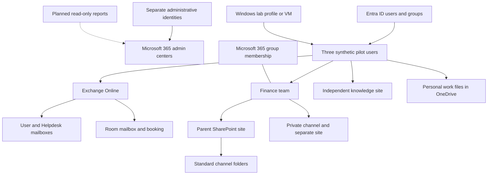

# Planned lab architecture

Status: design only. Three pilot identities, roles and objects remain to be verified or created.

This is a conceptual relationship diagram, not a network/protocol trace. The private-channel site has its own channel membership boundary; membership in the parent team alone does not establish access. See [Microsoft's Teams and SharePoint description](https://learn.microsoft.com/en-us/sharepoint/teams-connected-sites).

The core uses the default onmicrosoft.com domain. An owned custom domain is optional. There is no required Azure VM, on-premises Exchange server or hybrid identity integration in this project.

[Access matrix](access-matrix.md) · [Roadmap](roadmap.md)
