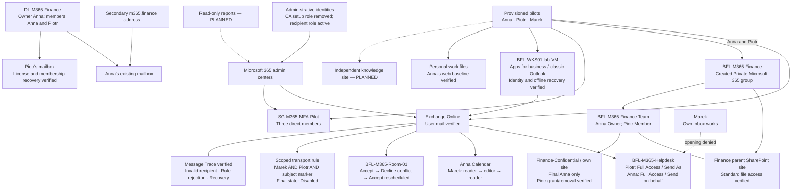

# Lab architecture — implemented baseline and target extensions

**Stages 01–07 COMPLETE.** Three pilots, the MFA scope, the Private Finance Microsoft 365 group, a distribution list, Anna's Finance alias, Helpdesk and the room mailbox are implemented. Delegated mail, calendar permission restoration, room conflict/recovery and NDR/Trace-based mail-flow rejection/control/recovery are verified. The scoped exercise rule remains Disabled. BFL-WKS01 now has active Microsoft 365 Apps and classic Outlook, with identity and offline-mode recovery plus desktop delegation verified. Finance now has standard/private channels, separate parent/channel sites and verified temporary private membership plus a cross-device meeting. The diagram combines observed components and explicitly planned extensions; it is not a protocol trace.

## Resource distinctions

- The Finance alias is another address on Anna's mailbox, not another mailbox.
- The DL distributes mail to its members. Marek's permitted sender role does not make him a member.
- Stage 07 adds Teams to the existing Private Finance Microsoft 365 group in the owner-confirmed workflow, retaining Anna as Owner and Piotr as Member.
- The older Public Baltic Finance Lab team/site was used for Day 01 baseline tests. It is not the new Finance resource.
- Helpdesk opening and sending are separately delegated; its direct account sign-in is blocked.
- Anna's personal Calendar sharing is distinct from Helpdesk Full Access and sender permissions.
- Room booking uses meeting requests and the resource's actual replies. Conflict recovery changed Marek's requested time, not the room's conflict policy.
- The transport rule rejects a known working recipient only when all three conditions match; disabling it restores a new marked message. Message Trace is service-side evidence, not an Inbox opening/read receipt.
- Office active-user identity is distinct from the product licensing account and Outlook mailbox/profile. Work Offline is a client synchronization setting; web mail and a new desktop control supported the diagnosis and recovery.
- Finance-Operations uses /sites/bfl-m365-finance; Finance-Confidential uses /sites/BFL-M365-Finance-Finance-Confidential. Piotr's parent-team membership does not by itself grant private access; temporary channel membership and its removal were tested.
- A phone received Anna's presentation; two-way audio, dynamic view changes and meeting closure are owner-confirmed. A still image is not an audio-quality measurement.

## Current limits

The first internal alias test shows a primary recipient in private headers; the external pair establishes actual alias addressing and delivery. The membership fault is repaired and the DL is left restored. The recipient-admin assignment is Active/Permanent, not automatically expiring. Stage 05 Trace access as adm-lab is owner-confirmed; rule work used bg01. Attempted Transport Rules delegation remains unresolved, with no successful custom-group grant or complete RBAC audit claimed.

Independent knowledge-site roles/sharing, OneDrive synchronization/recovery, scripts and validated Copilot use remain planned. The Finance private-channel boundary is verified; it is separate from Stage 08's knowledge-site role and inheritance tests. Stage 06 local Word persistence is not OneDrive synchronization; new Outlook and device registration/enrollment were not validated. The reused Windows VM does not establish an Exchange hybrid deployment. Selected calendar/session restoration checks and the room account block are owner-reported; no exact delegation propagation time is claimed. Rule-change times likewise were not recorded; message timestamps are not converted into a propagation measurement. RULE-02 opening is owner-reported and RULE-03 recovery is established by Trace. The core uses the default lab domain; an owned custom domain is optional.

[Access matrix](access-matrix.md) · [Baseline](01-environment-baseline.md) · [Roadmap](roadmap.md) · [Evidence](../evidence/README.md)
