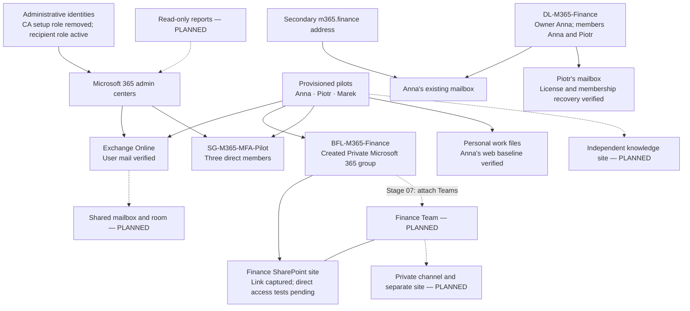

# Lab architecture — implemented baseline and target extensions

**Stages 01–03 COMPLETE.** Three pilots, the MFA scope, the Private Finance Microsoft 365 group, a distribution list and Anna's Finance alias are implemented. The diagram combines observed components and explicitly planned extensions; it is not a protocol trace.

## Resource distinctions

- The Finance alias is another address on Anna's mailbox, not another mailbox.
- The DL distributes mail to its members. Marek's permitted sender role does not make him a member.
- The new Private Finance Microsoft 365 group already has a site link. Stage 07 adds Teams to it, preserving ownership and membership.
- The older Public Baltic Finance Lab team/site was used for Day 01 baseline tests. It is not the new Finance resource.
- A later private channel has its own site/membership boundary; that boundary is not yet tested.

## Current limits

The first internal alias test shows a primary recipient in private headers; the external pair establishes actual alias addressing and delivery. The membership fault is repaired and the DL is left restored. The recipient-admin assignment is Active/Permanent, not automatically expiring.

Desktop clients, delegation, room booking, private-site access boundaries, synchronization/recovery, scripts and validated Copilot use remain planned. The core uses the default lab domain; an owned custom domain is optional.

[Access matrix](access-matrix.md) · [Baseline](01-environment-baseline.md) · [Roadmap](roadmap.md) · [Evidence](../evidence/README.md)
