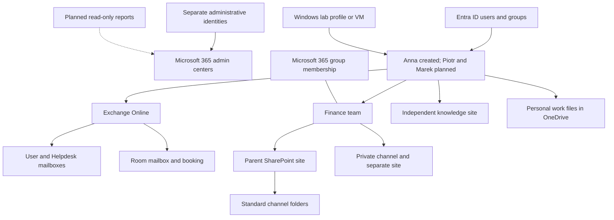

# Planned lab architecture

Status: target design with Stage 01 partially implemented. Anna's license/mail access and the one-member SG-M365-MFA-Pilot group are captured; other collaboration objects and the remaining two pilots are still planned. The diagram is conceptual and does not establish deployment of every node.

This is a conceptual relationship diagram, not a network/protocol trace. The private-channel site has its own channel membership boundary; membership in the parent team alone does not establish access. See [Microsoft's Teams and SharePoint description](https://learn.microsoft.com/en-us/sharepoint/teams-connected-sites).

The core uses the default onmicrosoft.com domain. An owned custom domain is optional. There is no required Azure VM, on-premises Exchange server or hybrid identity integration in this project.

[Access matrix](access-matrix.md) · [Roadmap](roadmap.md)

[Stage 01 implementation](stages/01-tenant-and-roles.md) · [Published evidence](../evidence/day-01/README.md) · [One-seat Copilot extension](copilot-pilot-plan.md)
