# Day 01 evidence

Status: **31 screenshots published; Stage 01 COMPLETE.** Execution date: **14 November 2026**. Captures were uploaded by the owner and are indexed below. Functional results also use the owner's explicit test report; screenshot contents and reported actions are distinguished.

## Published captures

### 01 — Pilot license assignment

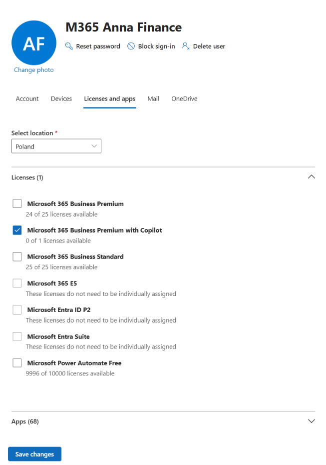

**Shows:** Business Premium with Copilot selected for Anna; Poland usage location. Apps is collapsed, so individual service-plan enablement remains owner-reported.

### 02 — Pilot mail sent

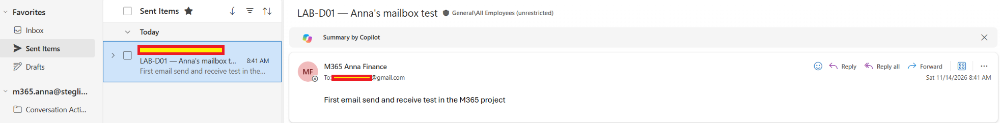

**Shows:** Synthetic message to external Gmail in Anna's Sent Items; displayed time 08:41 on 14 November 2026. The client timezone is not captured.

### 03 — Pilot mail received

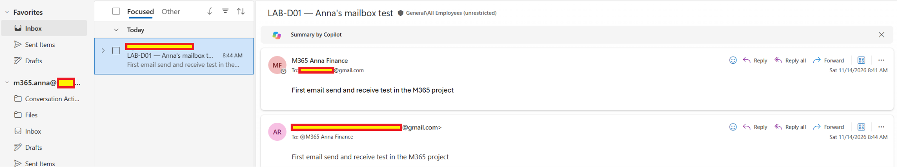

**Shows:** Matching Gmail reply in Anna's Inbox at displayed time 08:44; the owner also confirms the mail round trip.

### 04 — Pilot admin center denied

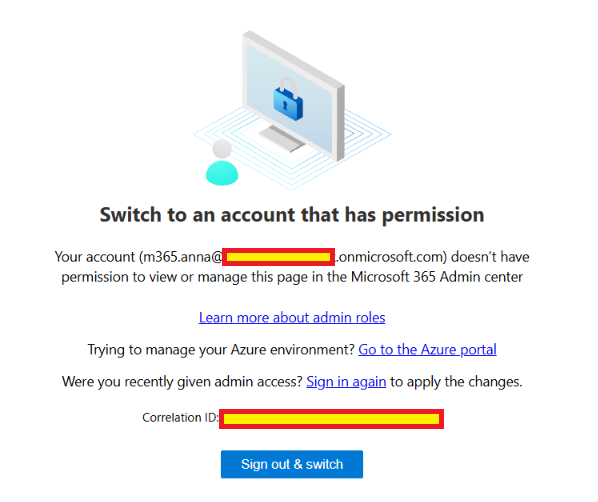

**Shows:** Microsoft 365 Admin Center explicitly denies the ordinary Anna account access before the MFA change.

### 05 — Signin before basic info

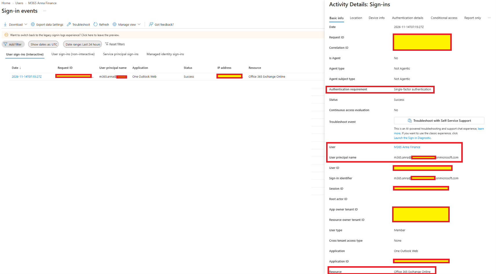

**Shows:** 2026-11-14T07:15:27Z: interactive One Outlook Web / Office 365 Exchange Online; Success; Single-factor authentication.

### 06 — Signin before authentication details

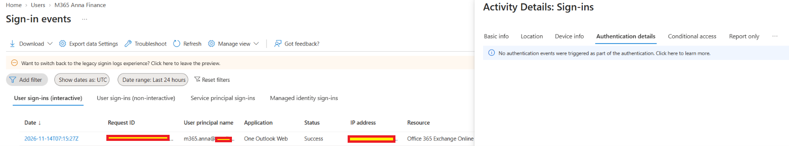

**Shows:** Same baseline event: no authentication events recorded. This does not reconstruct the original password-change interaction.

### 07 — Signin before conditional access

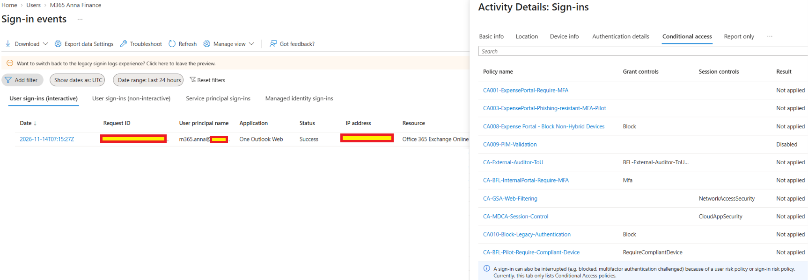

**Shows:** Same baseline event: visible Conditional Access policies Not applied or Disabled. The separate Report only tab was not captured for this baseline.

### 08 — MFA pilot group members

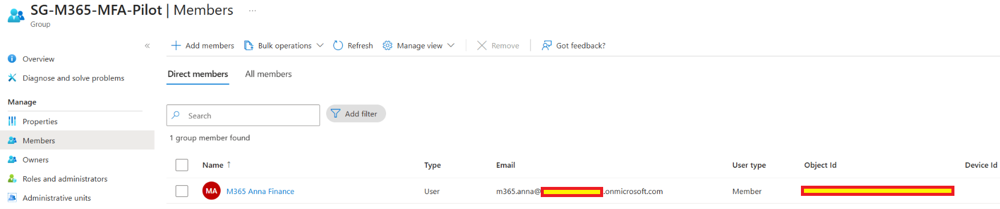

**Shows:** SG-M365-MFA-Pilot contains Anna as its sole direct member at capture time.

### 09 — Authenticator method scope

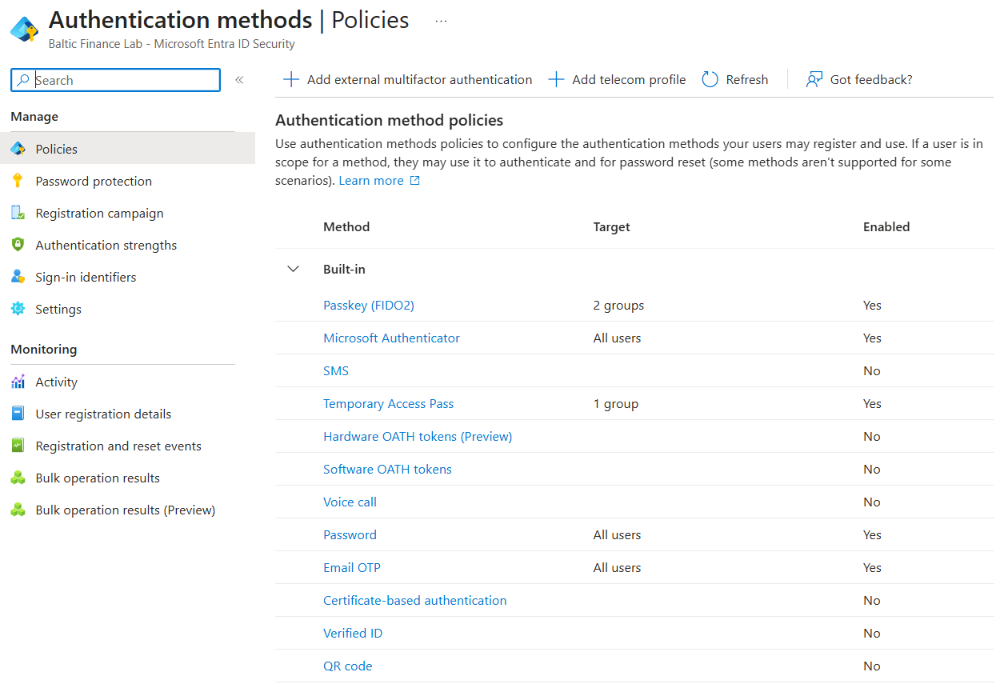

**Shows:** Authentication methods overview: Microsoft Authenticator enabled for All users.

### 09a — Authenticator mode and exclusions

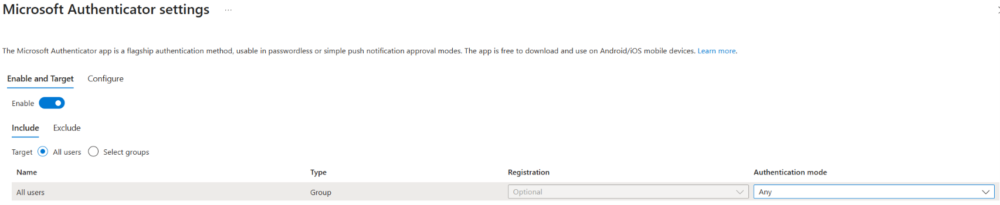

**Shows:** Authenticator detail: Enabled, All users, Authentication mode Any; Registration Optional. Despite the filename, exclusions are shown separately in 09c.

### 09b — CA operator role assignment

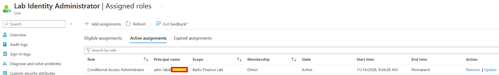

**Shows:** adm-lab has Conditional Access Administrator: Direct, Active, tenant scope, Permanent. It is later removed manually; it was not an automatically expiring assignment.

### 09c — Authenticator exclusions

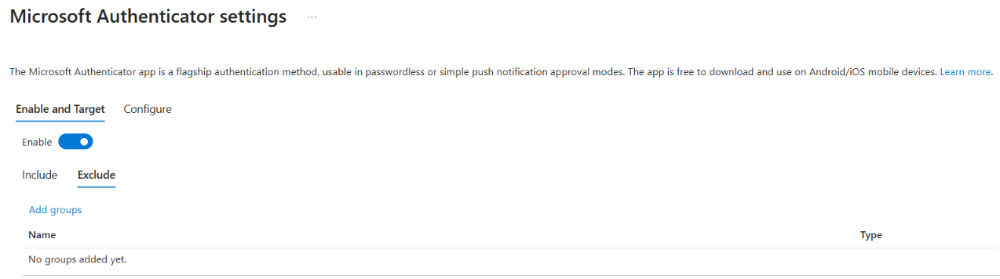

**Shows:** Authenticator's Exclude tab contains no groups.

### 10 — MFA policy report only

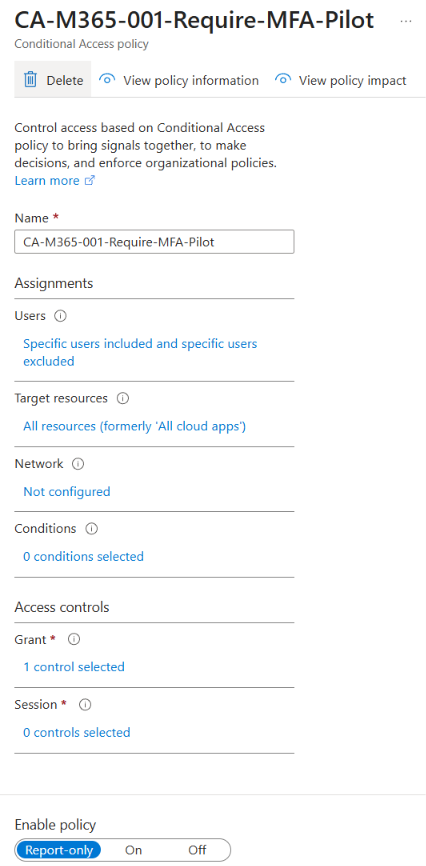

**Shows:** CA-M365-001-Require-MFA-Pilot saved in Report-only state.

### 10a — MFA policy pilot scope

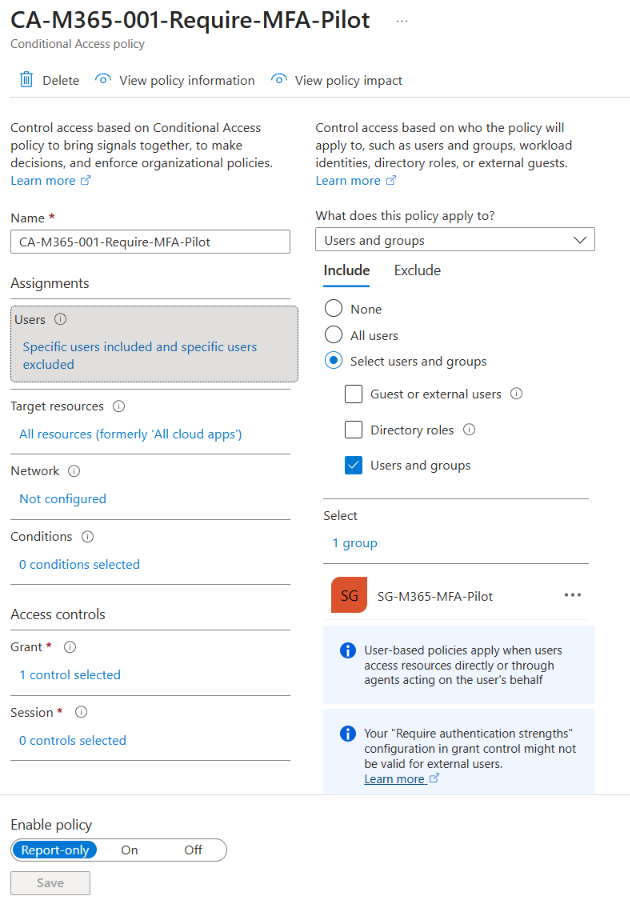

**Shows:** Policy includes SG-M365-MFA-Pilot; All resources; no additional conditions. Emergency exclusions are captured in 10c.

### 10b — MFA policy authentication strength

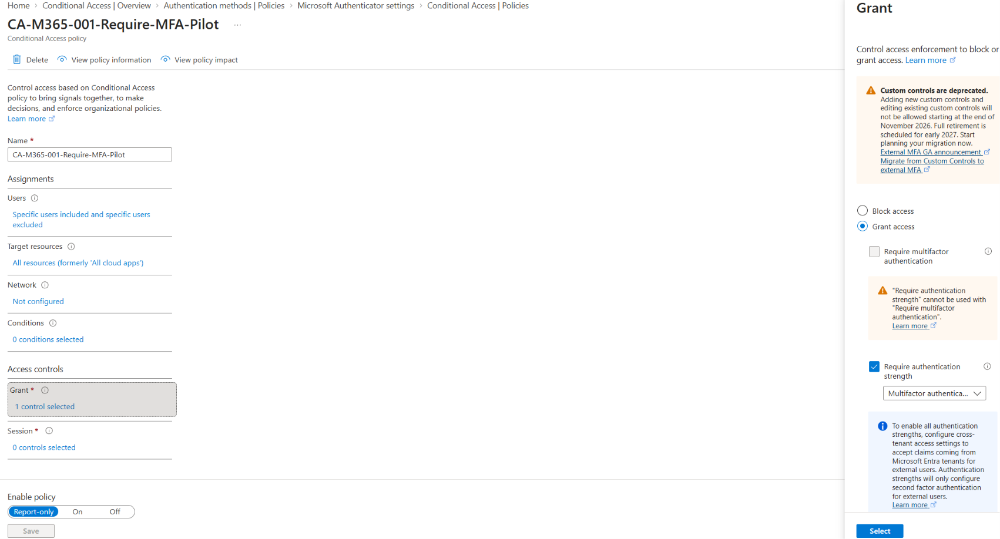

**Shows:** Grant access requires the built-in Multifactor authentication strength. The separate Require multifactor authentication checkbox is not selected.

### 10c — MFA policy exclusions

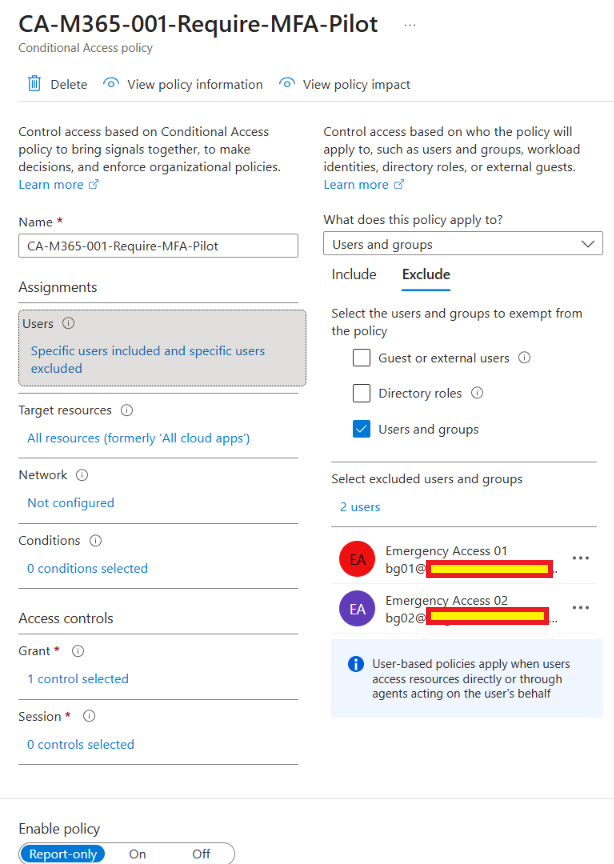

**Shows:** Emergency Access 01 and Emergency Access 02 are explicitly excluded from this pilot policy.

### 11 — Report only signin evaluation

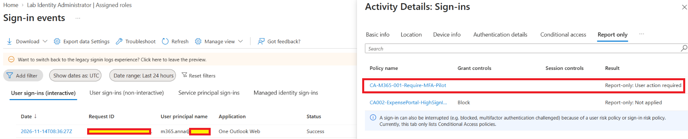

**Shows:** 2026-11-14T08:36:27Z: Anna's Outlook sign-in succeeds; the pilot evaluates as Report-only: User action required. Report-only did not enforce a challenge.

### 12 — MFA policy enabled

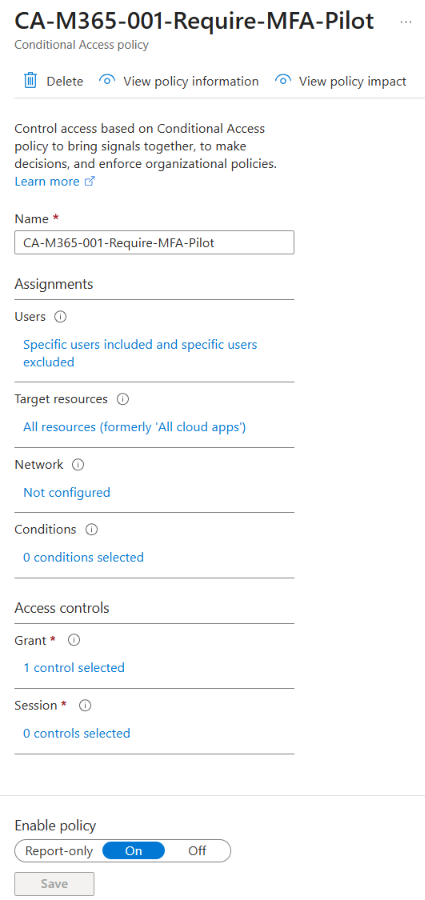

**Shows:** The same pilot policy saved in On state.

### 13 — Pilot registered method

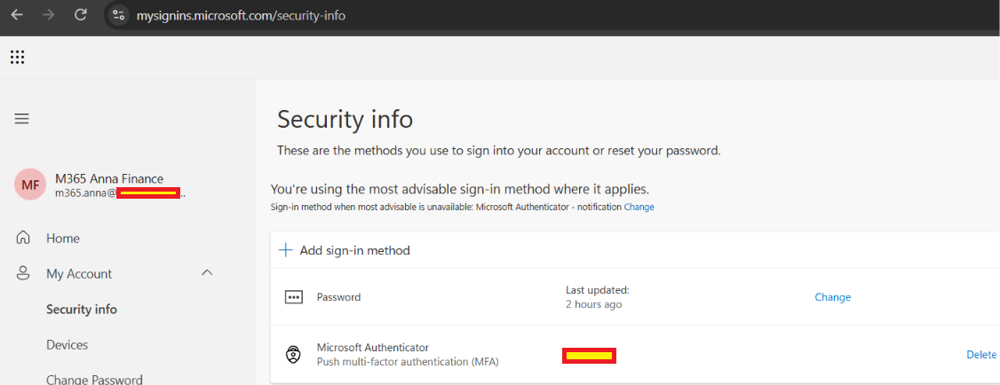

**Shows:** Anna's Security info lists a completed Microsoft Authenticator push MFA method. Enrollment secrets and the QR code are not included.

### 14 — Signin after authentication details

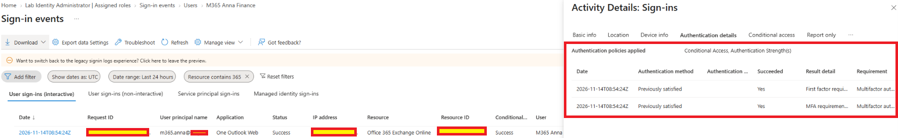

**Shows:** 2026-11-14T08:54:24Z: Conditional Access and Authentication Strength(s) applied; authentication steps Previously satisfied. This is claim reuse, not a fresh Authenticator approval.

### 14a — Signin after basic info

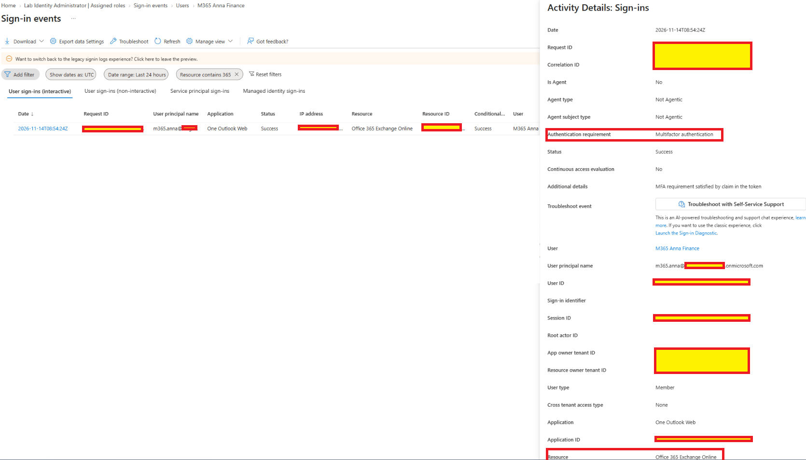

**Shows:** Same 08:54:24Z event: Success; Multifactor authentication requirement; MFA requirement satisfied by claim in the token.

### 14b — Signin MFA claim reuse

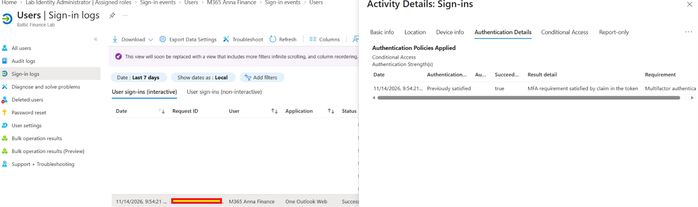

**Shows:** 09:54:21 local / 08:54:21Z: Previously satisfied; MFA requirement satisfied by claim in the token. Supplementary reuse evidence, not a fresh MFA-method capture.

### 15 — Signin after conditional access

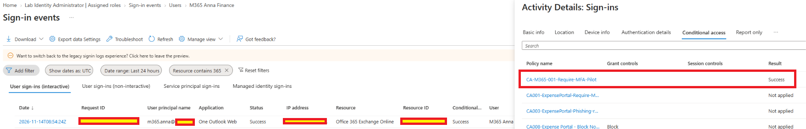

**Shows:** Same 08:54:24Z event as 14/14a: CA-M365-001-Require-MFA-Pilot returns Success.

### 16 — Pilot admin denied after MFA

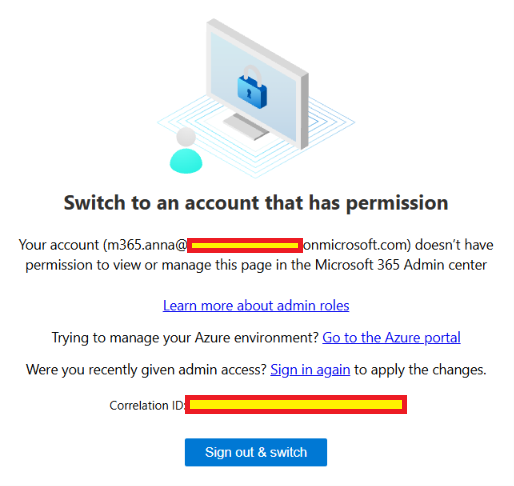

**Shows:** Anna is still explicitly denied Microsoft 365 Admin Center access after MFA verification.

### 17 — Service health baseline

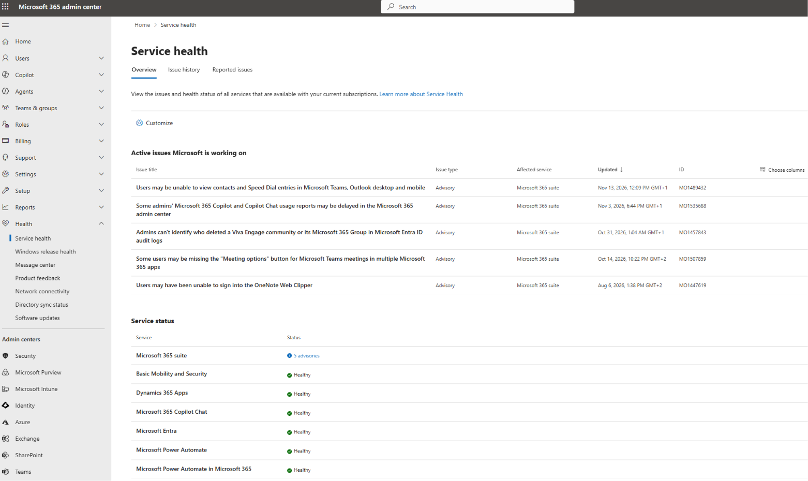

**Shows:** Microsoft 365 suite has five advisories; visible individual services have the shown statuses. Separate Exchange, SharePoint and Teams rows are absent from the owner's available view.

### 18 — OneDrive Word web test

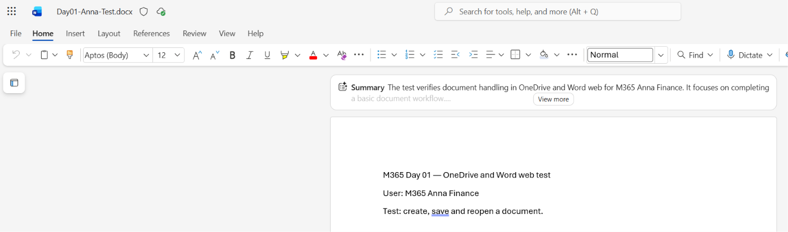

**Shows:** Day01-Anna-Test.docx open in Word web with the synthetic test text and saved-state indicator. The owner confirms closing and reopening from OneDrive preserved the contents.

### 19 — Teams web self chat test

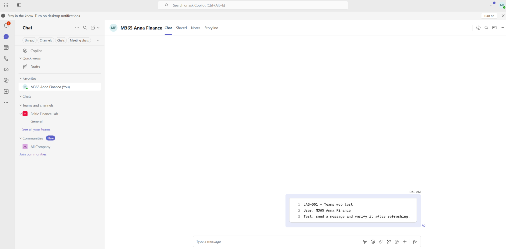

**Shows:** Anna's self-chat and sent synthetic message; the owner confirms the message remained after refreshing.

### 20 — SharePoint library file test

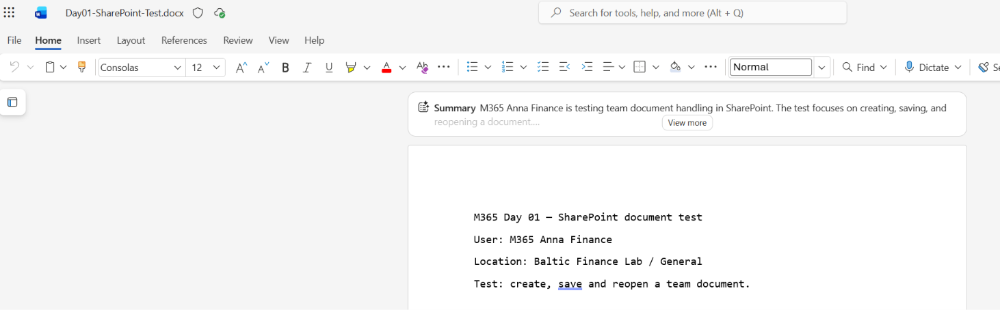

**Shows:** Day01-SharePoint-Test.docx open in Word web with synthetic text. The document's typed Location line alone is not proof of its storage location; see 20a.

### 20a — SharePoint library location

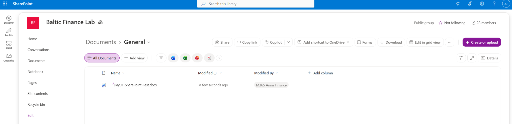

**Shows:** Baltic Finance Lab > Documents > General contains Day01-SharePoint-Test.docx; Modified By is M365 Anna Finance. The owner confirms contents persisted after reopening.

### 21 — CA operator role removed

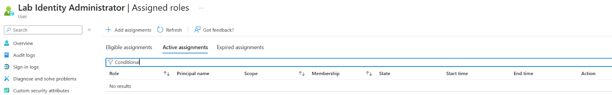

**Shows:** adm-lab's Active assignments filtered by Conditional show No results after removal of the added CA role.

### 22 — Admin access after role removal

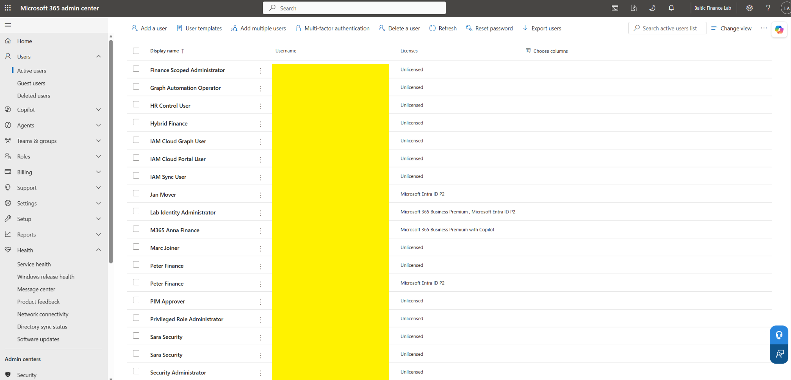

**Shows:** Microsoft 365 Admin Center Active users remains accessible. The owner identifies the operator as adm-lab; the profile menu is not expanded in the capture. Uploaded UPNs are masked.

## Event sequence and interpretation

| Step | Event time (UTC) | Observation |
| --- | --- | --- |
| Baseline | 07:15:27Z | Exchange sign-in succeeds with a single-factor requirement; empty method details; visible CA policies Not applied/Disabled (05–07). |
| Report-only | 08:36:27Z | Pilot policy evaluates to User action required without enforcing its control (11). |
| Enforced policy | 08:54:24Z | MFA requirement, existing MFA claim and pilot policy Success in the same event (14, 14a, 15). |
| Supplementary record | 08:54:21Z | A separate record also reuses an MFA claim (14b; shown as 09:54:21 local). |

The mail captures show 08:41 and 08:44 without a captured client timezone. Do not equate them with the UTC sign-in timestamps. The mail counterpart is external Gmail, not a second M365 pilot.

Together, registration, an MFA-required successful sign-in and the matching policy Success support the restricted pilot's MFA enforcement. **No captured sign-in proves a fresh Authenticator push approval in that event.** Existing MFA claims can satisfy the requirement. The original misleading fresh-method filename has been replaced by `14b-signin-mfa-claim-reuse.png`.

## Owner-reported closure checks

The owner explicitly confirmed that the OneDrive and SharePoint documents retained their contents after closing/reopening, and that the Teams message remained after refreshing. After CA role removal, adm-lab could access Active users. Separate new sign-ins with bg01 and bg02 succeeded, and both had active Global Administrator assignments; these recovery checks are **reported results without screenshots**, and no recovery material is published.

Client context reported by the owner: Windows 11; Anna uses Chrome **157.0.8103.52** (64-bit); administrators use Edge **157.0.4341.46** (64-bit).

## Later scope changes

Day 01 captures preserve their original state: the pilot group had Anna as its sole member. [Day 02](../day-02/README.md) extends that group to Piotr and Marek; [Day 03](../day-03/README.md) adds alias and distribution-recovery evidence. Current cumulative results are in the [test guide](../../tests/README.md).

## Scope and remaining limits

- Service health records five suite advisories, not an all-services-healthy conclusion or proof that Anna reproduced an incident.
- The existing Baltic Finance Lab team/site was reused. Capture 20a labels it Public group with 28 members. No new Finance team, membership hardening or excluded-user SharePoint boundary is claimed.
- Capture 21 verifies removal of the additional active CA role. It does not establish that adm-lab has no other administrative roles or access paths.
- Desktop Office activation, OneDrive synchronization/recovery, private-channel isolation, deliberate Copilot exercises and output validation remain future work.
- Day 01 is complete. Future capture names will be announced during the relevant stage; there are no outstanding Day 01 screenshot requirements.

[Stage 01 notes](../../docs/stages/01-tenant-and-roles.md) · [Day 01 results](../../tests/day-01.md) · [Global test matrix](../../tests/test-matrix.csv) · [Evidence rules](../README.md)
