# Day 02 evidence

Status: **21 screenshots published; Stage 02 COMPLETE.** Execution date: **14 November 2026**. These images were uploaded by the owner. Captured configuration and functional results are distinguished from reported checks.

## 01 — Pilot users baseline

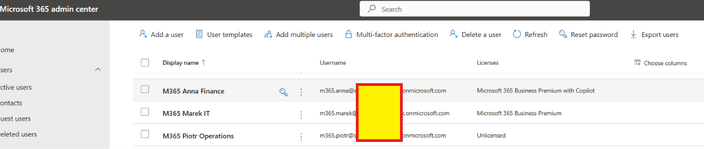

**Shows:** Anna has the Copilot bundle; Marek has ordinary Premium; Piotr starts Unlicensed.

## 02 — Piotr unlicensed baseline

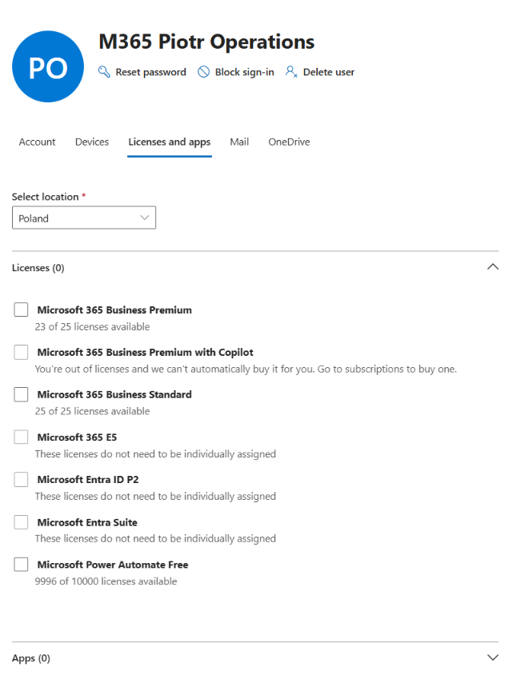

**Shows:** Piotr: Poland usage location, zero assigned licenses and zero apps.

## 03 — Piotr signin success

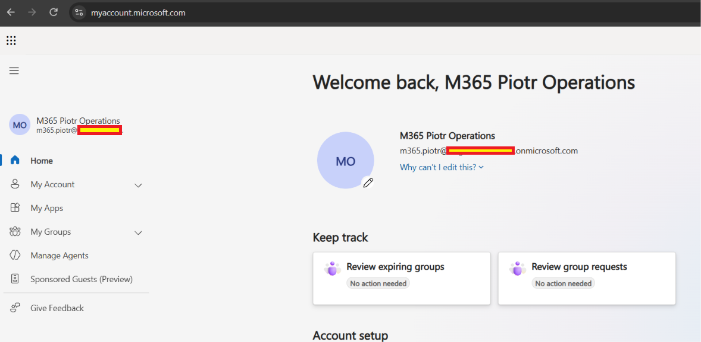

**Shows:** Piotr successfully opens My Account before receiving a product license.

## 04 — Piotr Outlook before license

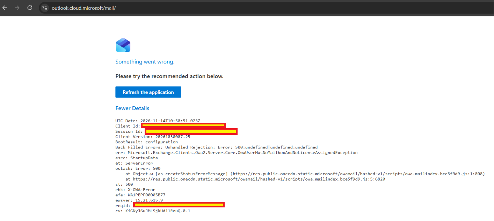

**Shows:** 2026-11-14T10:50:51.023Z: Outlook HTTP 500; OwaUserHasNoMailboxAndNoLicenseAssignedException.

## 05 — Piotr license assigned

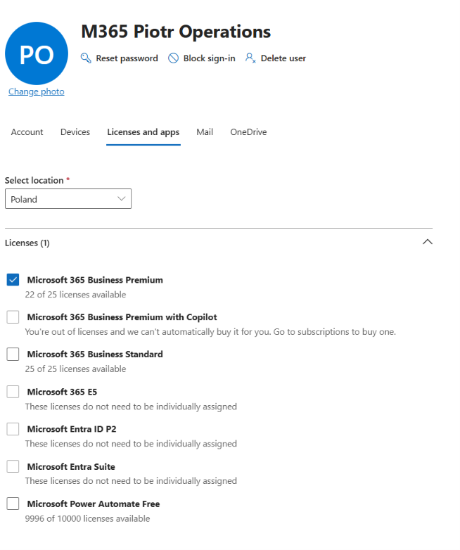

**Shows:** Piotr has ordinary Business Premium selected; Poland; 22 of 25 Premium seats available at capture.

## 05a — Piotr exchange plan enabled

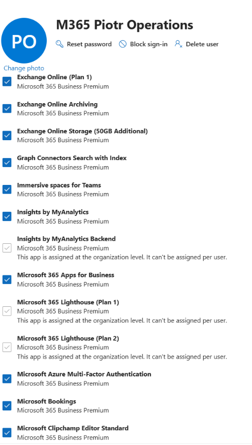

**Shows:** Exchange Online Plan 1 is enabled within Piotr's Premium assignment.

## 06 — Piotr Outlook after license

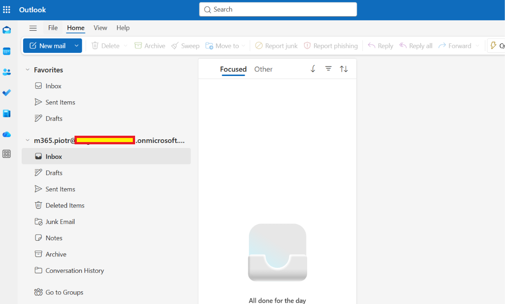

**Shows:** Piotr's Outlook mailbox opens after licensing; provisioning elapsed time was not measured.

## 07 — Piotr mail sent after license

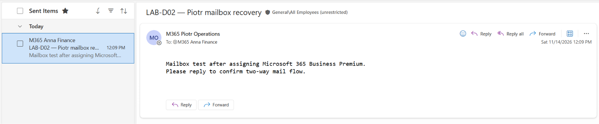

**Shows:** Piotr sends LAB-D02 — Piotr mailbox recovery to Anna at displayed 12:09.

## 08 — Piotr mail received after license

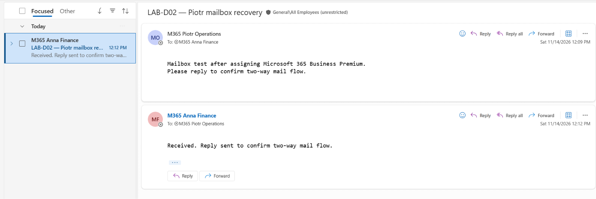

**Shows:** Anna's matching reply arrives in Piotr's Inbox at displayed 12:12.

## 09 — MFA pilot three members

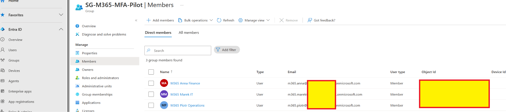

**Shows:** SG-M365-MFA-Pilot now contains Anna, Marek and Piotr as direct members.

## 10 — Piotr MFA policy success

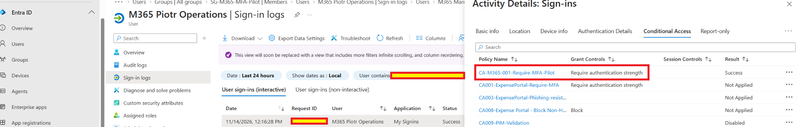

**Shows:** Piotr, My Signins, displayed 12:16:28: CA-M365-001-Require-MFA-Pilot returns Success.

## 11 — Marek MFA policy success

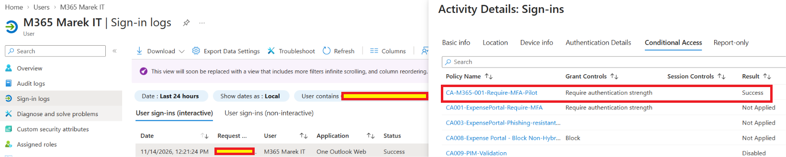

**Shows:** Marek, One Outlook Web, displayed 12:21:24: the same pilot policy returns Success.

## 12 — Finance M365 group settings

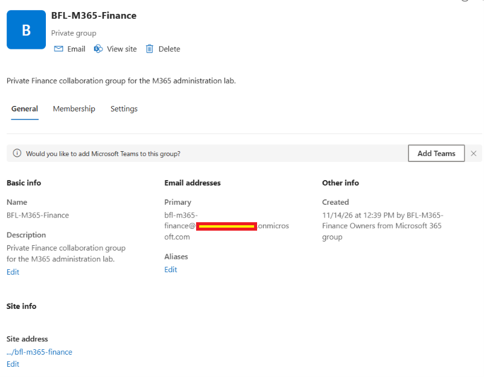

**Shows:** BFL-M365-Finance is Private; its site link is present and the UI offers Add Teams.

## 13 — Finance M365 group members

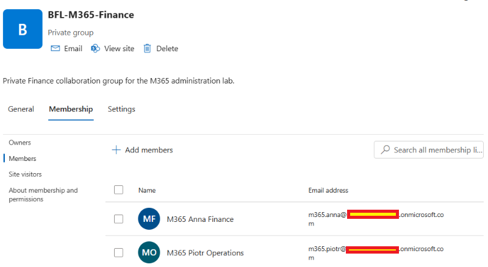

**Shows:** Microsoft 365 group members are Anna and Piotr; Marek is not listed.

## 14 — Finance M365 group owner

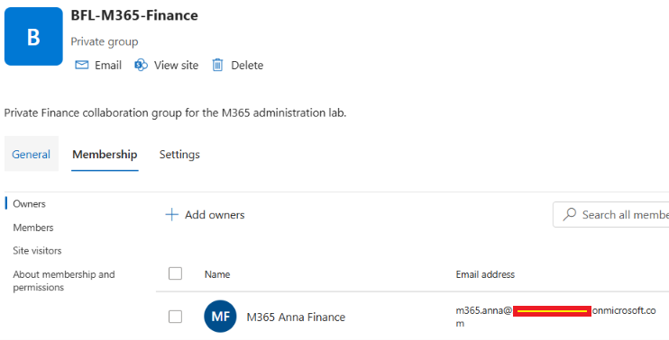

**Shows:** Anna is the Microsoft 365 group's owner.

## 15 — Exchange recipient admin role

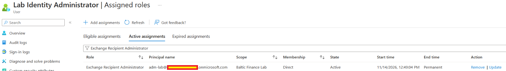

**Shows:** adm-lab: Exchange Recipient Administrator; Direct, Active, tenant scope, Permanent; displayed start 12:49:04.

## 16 — Finance distribution list overview

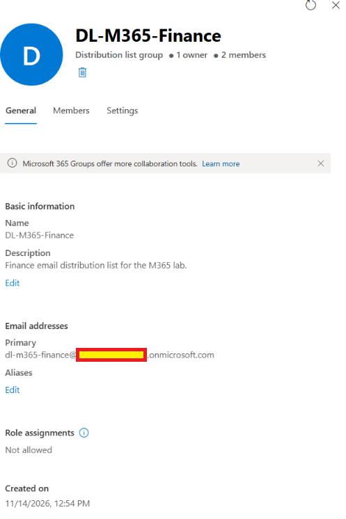

**Shows:** DL-M365-Finance is a Distribution list group with one owner, two members and its own email address.

## 17 — Finance distribution list members owner

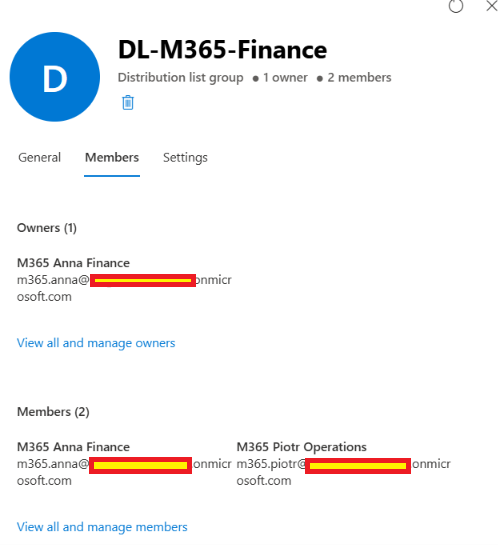

**Shows:** DL owner Anna; members Anna and Piotr.

## 18 — DL mail sent by Marek

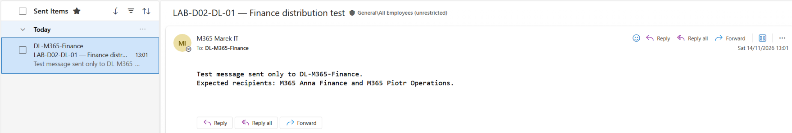

**Shows:** Marek sends LAB-D02-DL-01 only to the DL at displayed 13:01.

## 19 — DL mail received Anna

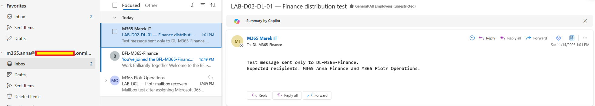

**Shows:** The matching DL message is present in Anna's Inbox.

## 20 — DL mail received Piotr

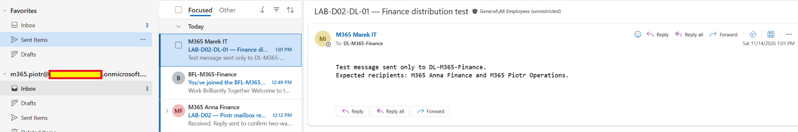

**Shows:** The matching DL message is present in Piotr's Inbox.

## Reported checks and limits

- The owner confirmed Department/Job title: Piotr = Operations / Operations Specialist; Marek = IT / IT Support Trainee. The owner explicitly waived images 04a/04b; these are reported attributes, not missing evidence.
- Authenticator registration for both users is owner-reported. Captures 10/11 show policy evaluation, not Basic info's Authentication requirement or a fresh approval method. Piotr's event is My Signins, not Outlook.
- Delivery management is owner-reported: internal senders only, Specified senders empty, moderation off. Closed join/leave was requested but not explicitly confirmed.
- Marek is not a DL member. The owner reports no copy in his Inbox/Junk after ten minutes. No transport trace or indefinite non-delivery claim is made.
- The CA group capture was originally viewed as bg01. It does not prove that adm-lab performed every operation. Capture 15 identifies the recipient-role assignment on adm-lab, not a full audit of all actions.
- Mail and role timestamps are displayed client times without a captured timezone; the Outlook error explicitly provides UTC. Do not infer provisioning elapsed time from the mail timestamps.

## Final state and carry-forward

All three pilots are provisioned. Anna retains the one-seat Copilot bundle; Piotr and Marek use ordinary Premium. The MFA group has three members. The Private Finance Microsoft 365 group has Anna as owner and Anna/Piotr as members; a site link is present, but Teams has not been added. The DL has the same owner/member set.

Exchange Recipient Administrator remains Direct/Active/Permanent on adm-lab for subsequent recipient work. The unrelated CA configuration role removed in Day 01 remains a separate historical action.

T04 passes for Piotr's license recovery. T06 was first exercised here and is extended with removal/recovery in [Day 03](../day-03/README.md), not counted twice.

[Implementation](../../docs/stages/02-users-licenses-and-groups.md) · [Results](../../tests/day-02.md) · [Licensing case](../../tickets/M365-001-pilot-license-recovery.md) · [All evidence](../README.md)
