# Day 03 evidence

Status: **11 screenshots published; Stage 03 COMPLETE.** Execution date: **14 November 2026**. External alias addressing is verified by the matched sent/received pair; internal recipient display alone is not used as proof of the alias target.

## 01 — Anna Finance alias config

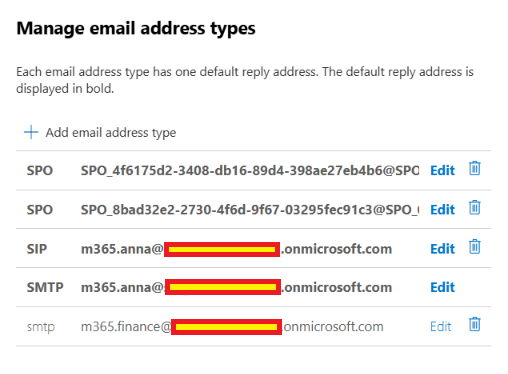

**Shows:** Primary/default m365.anna and secondary SMTP address m365.finance are configured on the same mailbox.

## 02 — Mail sent to Finance alias

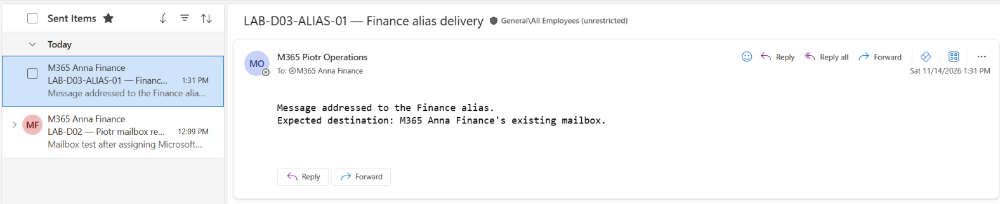

**Shows:** Piotr's internal ALIAS-01 attempt at displayed 13:31; the visible recipient is Anna's display name.

## 03 — Finance alias mail received Anna

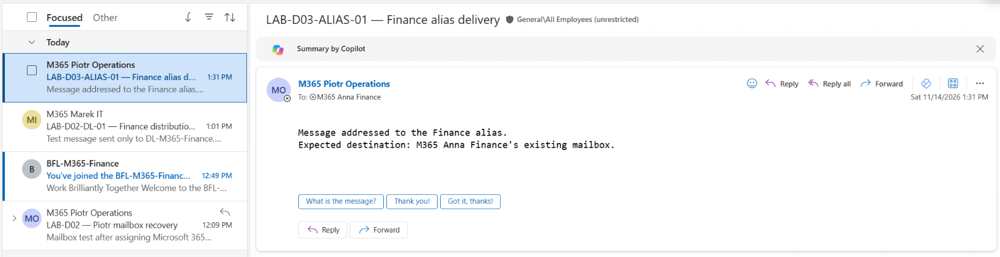

**Shows:** Anna receives ALIAS-01. Privately inspected headers name her primary address; this attempt alone is not alias-target proof.

## 03a — Finance alias external sent

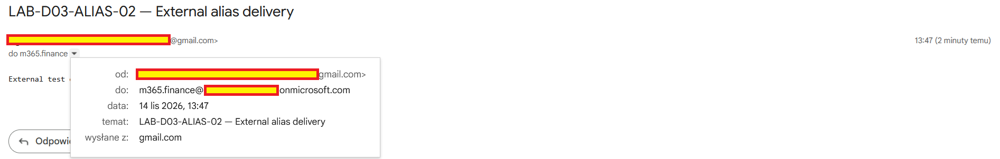

**Shows:** Gmail sent-message details explicitly show recipient m365.finance for LAB-D03-ALIAS-02 at displayed 13:47.

## 03b — Finance alias external received

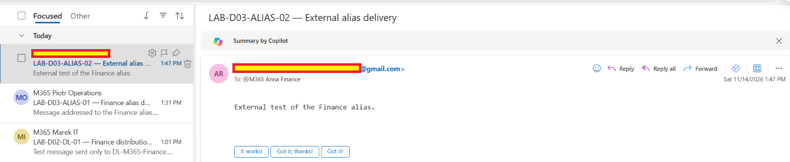

**Shows:** Anna receives the matching external ALIAS-02 message at displayed 13:47. Paired with 03a, this verifies alias delivery.

## 04 — DL membership Piotr missing

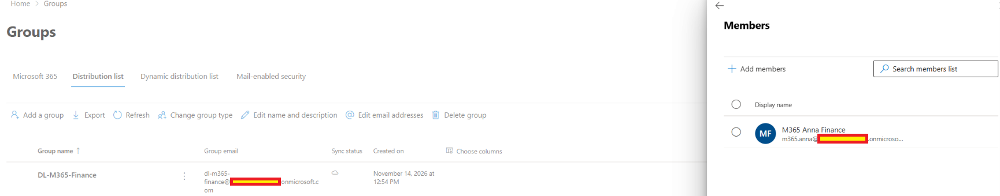

**Shows:** During the controlled fault, DL-M365-Finance has Anna as its sole member.

## 05 — Piotr direct mail control

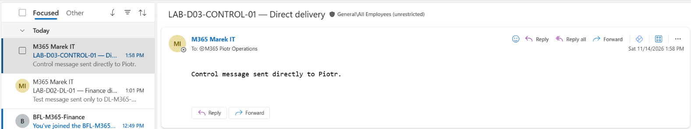

**Shows:** Piotr receives LAB-D03-CONTROL-01 directly from Marek at displayed 13:58; his mailbox still receives mail.

## 06 — Anna DL mail Piotr excluded

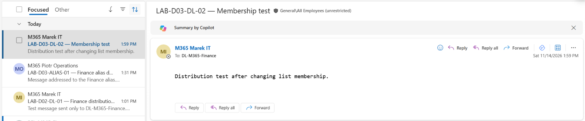

**Shows:** Anna receives LAB-D03-DL-02 from the DL at displayed 13:59. Piotr's non-receipt is separately owner-reported.

## 07 — DL membership Piotr restored

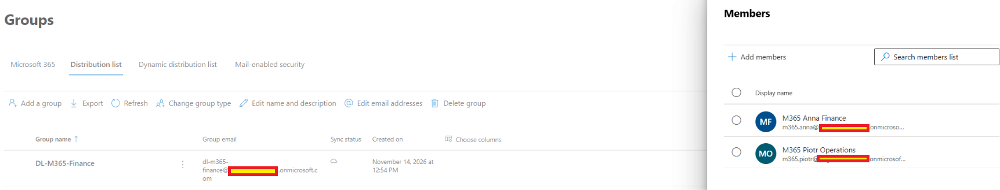

**Shows:** After repair, the DL again lists Anna and Piotr.

## 08 — DL mail after repair Anna

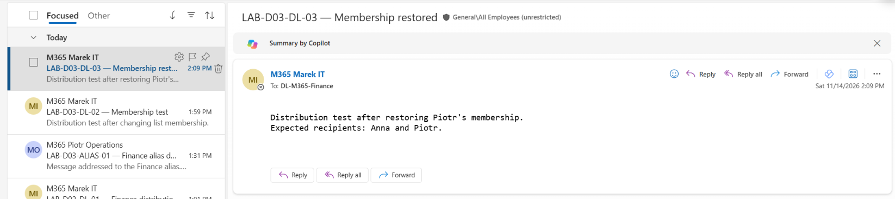

**Shows:** Anna receives the new LAB-D03-DL-03 test at displayed 14:09.

## 09 — DL mail after repair Piotr

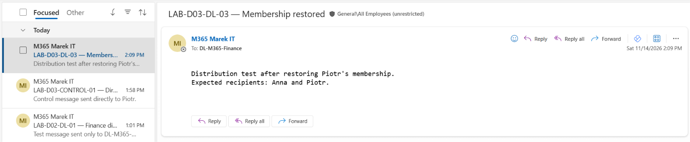

**Shows:** Piotr receives the same new DL-03 test at displayed 14:09, confirming restored distribution.

## Alias test interpretation

The private ALIAS-01 headers show To: m365.anna and Date: 14 November 2026, 12:31:39 UTC. They do not contain m365.finance. Recipient resolution is a possible explanation; the exact rewriting mechanism was not established. Raw headers are not published.

The external ALIAS-02 sent view explicitly names m365.finance. Its subject/content and the corresponding receipt in Anna's mailbox support T05 PASS. The primary address remains m365.anna; no organization-wide sending-from-alias change was performed.

## Controlled membership fault and recovery

Before repair, Piotr still receives direct mail (05), Anna receives the DL message (06), and the owner confirms Piotr did not receive DL-02 during a **ten-minute** observation. The screenshot of Piotr's direct control precedes DL-02 and is not itself a non-receipt screenshot.

After restoring membership (07), a new subject avoids confusing old and new delivery. Both users receive DL-03 (08/09), also confirmed by the owner. The DL is restored to Anna/Piotr members with Anna as owner. T06 remains one global check, extended by this controlled recovery.

All displayed mail times except the privately inspected UTC header are client times with no captured timezone. No exact membership-propagation interval is claimed.

## Publication review

The owner-supplied images mask the SPO identifiers in 01, destination tenant domain in 03a and external sender's display name in 03b. Alias local parts, test subjects and delivery results remain readable. Keep raw headers and private details outside the repository.

[Implementation](../../docs/stages/03-exchange-recipients-and-mail.md) · [Results](../../tests/day-03.md) · [Alias case](../../tickets/M365-002-finance-alias-delivery.md) · [Membership case](../../tickets/M365-003-distribution-membership-recovery.md) · [All evidence](../README.md)
