# Day 04 evidence

Status: **27 screenshots published; Stage 04 COMPLETE.** Execution date: **14 November 2026**. Calendar/room events are dated 16 November. Configuration, captured behavior and owner-reported checks are distinguished below.

## Shared mailbox and delegation

### 01 — Helpdesk shared mailbox created

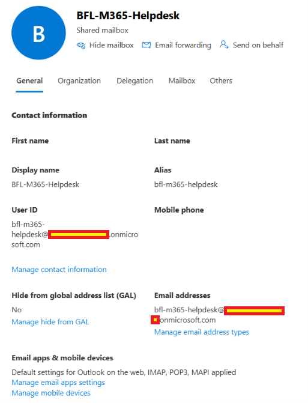

**Shows:** Helpdesk created as a Shared mailbox; synthetic name and alias visible.

### 02 — Helpdesk signin blocked

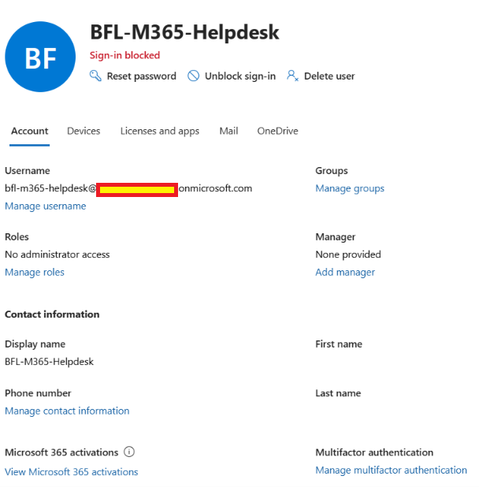

**Shows:** Associated Helpdesk account shows Sign-in blocked and no administrator access.

### 03 — Helpdesk full access only

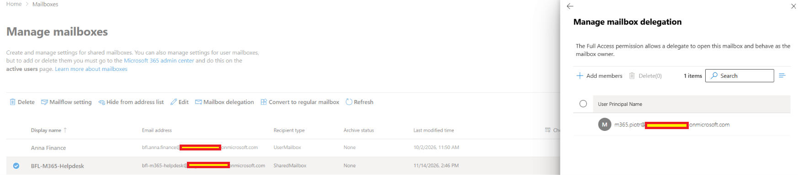

**Shows:** Full Access list contains Piotr; this is opening/read configuration, not a sender grant.

### 04 — Piotr opens Helpdesk

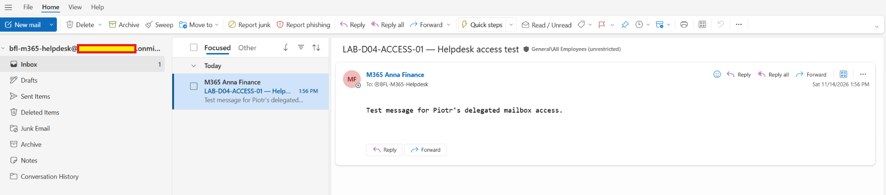

**Shows:** Helpdesk Inbox and Anna's ACCESS-01 opened in the guided Piotr session; signed-in identity is supplied by exercise context.

### 04a — Helpdesk delegation before send as

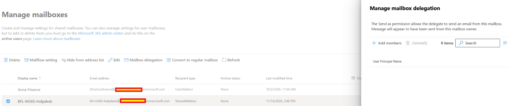

**Shows:** Send As list has zero items before the sending test.

### 05 — Helpdesk send as denied

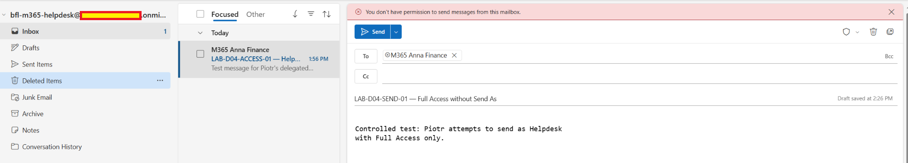

**Shows:** SEND-01 receives the explicit permission error in Helpdesk context. From field is not displayed.

### 06 — Helpdesk send as granted

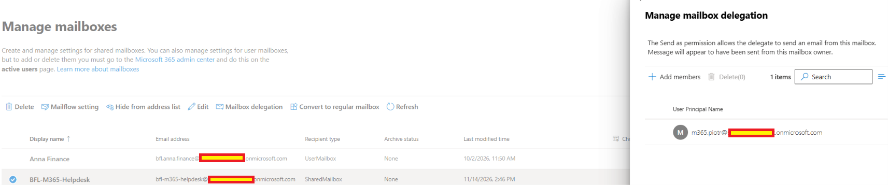

**Shows:** Saved Send As list contains m365.piotr; separate from Full Access.

### 07 — Helpdesk send as received Anna

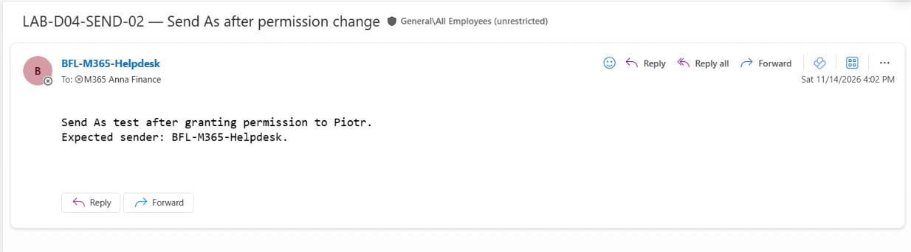

**Shows:** Anna receives SEND-02 with BFL-M365-Helpdesk as sender.

### 08 — Helpdesk reply received

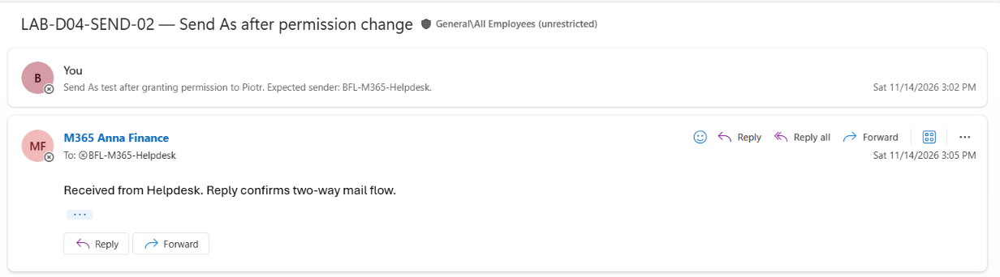

**Shows:** Anna's reply is addressed to Helpdesk and visible in the shared-mailbox conversation.

### 09 — Marek Helpdesk access denied

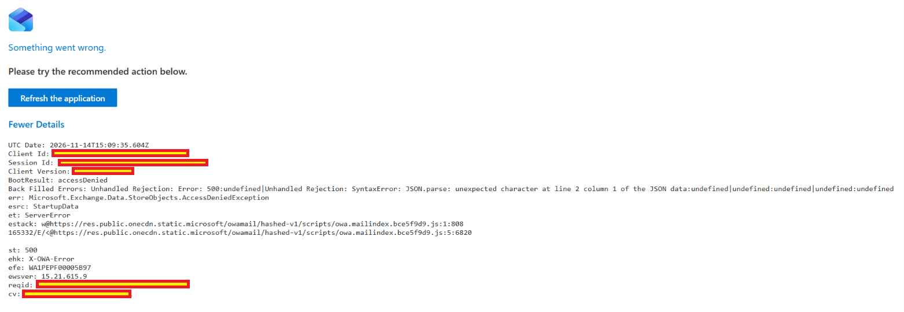

**Shows:** Opening fails with accessDenied / AccessDeniedException. Marek identity and working own Inbox are explicitly owner-confirmed; diagnostic identifiers including cv are masked.

### 10 — Helpdesk send on behalf granted

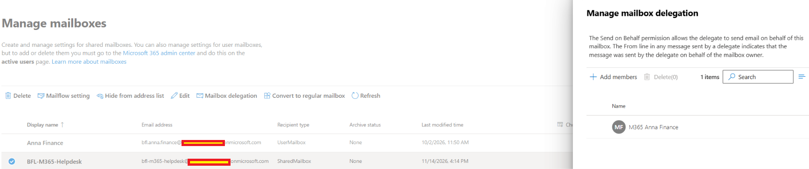

**Shows:** Send on behalf list contains Anna.

### 10a — Helpdesk Anna full access

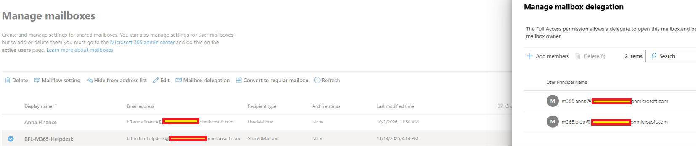

**Shows:** Full Access now lists Anna and Piotr.

### 11 — Helpdesk send on behalf received Marek

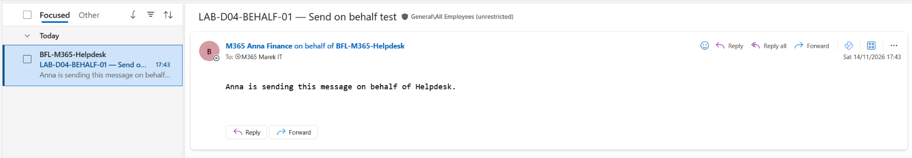

**Shows:** Marek receives BEHALF-01 with Anna explicitly shown on behalf of Helpdesk.

## Calendar permission comparison

### 12 — Anna calendar reader permission

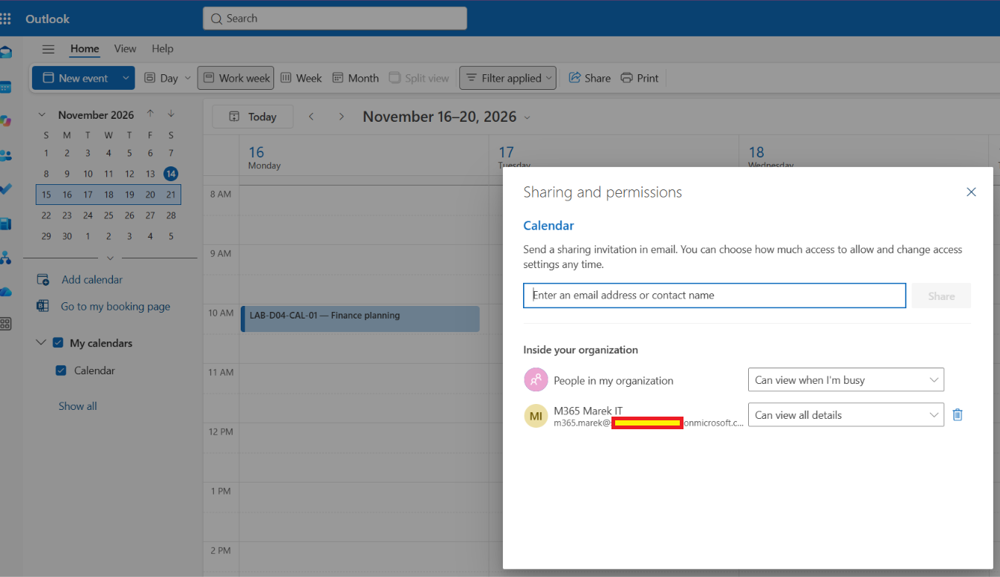

**Shows:** Anna's Calendar grants Marek Can view all details; organization entry remains free/busy.

### 13 — Marek calendar readonly event

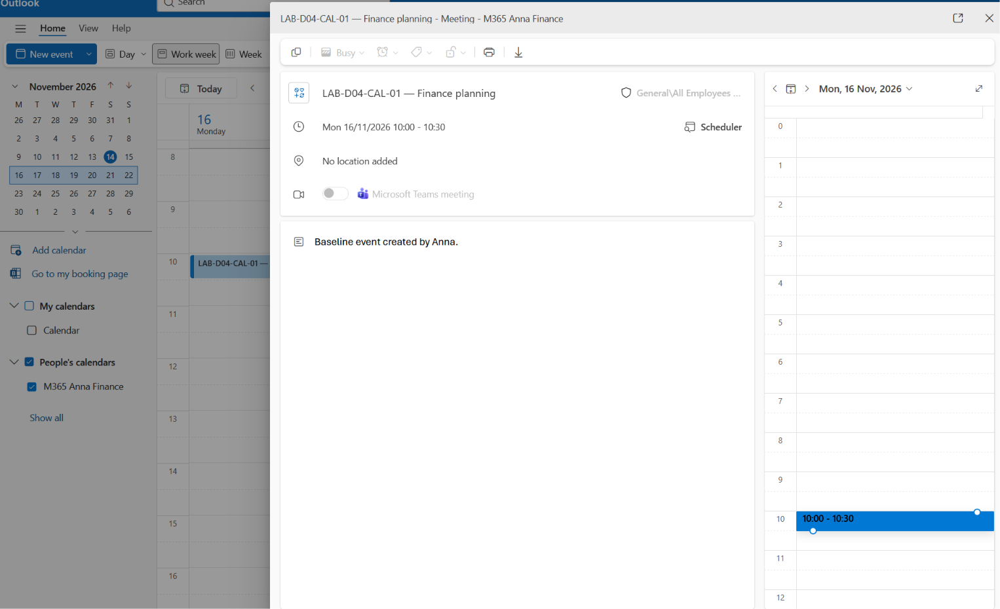

**Shows:** Anna's 16 November 10:00–10:30 event is visible in the shared calendar with editing unavailable; owner confirms read-only behavior and Warsaw settings.

### 14 — Anna calendar editor permission

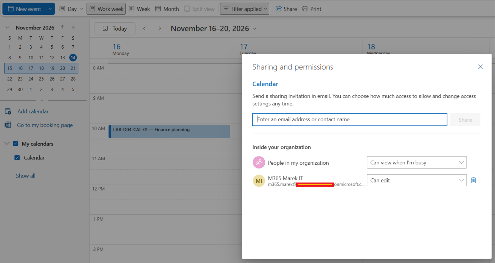

**Shows:** Marek's calendar permission temporarily changed to Can edit.

### 15 — Anna calendar change confirmed

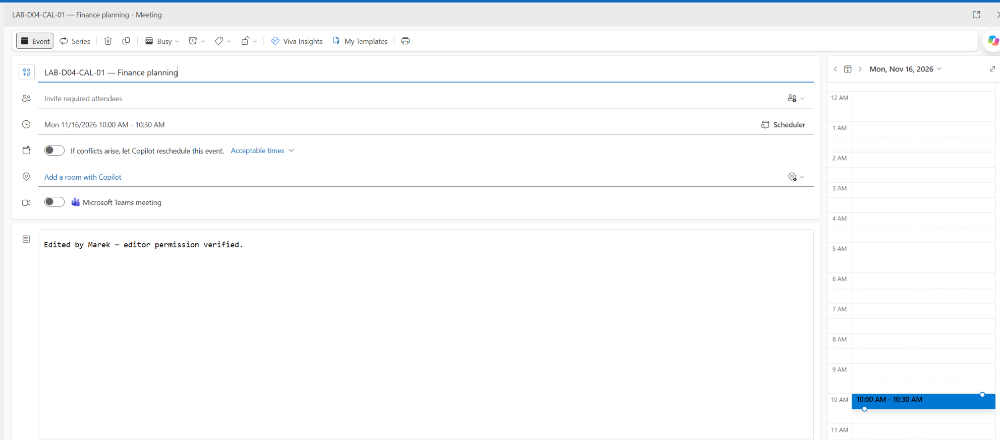

**Shows:** Edited event description shown. Owner confirms Marek saved and Anna saw it after reopening; the initial baseline text was replaced.

### 16 — Anna calendar reader restored

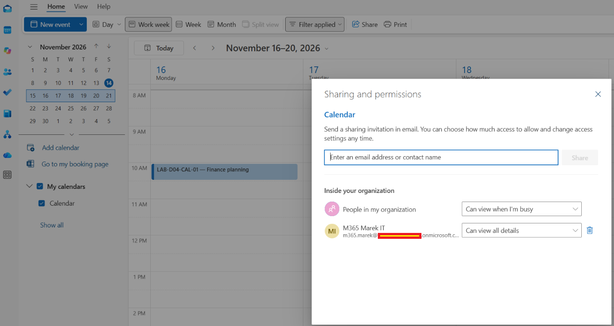

**Shows:** Marek restored to Can view all details. Inability to edit after fresh login is owner-confirmed.

## Room policy and reservations

### 17 — Room mailbox created

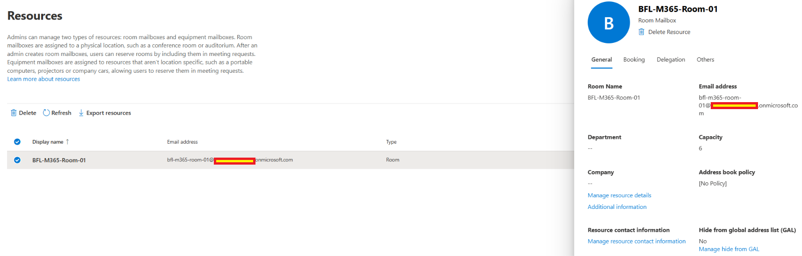

**Shows:** Room Mailbox BFL-M365-Room-01 created; capacity metadata 6.

### 18 — Room booking settings

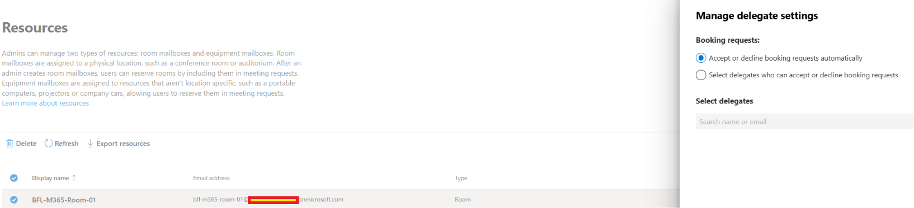

**Shows:** Automatic accept/decline radio selected in the actual delegate-settings panel.

### 18a — Room booking limits

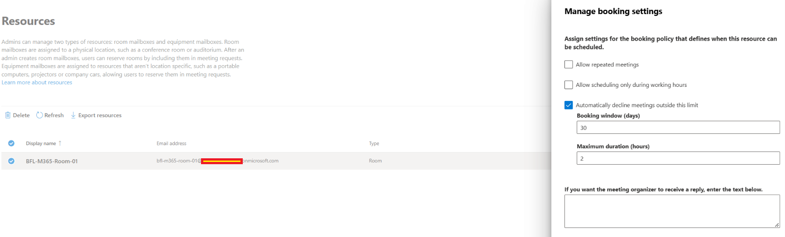

**Shows:** Saved limits: 30 days, two hours, decline outside limits; recurrence and working-hours-only unchecked.

### 19 — Room booking request Anna

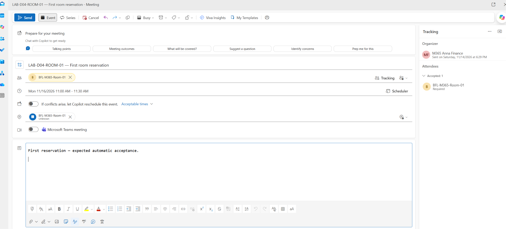

**Shows:** Corrected Anna ROOM-01 draft for 16 November, 11 AM–11:30 AM. Tracking can still refer to an older event version.

### 20 — Room booking accepted

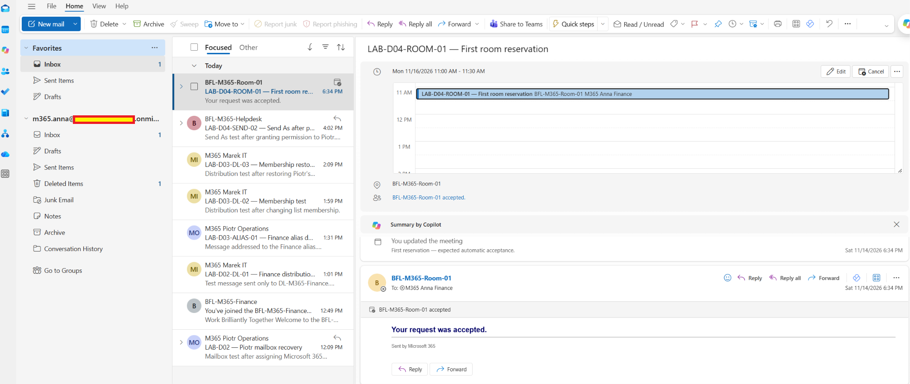

**Shows:** Fresh room acceptance for Anna ROOM-01 at 11 AM–11:30 AM.

### 21 — Room conflicting request Marek

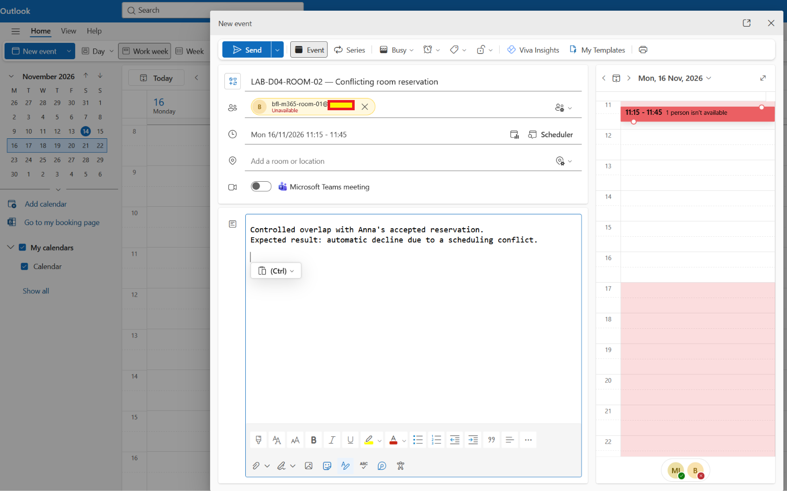

**Shows:** Marek ROOM-02 asks for 11:15–11:45; room is shown unavailable.

### 22 — Room booking conflict declined

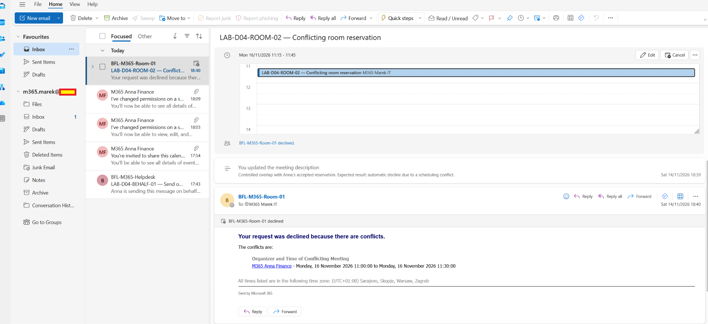

**Shows:** Room declines with an explicit conflict reason, naming Anna's 11:00–11:30 booking and the Warsaw UTC+01:00 timezone.

### 23 — Room booking rescheduled request

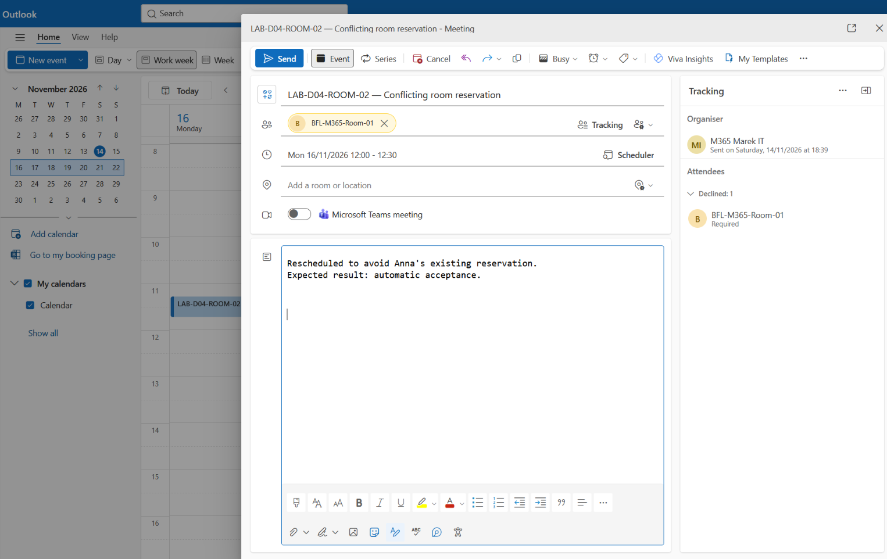

**Shows:** Marek is organizer of ROOM-02, edited to 12:00–12:30. Pre-send Tracking still displays the old decline.

### 24 — Room booking rescheduled accepted

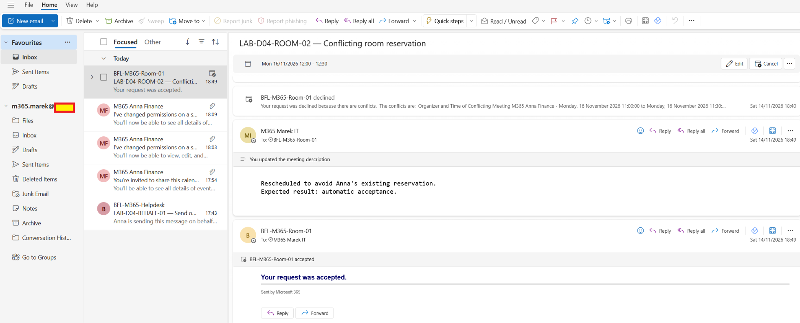

**Shows:** Conversation contains the old decline, the noon update and a new Accepted reply for ROOM-02 at 12:00–12:30.

## Owner-reported closure checks

The owner explicitly confirmed: the 09 attempt used m365.marek and his own Inbox worked; Marek saw Anna's calendar details but could not edit; his editor change persisted and was visible to Anna; editing was unavailable after restoring read permission and signing in again; the room account has Sign-in blocked; Anna's final ROOM-01 remains 11:00–11:30.

These reports supplement the images. They are not presented as screenshots, PowerShell output or independent audit logs. Exact propagation and processing intervals were not measured.

## Interpretation boundaries

The final uploaded 19/20 establish the corrected AM reservation. Earlier PM/AM and wrong-organizer drafts were corrected during guidance. Final 23 identifies Marek and ROOM-02; final 24 includes a fresh acceptance after the old decline. Do not read historical Tracking labels as responses to an unsent update.

The missing From field in 05 and absent account header in 09 limit independent session reconstruction. Calendar saving/restoration and room account blocking include attributed owner reports. Only the stated room valid/conflict/recovery sequence was tested; every booking limit and capacity enforcement were not.

## Publication review

The owner-supplied images retain synthetic names, test subjects and relevant results while masking lab domains where displayed. The owner replaced 02 with a masked version before documentation publication. Client/session/request identifiers and cv in 09 are masked. Raw diagnostics and private tenant configuration are not reproduced in text; uploaded image bytes are retained.

The tutor announced capture timing, view and filename during each phase. Optional diagnostics that were not performed are not invented: there is no required 03a/03b or 20a file. The final canonical filenames are the ones in this index.

[Implementation](../../docs/stages/04-delegation-calendars-and-rooms.md) · [Results](../../tests/day-04.md) · [Mailbox case](../../tickets/M365-004-helpdesk-sender-permission-recovery.md) · [Room case](../../tickets/M365-005-room-booking-conflict-recovery.md) · [All evidence](../README.md)
