# Day 05 evidence

Status: **14 screenshots published; Stage 05 COMPLETE.** Execution date: **16 November 2026**. All published images were opened and reviewed for this documentation update. Configuration, transport observations and attributed owner reports are separated below.

## Baseline and invalid recipient

### 01 — Service health before mailflow tests

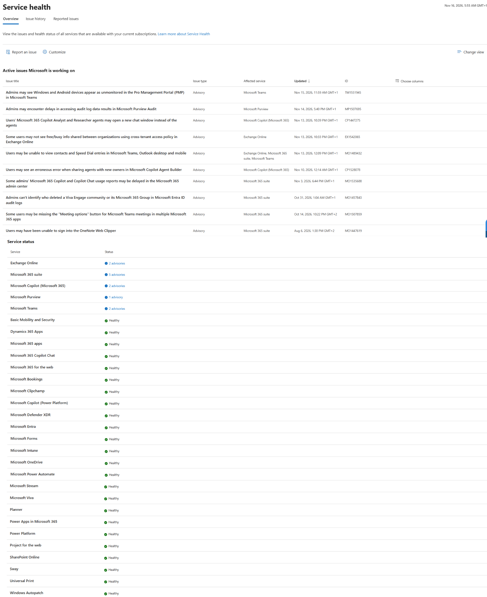

**Shows:** Overview at 05:55 GMT+1. Exchange Online has two advisories concerning cross-tenant free/busy and contacts/Speed Dial. Other services show their actual statuses; no all-services-healthy or reproduced outage claim.

### 02 — Baseline mail received Piotr

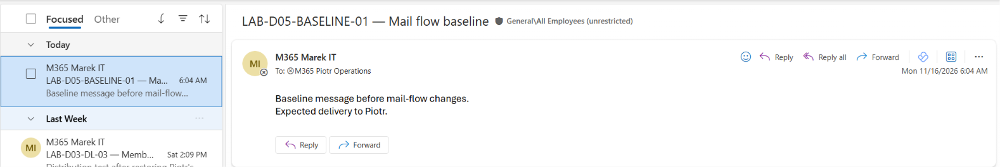

**Shows:** Opened BASELINE-01 from M365 Marek IT to M365 Piotr Operations, with expected body and 06:04 display time. Full account header/timezone are outside the crop.

### 03 — Baseline message trace result

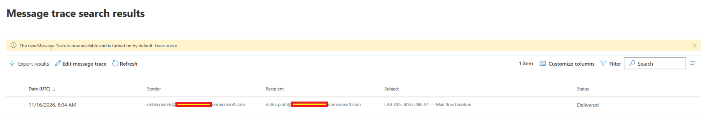

**Shows:** Matching Marek → Piotr baseline, Delivered at 05:04 UTC.

### 04 — Baseline message trace details

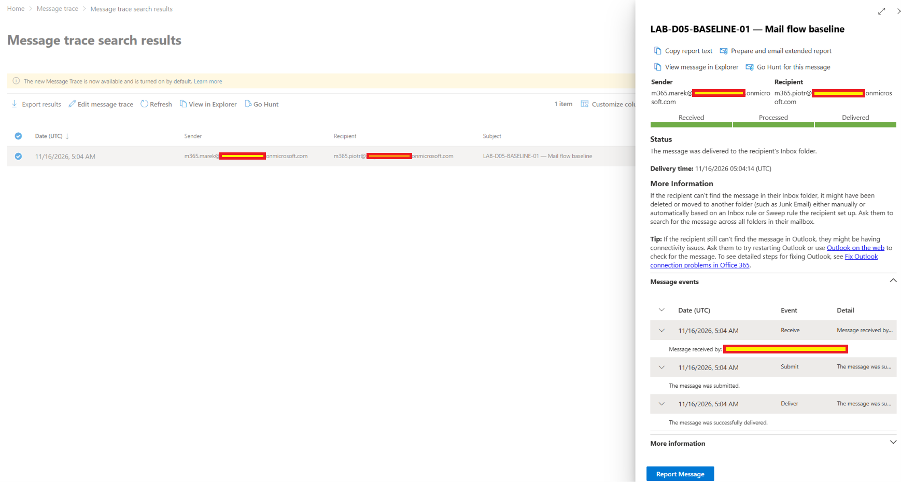

**Shows:** Delivery to recipient Inbox at 05:04:14 UTC; Receive → Submit → Deliver. Owner confirms the Trace session was adm-lab.

### 05 — Unknown recipient NDR

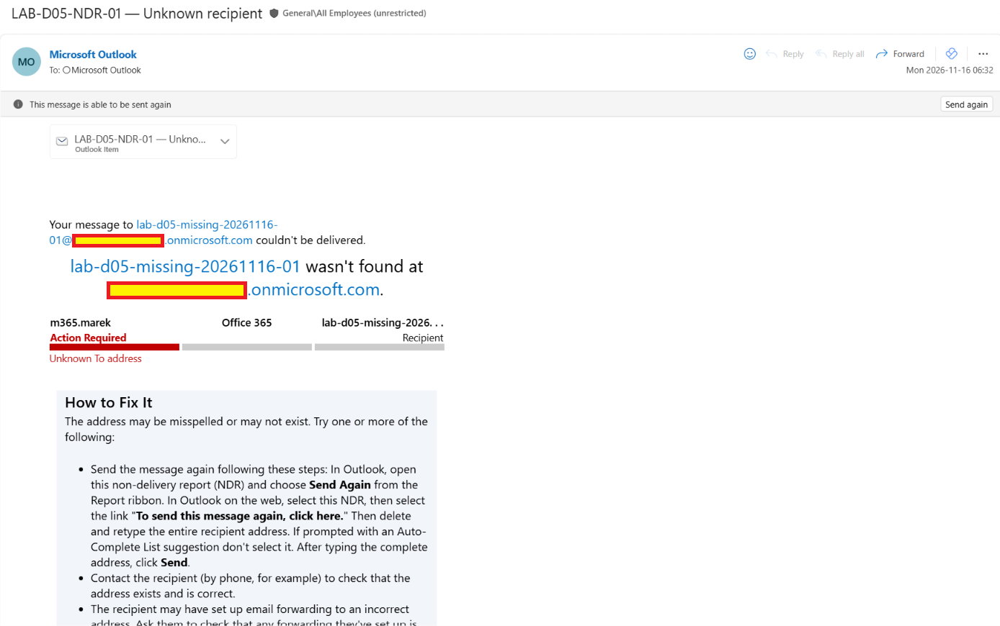

**Shows:** Actual NDR for LAB-D05-NDR-01; lab-d05-missing-20261116-01 was not found; Marek is the original sender.

### 06 — Unknown recipient NDR diagnostics

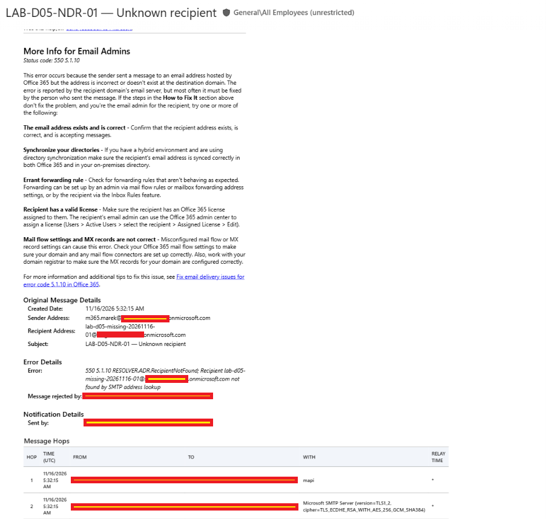

**Shows:** 550 5.1.10 RESOLVER.ADR.RecipientNotFound and SMTP address lookup failure; original message context and UTC hop table retained.

### 07 — Unknown recipient message trace result

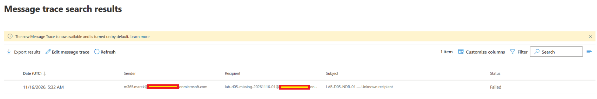

**Shows:** Original message to the missing recipient is Failed at 05:32 UTC.

### 08 — Unknown recipient message trace details

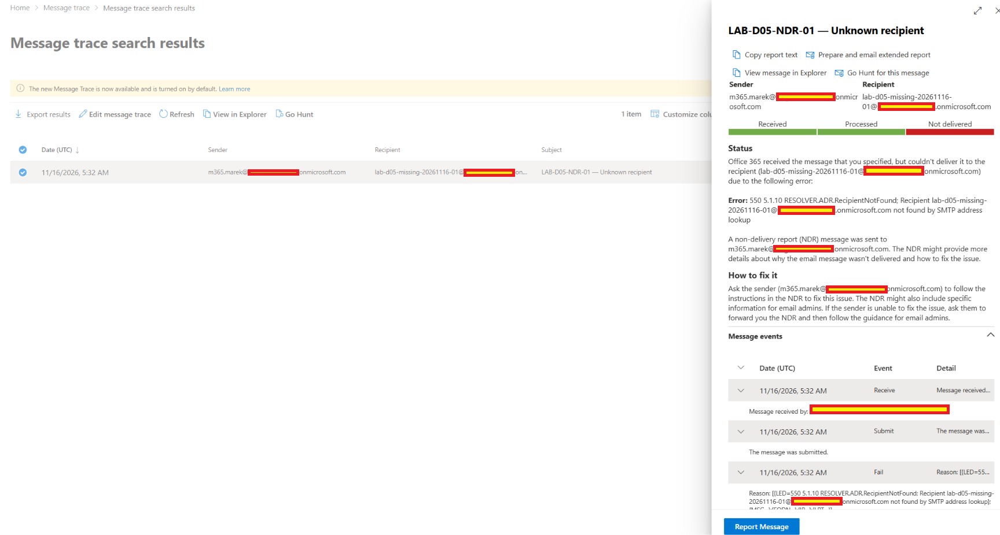

**Shows:** Receive → Submit → Fail; same 550 5.1.10 lookup error; Trace states an NDR was sent to Marek. Lowest detail text is partly cropped; the main error is visible.

## Rule configuration, control and recovery

### 09a — Transport rule access

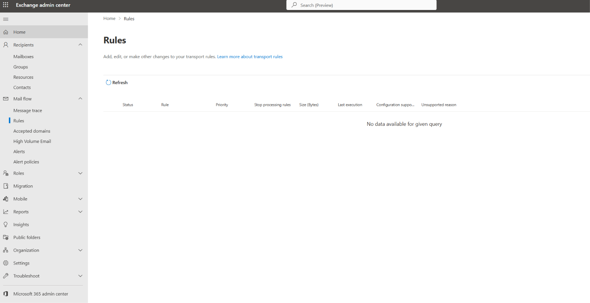

**Shows:** Initial Rules page has Refresh and no Add a rule control. The owner attributes this session to adm-lab; the image does not show the account header or independently prove the permission cause.

### 10 — Transport rule enabled

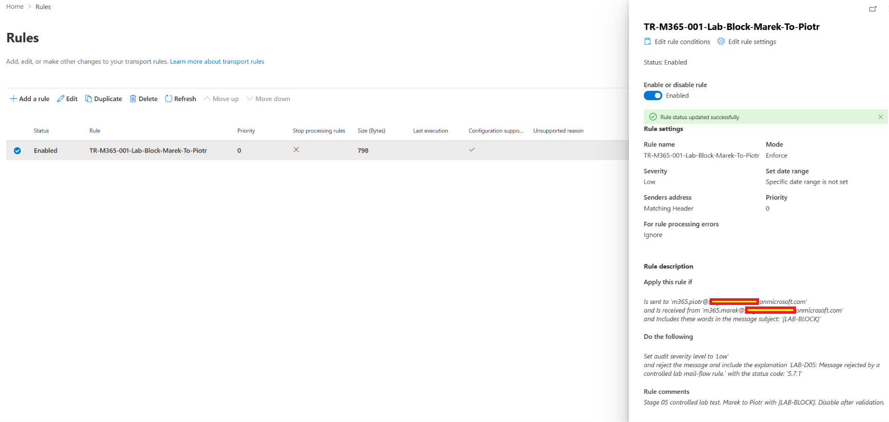

**Shows:** Saved TR-M365-001-Lab-Block-Marek-To-Piotr: Enabled / Enforce, sender Marek AND recipient Piotr AND subject [LAB-BLOCK], custom rejection explanation and configured code 5.7.1.

### 11 — Transport rule rejection NDR

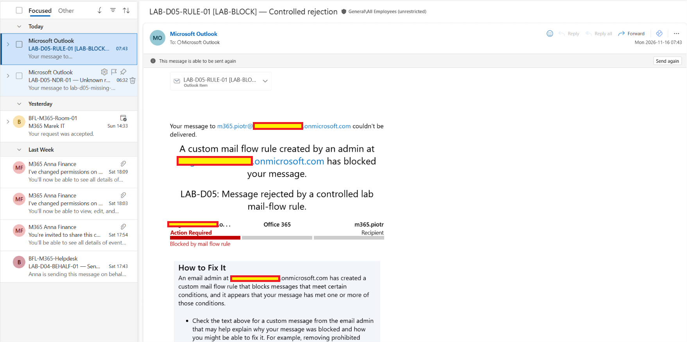

**Shows:** RULE-01 NDR identifies a custom mail-flow rule and displays the exact configured explanation. Detailed SMTP code is not shown. The reviewed public version also masks the domain in How to Fix It.

### 12 — Transport rule and control trace

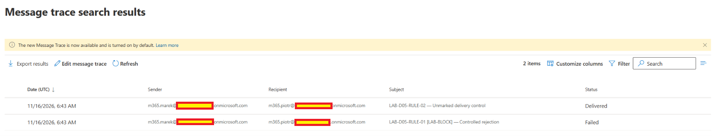

**Shows:** At 06:43 UTC, marked RULE-01 is Failed and unmarked RULE-02 is Delivered for the same sender/recipient pair. Piotr opening RULE-02 is separately owner-confirmed.

### 13 — Transport rule disabled

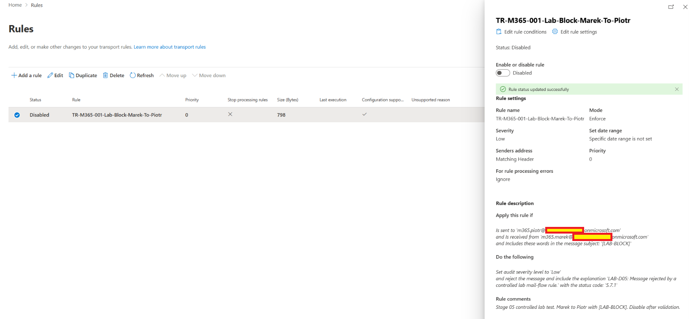

**Shows:** Successful status-update banner and Status: Disabled; Enforce mode and the three scoped conditions remain saved.

### 14 — Delivery after rule disabled trace

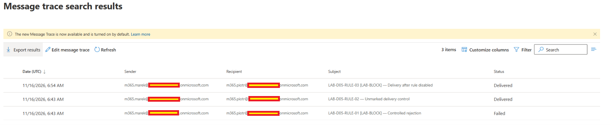

**Shows:** New marked RULE-03 is Delivered at 06:54 UTC, alongside the earlier Delivered control and Failed marked attempt. This establishes transport recovery, not an opening/read receipt.

## Interpretation boundaries

- **T11/T12/T13 PASS** is based on the combined functional evidence, rather than file names or configuration alone.
- Owner reports attribute the Trace and rule sessions, confirm Piotr opening RULE-02, and describe the administrative-role investigation.
- No separate Piotr opening confirmation for RULE-03, full pre-send alias inventory, different-sender control, different-recipient control or measured propagation interval is claimed.
- Configured rejection code 5.7.1 is distinguished from the actual 550 5.1.10 diagnostic captured for the missing recipient.
- The attempted RG-M365-Lab-Transport-Rules delegation remains unresolved. No successful custom-group grant or complete absence of a partial object is inferred.
- The owner waived extra role-diagnostic captures and deferred PowerShell. Gaps in the auxiliary numbering are intentional and do not create missing completion requirements.

## Publication review

The reviewed images preserve synthetic aliases, test subjects, UTC/status fields and relevant diagnostics while covering the lab-specific domain portion and unnecessary server/identifier details. Screen 11 includes the owner's corrected How to Fix It redaction. The owner's uploaded PNG bytes are retained; no evidence was generated or reconstructed.

No passwords, tokens, MFA enrollment QR codes, recovery codes or billing details were identified in this Day 05 set. This review covers these images and the public text; it is not a tenant-wide security audit.

[Implementation](../../docs/stages/05-mail-flow-troubleshooting.md) · [Results](../../tests/day-05.md) · [M365-006](../../tickets/M365-006-unknown-recipient-diagnosis.md) · [M365-007](../../tickets/M365-007-scoped-rule-recovery.md)
