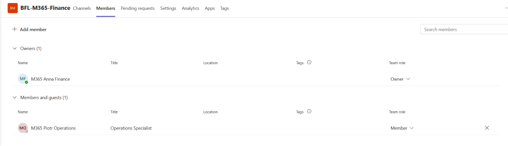
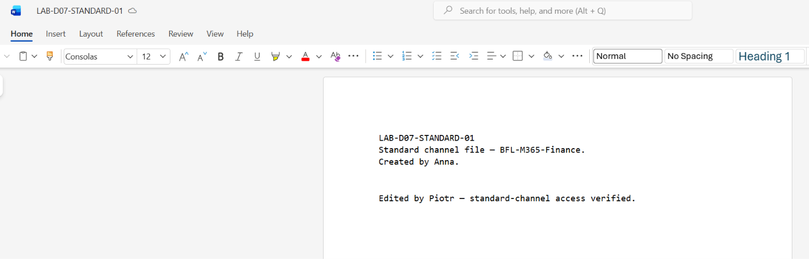
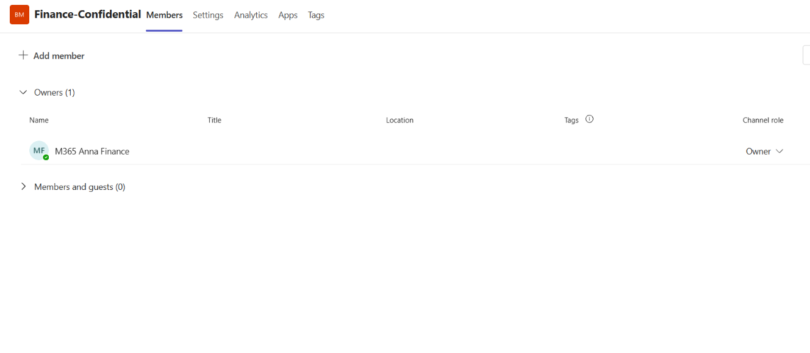
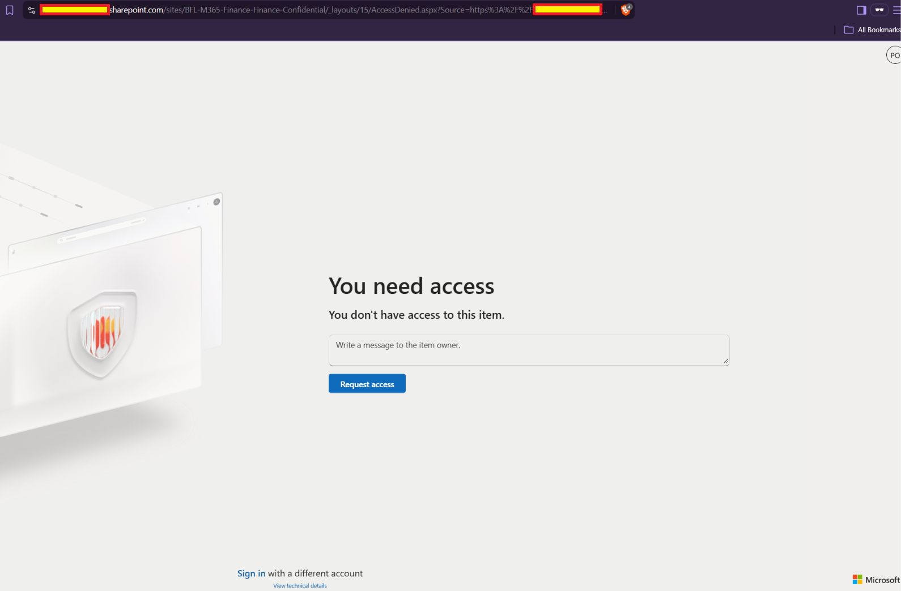
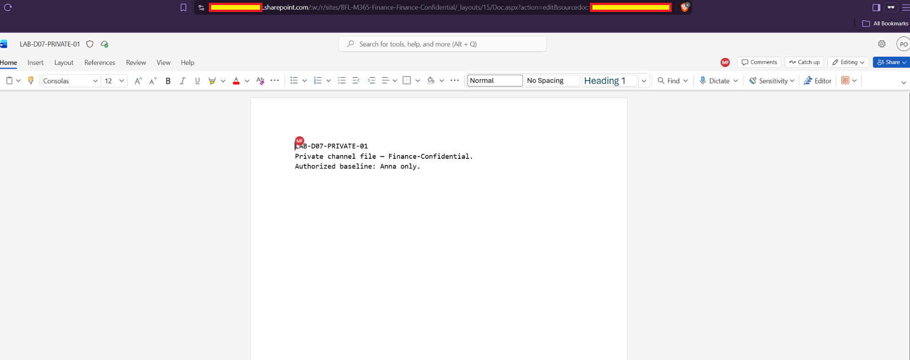
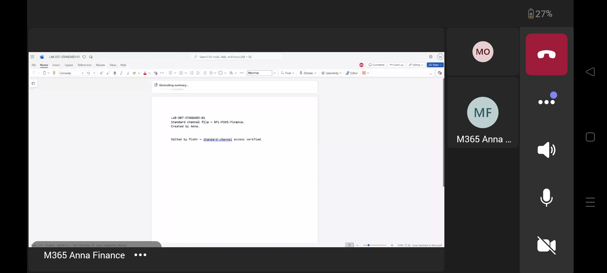

# Day 07 evidence — Teams and connected SharePoint sites

Execution date: **16 November 2026**. Six owner-supplied captures: **five PNGs and one JPG**. They support [Stage 07](../../docs/stages/07-teams-and-connected-sites.md), [T16/T17](../../tests/day-07.md) and the [private-channel case](../../tickets/M365-010-private-channel-membership-recovery.md).

## Capture index

### 01 — Finance team members

**Shows:** BFL-M365-Finance: Anna Owner, Piotr Member; one owner/one member and no Marek entry. From a group and Private privacy are separately owner-confirmed.

### 02 — Standard channel file Piotr

**Shows:** STANDARD-01 with the Anna baseline and appended Piotr line. Piotr identity, edit/save, direct SharePoint access and Anna's reopened view are owner-confirmed.

### 03 — Private channel members

**Shows:** Finance-Confidential initially has Anna as sole owner and zero other members/guests. This is the initial configuration, not a separate post-removal capture.

### 04 — Private file access denied Piotr

**Shows:** You need access / You don't have access to this item at the private-site path. Piotr identity, invisible channel and working standard-file control are owner-confirmed. The reviewed replacement masks both the tenant hostname and its repeat in Source.

### 05 — Private file access after membership

**Shows:** PRIVATE-01 open in Piotr's browser context after temporary channel membership. Its Anna-only text records the original baseline; it does not describe membership during this temporary grant. Final removal and fresh denial are owner-reported.

### 06 — Meeting screen share Piotr

**Shows:** Phone Teams meeting view receiving Anna's presentation of STANDARD-01; Anna label and participant initials visible. Two-device context, two-way audio, dynamic view change and meeting closure are owner-confirmed. Original JPG format retained.

## Interpretation boundaries

T16 was first passed in Day 01 and is extended here on the actual Finance Team without adding a matrix ID or another PASS increment. T17 combines authorized access, exclusion, a temporary grant and final restoration. The final Anna-only private membership and Piotr's fresh-session denial are attributed to the owner rather than represented as additional images.

The owner supplies the standard site root /sites/bfl-m365-finance; the private root /sites/BFL-M365-Finance-Finance-Confidential is also visible in 04/05. No full private hostname is reproduced. The actual link-setting panel and a group-ID comparison were not captured. A visible Word summary-generation interface in 06 is not a source-validated Copilot exercise.

## Publication review

Reviewed all six supplied captures, including the owner's corrected 04. Visible private hostname/source values and document identifiers are masked while synthetic resource paths, test content and relevant results remain readable. The meeting image contains the synthetic document and Teams interface; no meeting link is published. Image bytes are preserved, including 06's JPG encoding. The earlier uncorrected 04 from the conversation is not the publication source. Raw URLs, private handoff and local configuration are excluded.

[Results](../../tests/day-07.md) · [Membership case](../../tickets/M365-010-private-channel-membership-recovery.md) · [All evidence](../README.md)
