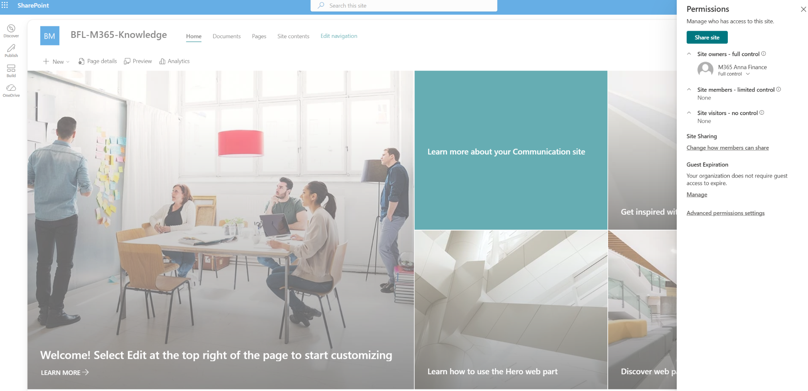
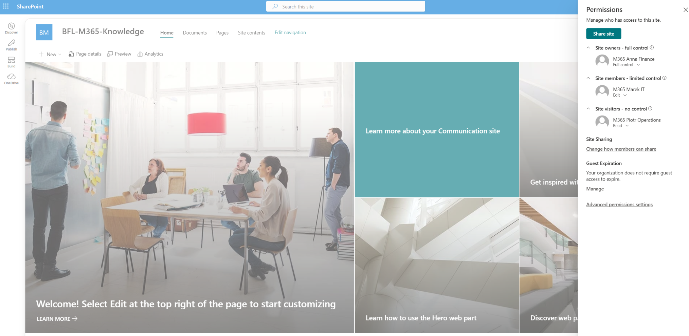
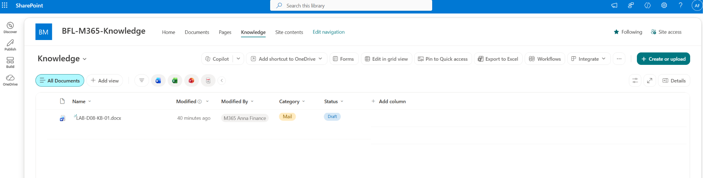
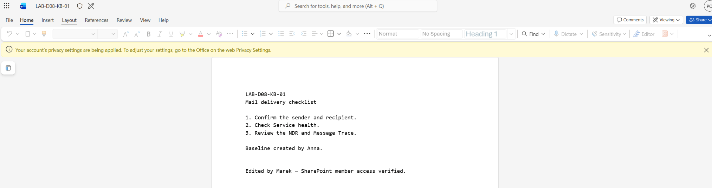
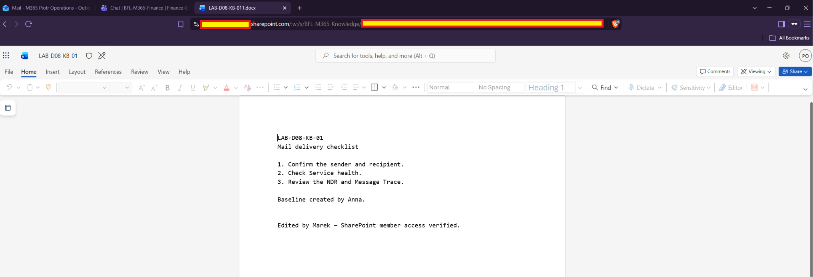
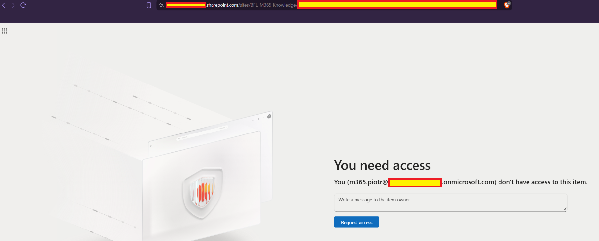
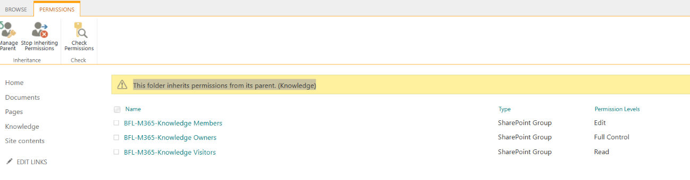

# Day 08 evidence — independent knowledge site

**7 reviewed owner-supplied PNG captures**, preserved without image editing or re-encoding. Execution: **16 November 2026**. [Stage](../../docs/stages/08-sharepoint-and-sharing.md) · [Results](../../tests/day-08.md).

## 01 — Knowledge site permissions

**Shows:** Communication-site template and expanded permissions: Anna Full Control; members/visitors None

**Scope and limits:** Anna creation and site path owner-confirmed; initial state, not final roles

## 02 — Knowledge site roles

**Shows:** Anna Full Control, Marek Edit and Piotr Read

**Scope and limits:** Configuration; functional checks supplied separately

## 03 — Knowledge library metadata

**Shows:** Knowledge lists original KB-01 with Category Mail and Status Draft

**Scope and limits:** Owner confirms save/refresh and same original item without replacement; does not establish lock-release time

## 04 — Knowledge reader Piotr

**Shows:** Original checklist plus Marek's saved line; Viewing and disabled controls

**Scope and limits:** Piotr identity, editing unavailable, Marek save and Anna reopen explicitly owner-confirmed

## 05 — Knowledge document opened through a sharing link

**Shows:** Checklist opens in Piotr's browser via redacted sharing-style URL; Viewing

**Scope and limits:** Despite its filename, the actual image shows opening, not link settings. Audience/recipient/Can view and revocation are text confirmations; tab text alone is not an original-item identity audit

## 06 — Restricted item access denied for Piotr

**Shows:** "You need access" and Piotr-specific "don't have access to this item"

**Scope and limits:** Owner filename ends -piot.png and is retained unchanged. Fresh-session target and positive controls are owner-confirmed

## 07 — Knowledge folder inheritance before

**Shows:** Folder inherits Knowledge; three SharePoint groups: Members Edit, Owners Full Control, Visitors Read

**Scope and limits:** Owner clipboard capture, collected before the restriction; numbering is an index, not an asserted chronological timestamp. Raw before/after Check Permissions output and final restoration are not captured

## Interpretation boundaries

T18–T20 combine captured configuration/content/denial with explicit owner confirmations. The owner confirms Specific people / Piotr / Can view, link removal, the exact old-link message **"This link has been removed."**, retained library access, expected permission-check changes, Marek's working TXT control and Piotr's working main KB-01. Restoring inheritance and Piotr reopening the same TXT are owner-reported. No additional image is required for every click.

The original DOCX's earlier shared-use lock was observed in a separate troubleshooting capture not included in this seven-image publication set because it exposes the full private account. The [stage narrative](../../docs/stages/08-sharepoint-and-sharing.md#original-docx-lock-and-observed-recovery) records the symptom and controls without that identifier. The owner explains recovery after closing Word and waiting; no exact interval or successful forced-unlock command is claimed. The original item was not replaced. Both diagnostic helpers were later removed per owner.

## Publication review

Synthetic display names, site path and test text remain visible. Where browser/account identifiers occur, the owner masks tenant hostnames, sharing-token paths/query portions and the private UPN component. 01–04 and 07 omit those private URL/account details. Image bytes are copied unchanged; the owner-uploaded 01–06 filenames are retained unchanged, and the additional clipboard capture has a descriptive 07 filename. No raw sharing URL, unredacted lock screenshot, local handoff, private workspace path, helper diagnostic export or generated supporting script is published.

[Evidence guide](../README.md) · [Access matrix](../../docs/access-matrix.md)
