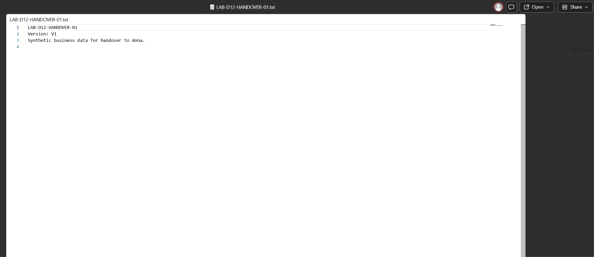
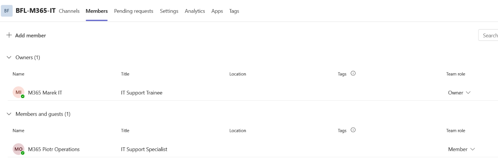
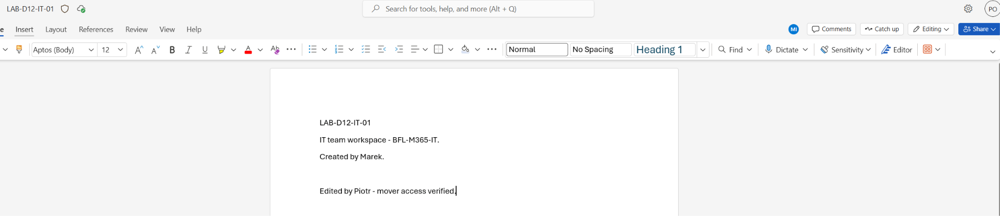
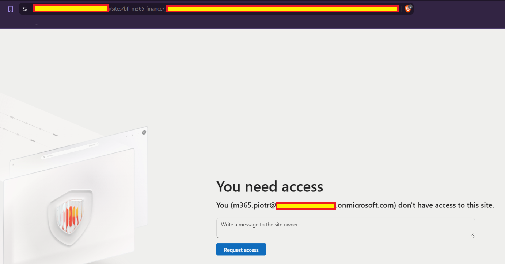
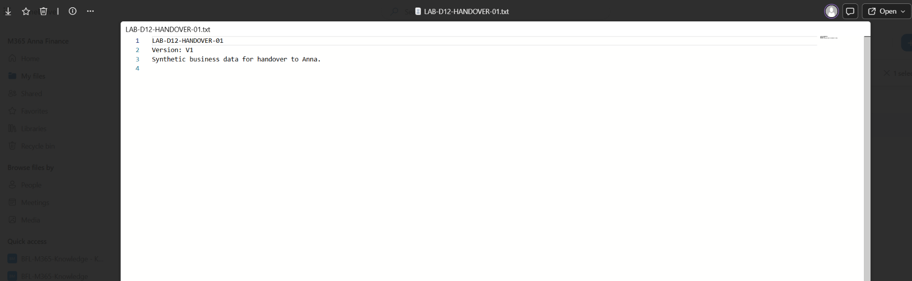
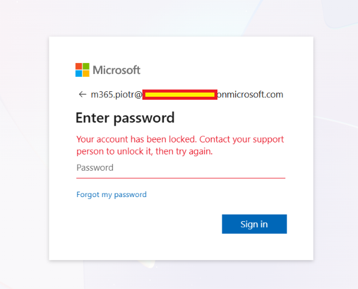
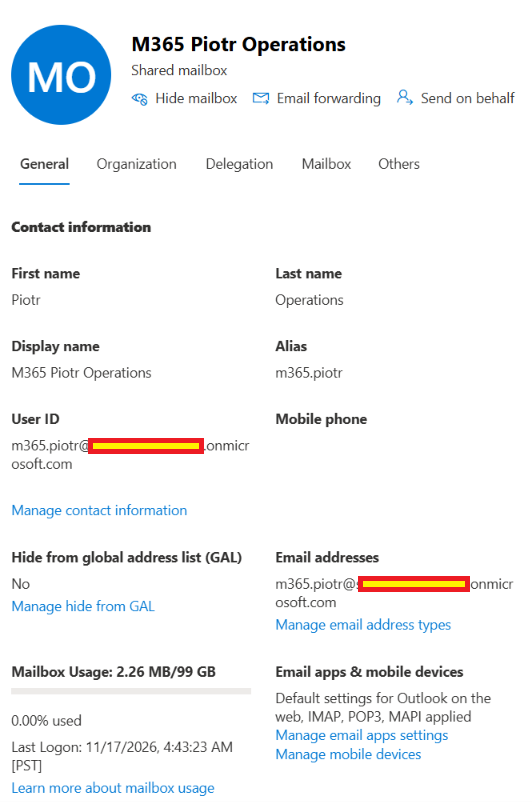
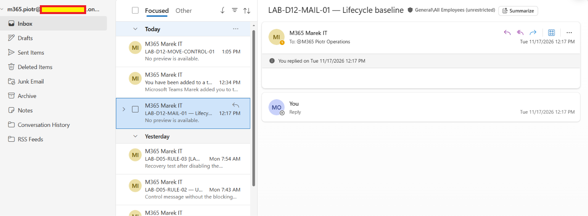
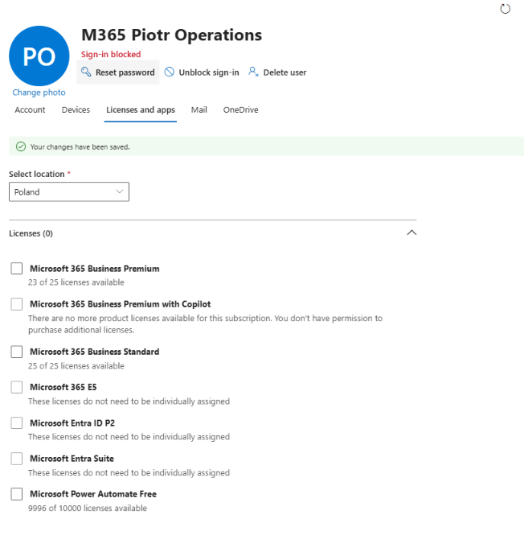

# Day 12 — Employee lifecycle evidence

Nine owner-supplied PNG captures, reviewed and preserved byte-for-byte. Executed 17 November 2026. These add to the prior 137 images for **146 total captures** (145 PNG and one JPG). Full private domain/UPN and session/request identifiers are excluded from public text; the raw OWA error frame is not included.

## 01 — Piotr lifecycle baseline

**Shows:** Piotr source TXT baseline

**Scope and limits:** Three full baseline lines; account/folder, readiness, mail and license are owner-confirmed.

## 02 — IT team members

**Shows:** IT mover membership

**Scope and limits:** Marek Owner and Piotr Member, with new title; Private and Department IT owner-confirmed.

## 03 — IT file access Piotr

**Shows:** IT document edit

**Scope and limits:** Saved-line content and editing UI; actual save and Marek reopen owner-confirmed.

## 04 — Finance access removed Piotr

**Shows:** Old Finance access denied

**Scope and limits:** Piotr and Finance site context with masked tenant; literal site-access denial; working controls owner-confirmed.

## 05 — OneDrive handover Anna

**Shows:** Anna selected-file copy

**Scope and limits:** Anna OneDrive context and full V1 contents; exact own destination, lineage and later reopens owner-confirmed.

## 06 — Piotr new signin blocked

**Shows:** Fresh login denied

**Scope and limits:** Literal account-locked message; saved administrative block, fresh-context attribution and 13:45 Poland time owner-confirmed; no AADSTS code.

## 07 — Piotr shared mailbox

**Shows:** Mailbox conversion

**Scope and limits:** Selected Piotr Shared mailbox; separately verified by read-only Exchange diagnostics before unassignment.

## 08 — Piotr retained mail Anna

**Shows:** Retained baseline mail

**Scope and limits:** Piotr Inbox and LAB-D12-MAIL-01 conversation; Anna actor/opening attribution owner-confirmed.

## 09 — Piotr license removed

**Shows:** Final blocked/unlicensed identity

**Scope and limits:** Saved changes, Licenses (0), unchecked Business Premium and Sign-in blocked; later custodian/regression checks owner-confirmed.

## Console, owner confirmations and limits

Read-only Exchange diagnostics distinguish an initial failed ACL read from a later successful pre-repair zero-correct-Anna result, then a post-fix one-correct-Anna grant. The first failure was a private helper's deferred-response enumeration issue, not proof of an empty ACL. Selected pre-unassignment size/archive/hold facts are published only as [curated observations](../../samples/lifecycle-mailbox-observations.csv), not raw tenant exports or new production report output.

Owner text supplies exact membership changes, full-login identity selection, ten-minute DL absence, old-session behavior, source/copy lineage and all later reopen/regression outcomes. Capture 08 shows the resource mailbox but not Anna's signed-in account. Capture 09 proves saved product/block UI state; it is not a post-removal API export or a complete feature audit.

The attempted Knowledge permission query returned a sharing-policy message, with no effective levels. This limit is retained rather than converted into a denial result. No additional screenshot for every click was required. Previous stage images and historical counters remain unchanged.

[Stage record](../../docs/stages/12-employee-lifecycle.md) · [Tests](../../tests/day-12.md) · [M365-015](../../tickets/M365-015-employee-offboarding.md) · [Runbook](../../runbooks/employee-lifecycle.md)
